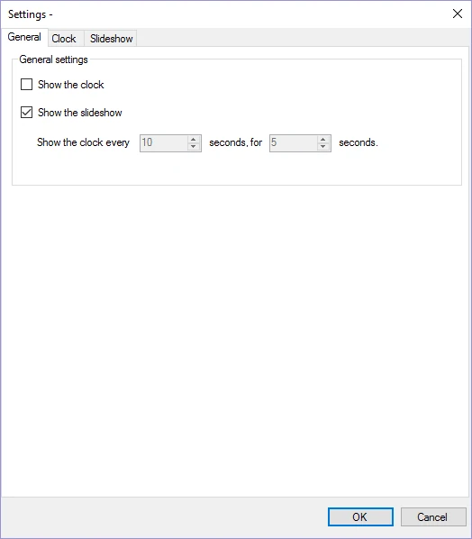
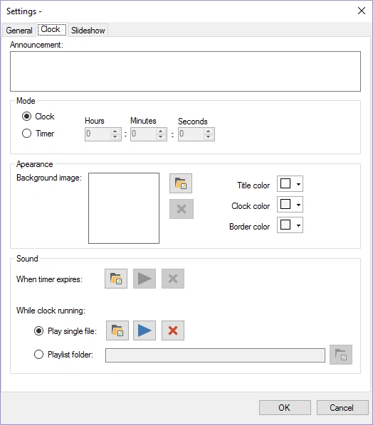
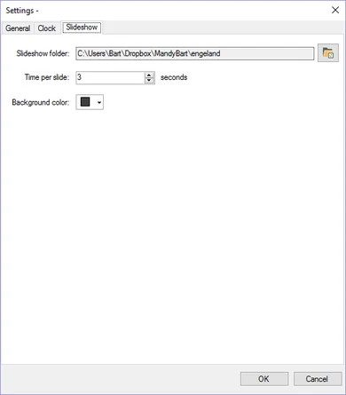
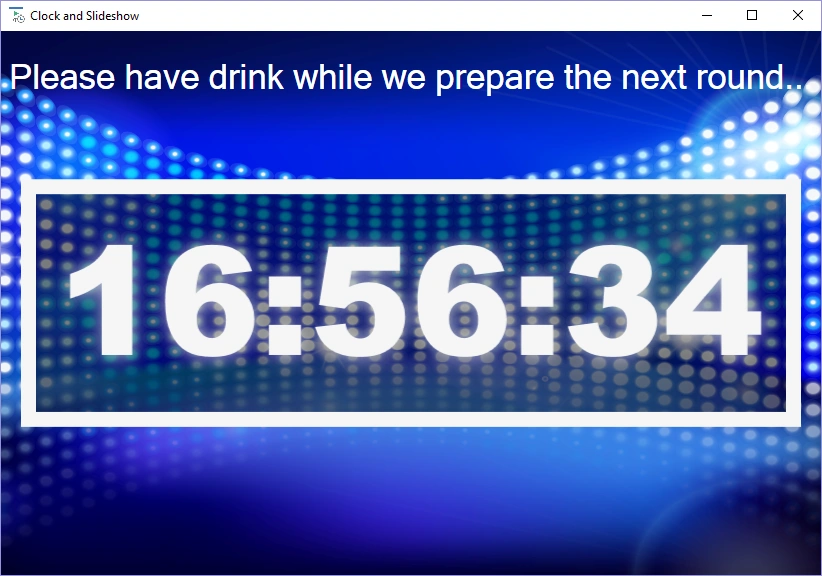

# Klok- en slideshowmodule

Deze module kan een digitale (aftellende) klok tonen, een slideshow met afbeeldingen en gave transitie-effecten, of een combinatie van beide.

Configuratieopties:

| { width="195" loading=lazy } | { width="199" loading=lazy } | { width="195" loading=lazy } |
|---------------------------------------------------------------------------------|------------------------------------------------------------------------------|---------------------------------------------------------------------------------|

Op de eerste pagina stelt u in of de klok, de slideshow of beide worden getoond (in dat laatste geval wordt de klok met een instelbaar interval gedurende een instelbare tijd getoond).

Voor de klok kunt u de volgende opties instellen:

- Aankondiging: tekst die boven de klok op het scherm wordt getoond

- Modus – Klok: de tijd wordt op het scherm getoond

- Modus – Timer: een timer telt af vanaf de opgegeven tijd tot 00:00:00

- Achtergrond afbeelding: afbeelding die op de achtergrond wordt getoond

- Geluid bij verlopen timer: wordt afgespeeld wanneer de timer afloopt

- Geluid tikkende klok: wordt afgespeeld terwijl de klok tikt, of

- Een afspeellijstmap: de map waaruit de module willekeurig MP3-bestanden afspeelt terwijl de klok tikt. (Let op: wanneer u de klok *in* de quiz gebruikt, moet deze map ook bestaan op de pc waarop u uw quiz afspeelt.)

Op de laatste pagina stelt u de slideshow in door een map te kiezen waaruit afbeeldingen worden gehaald, samen met de timinginstellingen.

Hieronder ziet u een afbeelding van de klok in actie (standaardinstellingen).

{ width="605" loading=lazy }
