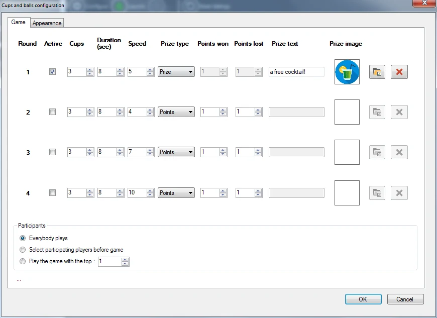
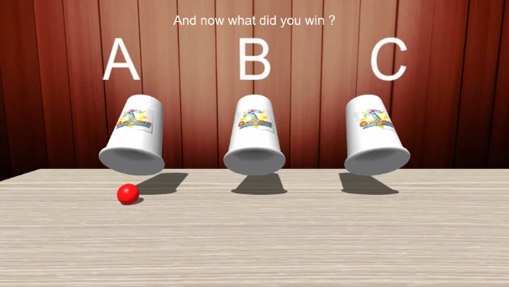
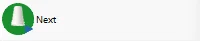

# Cups and Balls

Nel gioco dei bicchieri e della pallina il pubblico deve indovinare sotto quale bicchiere si trova una pallina dopo che i bicchieri sono stati mescolati. All'inizio la pallina viene mostrata. Poi i bicchieri vengono mescolati e ogni giocatore deve osservare con attenzione. Infine, ogni giocatore deve dire sotto quale bicchiere si trova la pallina. Con questo gioco si possono vincere punti o premi.

Opzioni di configurazione disponibili:

{ width="436" loading=lazy }

- Round: è possibile definire fino a quattro giochi che si susseguono (ad esempio con velocità o numero di bicchieri crescenti).

- Active: indica se un round è attivo (se non è attivo, viene saltato)

- Cups: il numero di bicchieri con cui si gioca

- Duration: la durata della mescolata dei bicchieri

- Speed: la velocità della mescolata

- Prize type: indica se si può vincere un premio o dei punti

- Points won: il numero di punti che un giocatore vince se risponde correttamente (se il ‘Prize type’ è ‘Points’)

- Points won: il numero di punti che un giocatore perde se risponde in modo errato (se il ‘Prize type’ è ‘Points’)

- Prize text: testo mostrato quando si vince un premio

- Prize image: immagine del premio vinto. Le immagini possono essere selezionate o eliminate con i due pulsanti accanto all'immagine.

- Participants: possono giocare tutti i giocatori, solo i giocatori meglio classificati oppure solo i giocatori selezionati (la selezione si effettua prima dell'inizio del gioco, sullo schermo del Director).

- Appearance tab: qui è possibile selezionare le immagini da mostrare sui bicchieri (ad esempio il logo di un'azienda), un'immagine di sfondo e la texture del tavolo su cui poggiano i bicchieri. È inoltre possibile selezionare una musica di sottofondo alternativa, riprodotta quando i bicchieri vengono mescolati

Di seguito è riportata un'immagine del gioco dei bicchieri e della pallina in azione.

{ width="402" loading=lazy }

Per passare attraverso le varie fasi del gioco (i bicchieri vengono caricati, la pallina viene mostrata, i bicchieri vengono mescolati, i giocatori scelgono un bicchiere, la pallina viene rivelata) è sufficiente premere il pulsante ‘Next’ nel pannello a sinistra.

{ width="200" loading=lazy }
