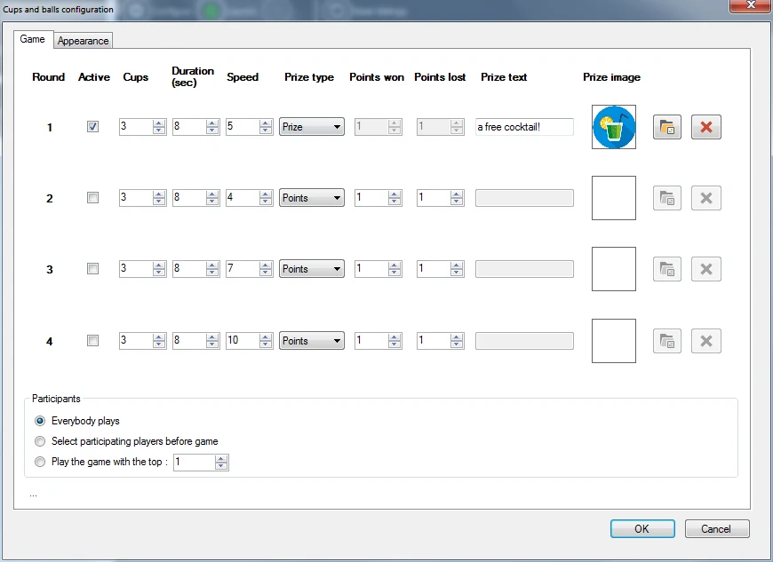
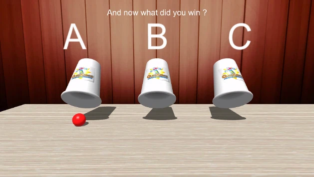
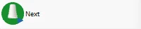

# Balletje balletje

Bij het spel balletje balletje moet het publiek raden onder welke beker een bal zich bevindt nadat de bekers zijn geschud. In het begin is de bal zichtbaar. Daarna worden de bekers geschud en moet iedere speler goed opletten. Tot slot moet iedere speler aangeven onder welke beker de bal ligt. Met dit spel kunnen punten of prijzen worden gewonnen.

Beschikbare configuratieopties:

{ width="436" loading=lazy }

- Ronde: u kunt maximaal vier spellen instellen die na elkaar worden gespeeld (bijvoorbeeld met toenemende snelheid of een groter aantal bekers).

- Actief: geeft aan of een ronde actief is (een ronde die niet actief is, wordt overgeslagen)

- Bekers: het aantal bekers waarmee wordt gespeeld

- Duur: de duur van het schudden van de bekers

- Snelheid: de snelheid van het schudden

- Prijs type: geef aan of er een prijs of punten kunnen worden gewonnen

- Punten gewonnen: het aantal punten dat een speler wint als hij of zij het juist heeft (als het ‘Prijs type’ ‘Punten’ is)

- Punten gewonnen: het aantal punten dat een speler verliest als hij of zij het onjuist heeft (als het ‘Prijs type’ ‘Punten’ is)

- Prijs tekst: tekst die wordt getoond wanneer een prijs is gewonnen

- Prijs afbeelding: afbeelding van de gewonnen prijs. Afbeeldingen kunt u selecteren of verwijderen met de twee knoppen naast de afbeelding.

- Deelnemers: alle spelers kunnen meespelen, alleen de best geplaatste spelers kunnen meespelen, of geselecteerde spelers kunnen meespelen (de selectie gebeurt voordat het spel begint, op het Director-scherm).

- Tabblad Weergave: hier kunt u afbeeldingen selecteren die op de bekers worden getoond (bijvoorbeeld een bedrijfslogo), een achtergrondafbeelding en de structuur van de tafel waarop de bekers staan. Ook kunt u alternatieve achtergrondmuziek kiezen die wordt afgespeeld zodra de bekers worden geschud.

Hieronder ziet u een afbeelding van het spel balletje balletje in actie.

{ width="402" loading=lazy }

Om de verschillende stappen van het spel te doorlopen (bekers worden geladen, bal wordt getoond, bekers worden geschud, spelers kiezen een beker, bal wordt onthuld) drukt u gewoon op de knop ‘Volgende’ in het linkerpaneel.

{ width="200" loading=lazy }
