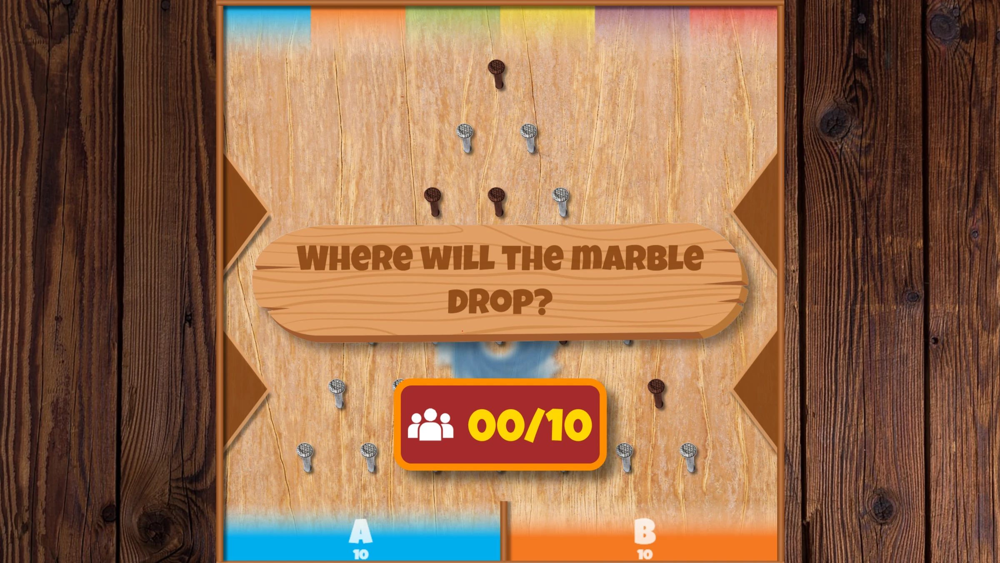
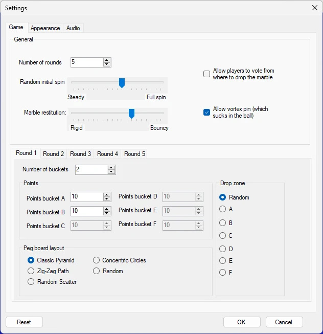

# Lucky Marbles

I giocatori possono guadagnare punti in questa entusiasmante variante del classico gioco delle biglie Plinko. Dopo aver scelto il contenitore in cui pensano che la biglia finirà — e, facoltativamente, dopo aver votato o gareggiato per selezionare il punto di rilascio — la biglia cade e rimbalza lungo il tabellone, guidata da una realistica simulazione fisica. Con più disposizioni del tabellone e un *vortice* rotante opzionale che può rimandare la biglia a una posizione di partenza casuale, ogni round è pieno di suspense e di sorprese.

{ loading=lazy }

{ loading=lazy }

Il gioco offre le seguenti opzioni di configurazione:

{ width="331" loading=lazy }

- Number of rounds: quanti round vengono giocati

- Allow players to vote on where to drop the marble: se attivata, il gioco inizia con il pubblico che sceglie dove far cadere la biglia. Il pubblico può continuare a cambiare la propria scelta finché il conduttore del quiz non decide di far cadere la biglia

- Random initial spin: quanto ruota la biglia quando cade

- Marble restitution: quanto rimbalza la biglia

- Allow vortex pin: mostra al centro un vortice che risucchia la biglia e la rimanda in alto

- Nelle schede dei round è possibile configurare le seguenti impostazioni per ciascun round:

  - Number of buckets: numero di contenitori bersaglio nella parte inferiore dello schermo

  - Points: punti da vincere per ciascun contenitore

  - Peg board layout: scegliere tra diverse disposizioni disponibili

  - Drop zone: indica da dove viene fatta cadere la biglia (attiva solo quando l'impostazione *Allow players to vote on where to drop the marble* non è attivata).

La scheda Text settings permette di modificare il testo mostrato sullo schermo e sul telefono cellulare. Nella scheda Audio è possibile selezionare la musica riprodotta durante il gioco.
