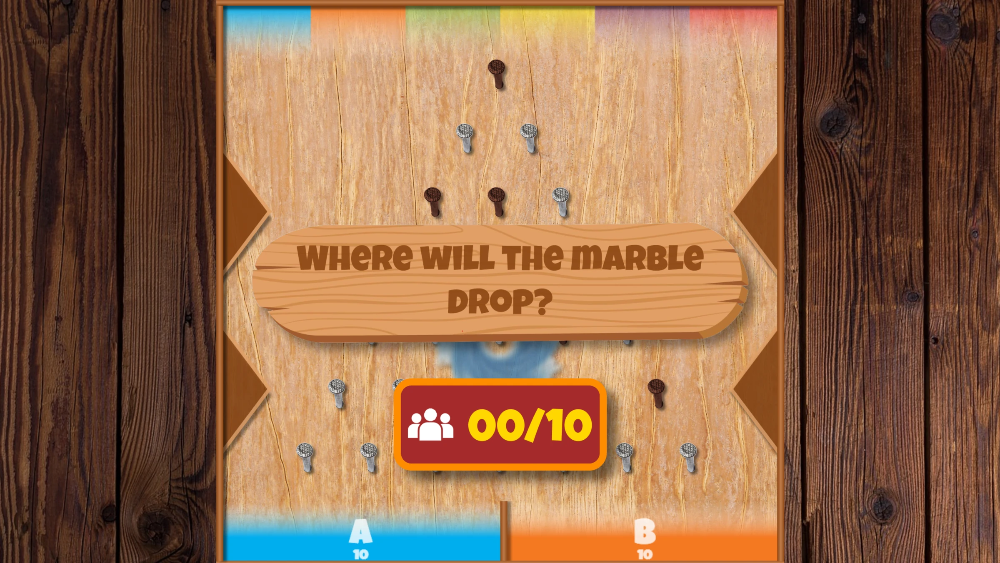
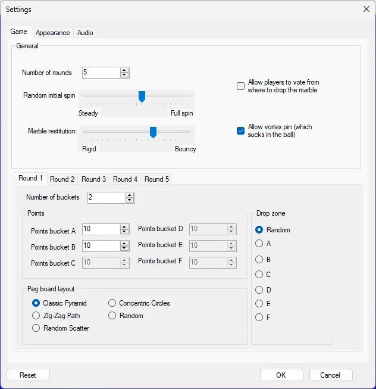

# Lucky Marbles

Spelers kunnen punten scoren in deze spannende variant op het klassieke Plinko-knikkerspel. Nadat ze hebben gekozen in welke bak volgens hen de knikker terechtkomt – en eventueel hebben gestemd of gestreden om het loslaatpunt te bepalen – valt de knikker en stuitert hij naar beneden over het bord, aangestuurd door een realistische natuurkundesimulatie. Met meerdere bordindelingen en een optionele draaiende *vortex* die de knikker terug kan sturen naar een willekeurige beginpositie is elke ronde vol spanning en verrassingen.

{ loading=lazy }

{ loading=lazy }

Het spel heeft de volgende configuratieopties:

{ width="331" loading=lazy }

- Aantal rondes: hoeveel rondes het spel wordt gespeeld

- Spelers laten stemmen waar de knikker wordt losgelaten: indien ingeschakeld begint het spel met het publiek dat kiest waar de knikker wordt losgelaten. Het publiek kan zijn keuze blijven wijzigen totdat de quizmaster besluit de knikker los te laten

- Willekeurige beginrotatie: hoeveel de knikker draait wanneer hij valt

- Veerkracht van de knikker: hoe springerig de knikker is

- Vortexpin toestaan: toont een vortex in het midden die de knikker opzuigt en terugstuurt naar de bovenkant

- Op de rondetabbladen kunt u per ronde de volgende instellingen configureren:

  - Aantal bakken: aantal doelbakken onderaan het scherm

  - Punten: te winnen punten voor elke bak

  - Indeling pennenbord: kies uit meerdere beschikbare indelingen

  - Loslaatzone: geeft aan van waaruit de knikker wordt losgelaten (alleen actief wanneer de instelling *Spelers laten stemmen waar de knikker wordt losgelaten* niet actief is).

Op het tabblad Tekstinstellingen kunt u de tekst wijzigen die op het scherm en op de mobiele telefoon wordt getoond. Op het tabblad Audio kunt u kiezen welke muziek tijdens het spel wordt afgespeeld.
