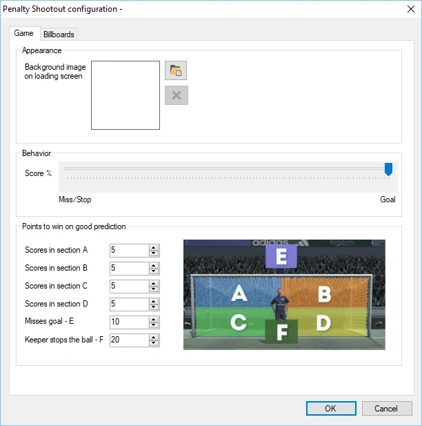
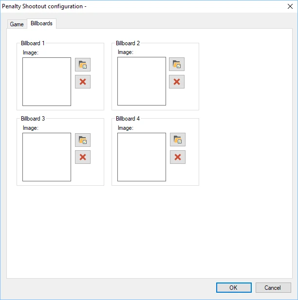
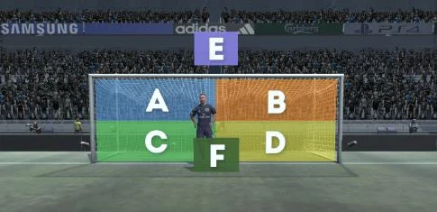
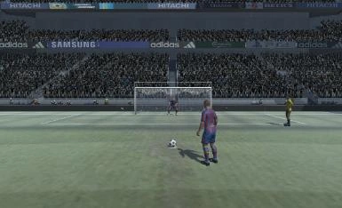

# Penalty Shootout

Le but du mini-jeu Penalty Shootout est de prédire si le footballeur va marquer (et dans quelle section du but), si le penalty sera raté ou si le gardien va arrêter le penalty.

Les options de configuration disponibles sont :

- Background image on loading screen : définit l'image affichée pendant le chargement du jeu

- Score% : définit la probabilité de marquer ou de rater.

- Points to win on good prediction : attribue des points aux différents résultats possibles du jeu :

  - Player scores in section A

  - Player scores in section B

  - Player scores in section C

  - Player scores in section D

  - Player misses (E)

  - Keeper stops the ball (F)

- Billboards tab : quatre panneaux publicitaires se trouvent le long de la piste. Vous pouvez choisir vos propres images à y afficher

{ width="300" loading=lazy } { width="302" loading=lazy }

Voici deux images du jeu Penalty Shootout en action.

{ width="306" loading=lazy } { width="243" loading=lazy }
