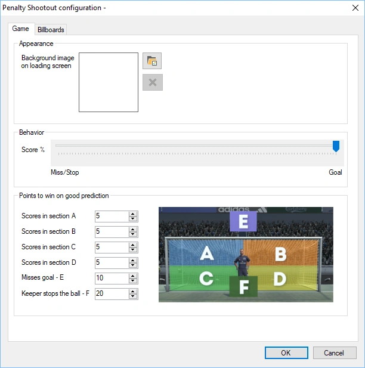
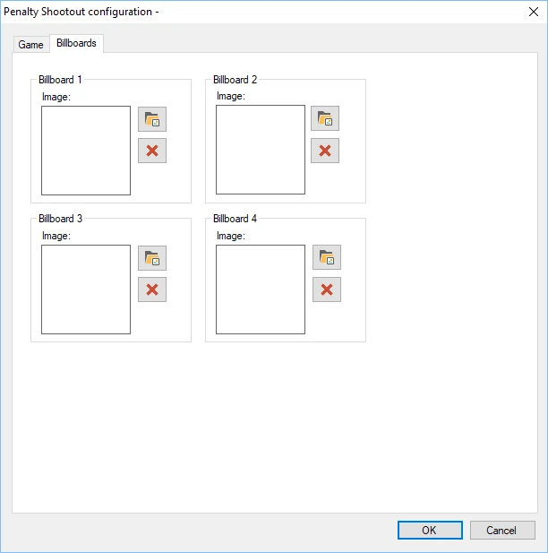
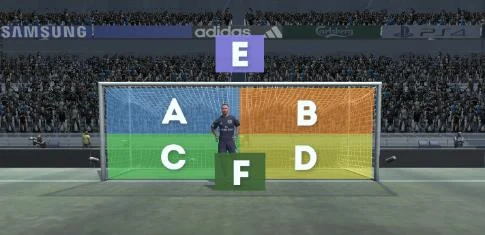
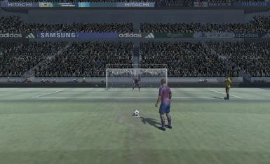

# Penalty Shootout

Het doel van de minigame Penalty Shootout is te voorspellen of de voetballer gaat scoren (en in welk deel van het doel), of de penalty wordt gemist, of dat de keeper de penalty tegenhoudt.

De beschikbare configuratieopties zijn:

- Achtergrond afbeelding tijdens laden: stelt de afbeelding in die wordt getoond terwijl het spel laadt

- Score%: stel de kans in op scoren of missen.

- Te winnen punten bij een juiste voorspelling: wijs punten toe aan de mogelijke uitkomsten van het spel:

  - Speler scoort in deel A

  - Speler scoort in deel B

  - Speler scoort in deel C

  - Speler scoort in deel D

  - Speler mist (E)

  - Keeper houdt de bal tegen (F)

- Tabblad Reclameborden: naast de renbaan staan vier reclameborden. U kunt uw eigen afbeeldingen kiezen die op deze reclameborden worden getoond

{ width="300" loading=lazy } { width="302" loading=lazy }

Hieronder ziet u twee afbeeldingen van het spel penalty shootout in actie.

{ width="306" loading=lazy } { width="243" loading=lazy }
