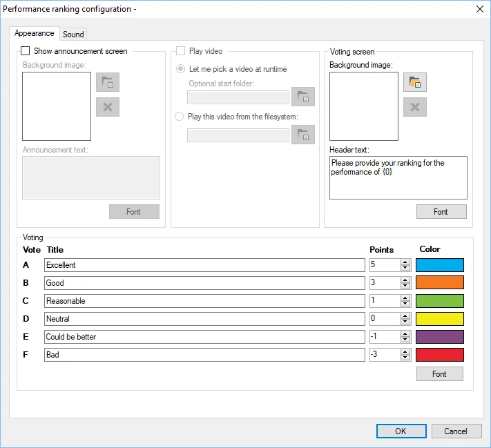
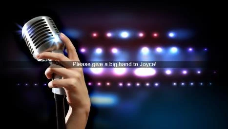
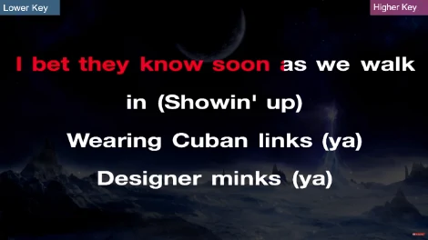
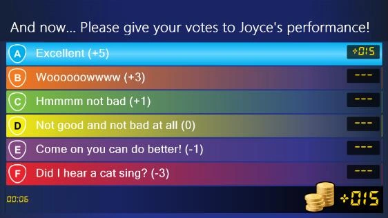
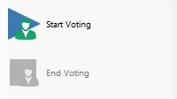

# Performance ranking

Con el módulo Performance ranking puede organizar concursos de talentos y de karaoke. El público o los jugadores pueden clasificar la actuación de otro de los jugadores.

Las opciones de configuración disponibles son:

> { width="401" loading=lazy }

- Show announcement screen: active esta opción para mostrar una pantalla de anuncio antes de la actuación.

- Background image (announcement screen section): seleccione un fondo para la pantalla de anuncio.

- Announcement text: el texto que se muestra en el anuncio. Para incluir el nombre del jugador que va a actuar, añada {0}, que se sustituirá por el nombre del jugador seleccionado.

- Play video section: active esta opción para mostrar un vídeo durante la actuación y, a continuación, seleccione un archivo de vídeo para reproducir. Se utiliza normalmente para mostrar un vídeo de karaoke.

<!-- -->

- Background image (voting screen section): elija la imagen de fondo que se muestra en la pantalla de votación

<!-- -->

- Header text: elija el texto que se muestra en la pantalla de votación. Para incluir el nombre del jugador que ha actuado, añada {0}, que se sustituirá por el nombre del jugador seleccionado.

<!-- -->

- Campos Title/Points/Color: introduzca las etiquetas que se muestran en la pantalla de votación para indicar la calidad de la actuación. Cada etiqueta tiene asociado un número de puntos, así como un color.

- Pestaña Sound: configure la música que suena antes de que comience la votación, durante la votación y después de que finalice.

A continuación se muestran imágenes de las distintas pantallas del módulo Performance ranking en acción.

{ width="293" loading=lazy } { width="294" loading=lazy }

{ width="358" loading=lazy }

Cuando se inicia el complemento Performance ranking, se abre una ventana en la que debe seleccionarse a uno de los jugadores como el jugador que será juzgado por los demás.

Cuando se pulsa el botón ‘Start Voting’ en el panel izquierdo de QuizXpress Director, comienza la actuación y los jugadores pueden empezar a dar su opinión. En la parte inferior izquierda de la pantalla de votación se muestra el tiempo transcurrido desde que comenzó la actuación, junto con el número de jugadores que han votado hasta ahora.

Cuando se pulsa el botón ‘End Voting’ en el panel izquierdo, los jugadores ya no pueden votar y la puntuación final se muestra en la pantalla.

Como alternativa, cuando el ajuste ‘Play video’ está activado, el botón indica inicialmente ‘Start Video’. Al pulsarlo se reproduce un vídeo, o se permite seleccionar uno, según los ajustes. Después, el botón cambia a ‘Start Voting’.

Una vez finalizado el proceso de votación, al pulsar el botón ‘Start Voting’ se repite todo el proceso. ¡Ahora otro jugador puede subir al escenario y dar lo mejor de sí!

{ width="180" loading=lazy }
