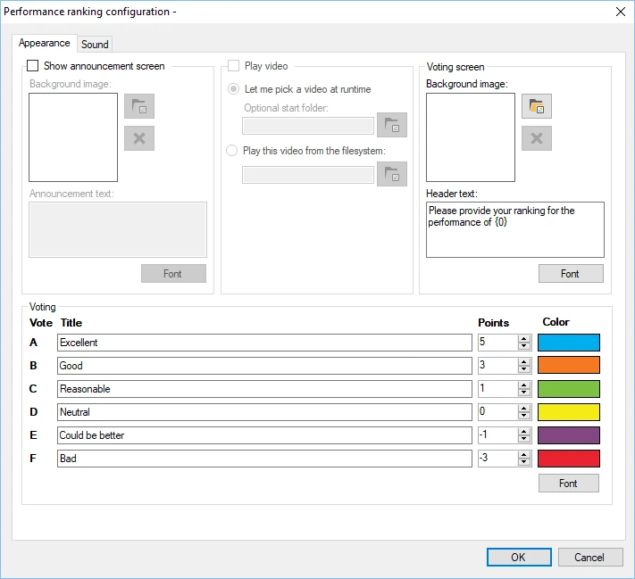
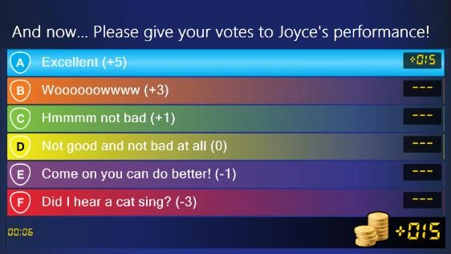
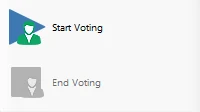

# Valutazione Performance

Con il modulo Performance ranking è possibile organizzare gare di talenti e di karaoke. Il pubblico/i giocatori possono valutare l'esibizione di uno degli altri giocatori.

Le opzioni di configurazione disponibili sono:

> { width="401" loading=lazy }

- Mostra Schermata Annuncio: attivare questa opzione per mostrare una schermata di annuncio prima dell'esibizione.

- Immagine Sfondo (announcement screen section): selezionare uno sfondo per la schermata di annuncio.

- Testo Annuncio: il testo da mostrare nell'annuncio. Per includere il nome del giocatore che sta per esibirsi, aggiungere {0}, che verrà sostituito con il nome del giocatore selezionato.

- Riproduci Video section: attivare questa opzione per mostrare un video durante l'esibizione, quindi selezionare un file video da riprodurre. In genere si usa per mostrare un video di karaoke.

<!-- -->

- Immagine Sfondo (Schermata Votazione section): scegliere l'immagine di sfondo mostrata nella schermata di voto

<!-- -->

- Header text: scegliere il testo mostrato nella schermata di voto. Per includere il nome del giocatore che si è esibito, aggiungere {0}, che verrà sostituito con il nome del giocatore selezionato.

<!-- -->

- Title/Points/Color fields: inserire le etichette mostrate nella schermata di voto per indicare la qualità dell'esibizione. A ciascuna etichetta sono associati un numero di punti e un colore.

- Sound tab: configurare la musica riprodotta prima dell'inizio del voto, durante il voto e dopo la fine del voto.

Di seguito sono riportate immagini delle diverse schermate del modulo Performance ranking in azione.

{ width="293" loading=lazy } { width="294" loading=lazy }

{ width="358" loading=lazy }

All'avvio del plugin Performance ranking si apre una finestra in cui deve essere selezionato uno dei giocatori come giocatore che sarà giudicato dagli altri.

Quando si preme il pulsante ‘Avvia Voto’ nel pannello a sinistra di QuizXpress Director, l'esibizione ha inizio e i giocatori possono cominciare a esprimere la propria opinione. In basso a sinistra nella schermata di voto vengono mostrati il tempo trascorso dall'inizio dell'esibizione e il numero di giocatori che hanno votato finora.

Quando si preme il pulsante ‘Chiudi Voto’ nel pannello a sinistra, i giocatori non possono più votare e il punteggio finale viene mostrato sullo schermo.

In alternativa, quando l'impostazione ‘Riproduci Video’ è attivata, il pulsante inizialmente riporta ‘Avvia Video’. Premendolo si riproduce un video o si può selezionarne uno, a seconda delle impostazioni. Dopodiché il pulsante diventa ‘Avvia Voto’.

Al termine del processo di voto, premendo il pulsante ‘Avvia Voto’ l'intero processo si ripete. Un altro giocatore può ora salire sul palco e dare il meglio di sé!

{ width="180" loading=lazy }
