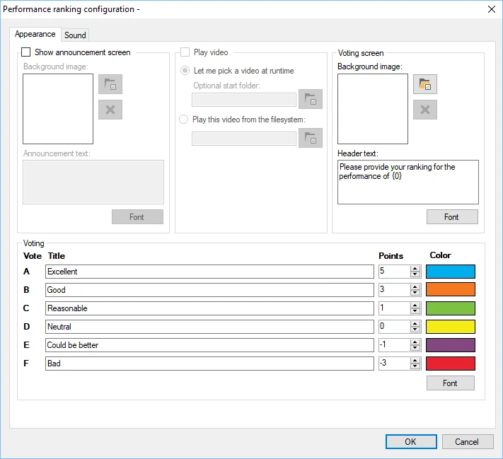
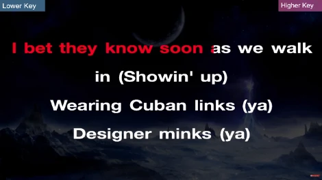
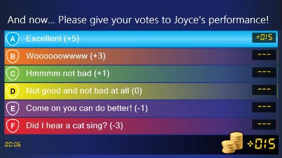
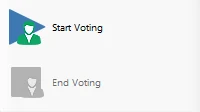

# Performance ranking

Met de module Performance ranking kunt u talentenjachten en karaokewedstrijden houden. Het publiek/de spelers kunnen de prestatie van een van de andere spelers beoordelen.

De beschikbare configuratieopties zijn:

> { width="401" loading=lazy }

- Aankondigingsscherm tonen: schakel deze optie in om vóór de prestatie een aankondigingsscherm te tonen.

- Achtergrond afbeelding (gedeelte aankondigingsscherm): kies een achtergrond voor het aankondigingsscherm.

- Aankondigingstekst: de tekst die in de aankondiging wordt getoond. Om de naam van de speler die gaat optreden op te nemen, voegt u {0} toe; dit wordt vervangen door de naam van de geselecteerde speler.

- Gedeelte Video afspelen: schakel deze optie in om tijdens de prestatie een video te tonen en selecteer vervolgens een videobestand om af te spelen. Meestal gebruikt om een karaokevideo te tonen.

<!-- -->

- Achtergrond afbeelding (gedeelte stemscherm): kies de achtergrondafbeelding die op het stemscherm wordt getoond

<!-- -->

- Koptekst: kies de tekst die op het stemscherm wordt getoond. Om de naam van de speler die heeft opgetreden op te nemen, voegt u {0} toe; dit wordt vervangen door de naam van de geselecteerde speler.

<!-- -->

- Velden Titel/Punten/Kleur: voer de labels in die op het stemscherm worden getoond om de kwaliteit van de prestatie aan te geven. Aan elk label zijn een aantal punten en een kleur gekoppeld.

- Tabblad Geluid: configureer de muziek die wordt afgespeeld voordat het stemmen begint, tijdens het stemmen en nadat het stemmen is afgelopen.

Hieronder ziet u afbeeldingen van de verschillende schermen van de module Performance ranking in actie.

{ width="293" loading=lazy } { width="294" loading=lazy }

{ width="358" loading=lazy }

Wanneer de plug-in Performance ranking start, wordt een venster geopend waarin een van de spelers moet worden geselecteerd als de speler die door de anderen wordt beoordeeld.

Wanneer u in het linkerpaneel van QuizXpress Director op de knop ‘Begin met stemmen’ drukt, begint de prestatie en kunnen spelers hun mening geven. Linksonder op het stemscherm wordt de tijd getoond die is verstreken sinds het begin van de prestatie, samen met het aantal spelers dat tot nu toe heeft gestemd.

Wanneer u in het linkerpaneel op de knop ‘Beëindig Stemming’ drukt, kunnen spelers niet meer stemmen en wordt de eindscore op het scherm getoond.

Wanneer de instelling ‘Video afspelen’ is ingeschakeld, staat op de knop in eerste instantie ‘Start video’. Als u erop drukt, wordt een video afgespeeld of kunt u er een selecteren, afhankelijk van de instellingen. Daarna verandert de knop in ‘Begin met stemmen’.

Nadat het stemproces is afgelopen, herhaalt u het hele proces door op de knop ‘Begin met stemmen’ te drukken. Nu kan een andere speler het podium op en zijn of haar beste prestatie neerzetten!

{ width="180" loading=lazy }
