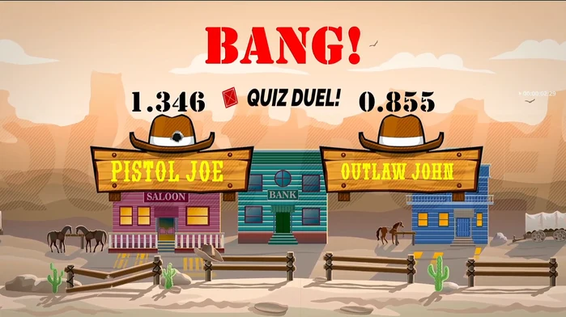
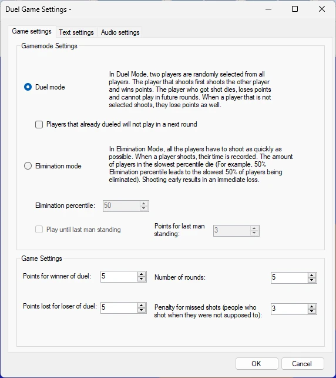

# Quiz Duel

Quiz Duel è un Modulo Gioco di ‘riflessi’ divertente, facile da usare e di ispirazione western. Con grafica divertente ed effetti sonori in stile western, questo gioco darà senz'altro un tocco in più al vostro evento!

{ loading=lazy }

Il gioco offre le seguenti opzioni di configurazione:

{ width="316" loading=lazy }

- Esistono due modalità di gioco:

  - **Random Duel mode**: nella modalità Duel, due giocatori vengono scelti a caso tra tutti i giocatori e mostrati sullo schermo su due cartelli. Il giocatore che spara per primo colpisce l'altro giocatore e vince punti. Il giocatore colpito muore, perde punti e non può partecipare ai round successivi. Se i giocatori del pubblico non selezionati sparano comunque, perdono anch'essi punti.

    - L'impostazione *Players that already dueled will not play in a next round* indica se i giocatori già comparsi sui cartelli vengono esclusi dal round successivo. In questo modo tutti hanno il proprio turno. Quando il numero di giocatori è dispari, l'ultimo giocatore gioca contro un ‘bot cowboy’.

  - **Elimination Duel mode**: nella modalità Elimination, tutti i giocatori devono sparare il più velocemente possibile quando sullo schermo compare il messaggio **Shoot!**. Per ogni giocatore che spara viene registrato il tempo e viene eliminato il percentile dei giocatori più lenti (ad esempio, un percentile di eliminazione del 50% elimina il 50% dei giocatori più lenti). Sparare in anticipo comporta la sconfitta immediata.

    - L'impostazione *Play until last man standing* porta avanti il gioco finché non rimane un solo giocatore.

    - L'impostazione *Extra points for last man standing* indica quanti punti vince l'ultimo giocatore rimasto in gioco.

- Altre impostazioni del gioco:

  - Points for winner of duel: punti vinti quando si vince un duello

  - Penalty for loser of duel: punti persi quando si perde un duello

  - Number of rounds: quanti round del gioco si desidera giocare

  - Penalty for missed shots: punti di penalità per i giocatori che sparano senza essere stati selezionati sui cartelli nella modalità Random Duel, o per aver sparato in anticipo in una delle due modalità di duello.

Le schede Text settings e Audio settings permettono di personalizzare il testo e l'audio utilizzati nel Modulo Gioco.
