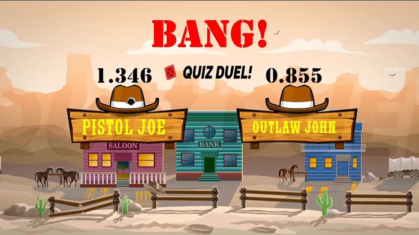
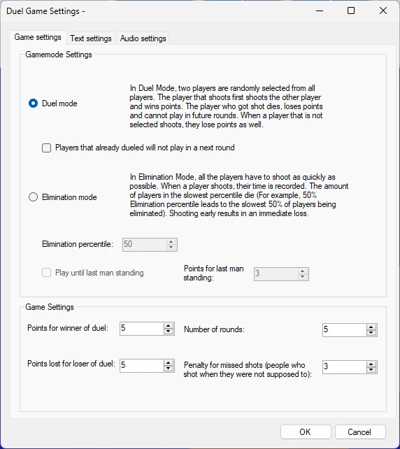

# Quiz Duel

Quiz Duel is een leuke, eenvoudig te gebruiken ‘reflex’-minigame in westernstijl. Met leuke graphics en geluidseffecten in westernstijl tilt dit spel uw evenement zeker naar een hoger niveau!

{ loading=lazy }

Het spel heeft de volgende configuratieopties:

{ width="316" loading=lazy }

- Er zijn twee spelmodi:

  - **Random Duel mode**: in de Duel-modus worden twee spelers willekeurig uit alle spelers geselecteerd en op het scherm getoond op twee bordjes. De speler die als eerste schiet, schiet de andere speler neer en wint punten. De speler die wordt neergeschoten, gaat dood, verliest punten en kan niet meer meedoen aan volgende rondes. Als spelers uit het publiek die niet zijn geselecteerd toch schieten, verliezen ook zij punten.

    - De instelling *Spelers die al hebben gedueld spelen niet mee in een volgende ronde* geeft aan of spelers die al op de bordjes zijn getoond, worden uitgesloten van de volgende ronde. Zo komt iedereen aan de beurt. Bij een oneven aantal spelers speelt de laatste speler tegen een ‘bot-cowboy’.

  - **Elimination Duel mode**: in de Eliminatie-modus moeten alle spelers zo snel mogelijk schieten wanneer het bericht **Shoot!** op het scherm verschijnt. Voor elke speler die schiet, wordt de tijd vastgelegd en het langzaamste percentiel van de spelers wordt uitgeschakeld (bij een eliminatiepercentiel van 50% wordt bijvoorbeeld de langzaamste 50% van de spelers uitgeschakeld). Te vroeg schieten betekent direct verliezen.

    - De instelling *Spelen tot de laatste man overblijft* laat het spel doorlopen totdat nog maar één speler over is.

    - De instelling *Extra punten voor de laatste man* geeft aan hoeveel punten de laatst overgebleven speler wint.

- Overige spelinstellingen:

  - Punten voor de winnaar van het duel: punten die u wint wanneer u een duel wint

  - Straf voor de verliezer van het duel: punten die u verliest wanneer u een duel verliest

  - Aantal rondes: hoeveel rondes van het spel u wilt spelen

  - Straf voor gemiste schoten: strafpunten voor spelers die schieten zonder op de bordjes te zijn geselecteerd in de Random Duel-modus, of voor te vroeg schieten in beide duelmodi.

Op de tabbladen Tekstinstellingen en Audio-instellingen kunt u de tekst en het geluid van de minigame aanpassen.
