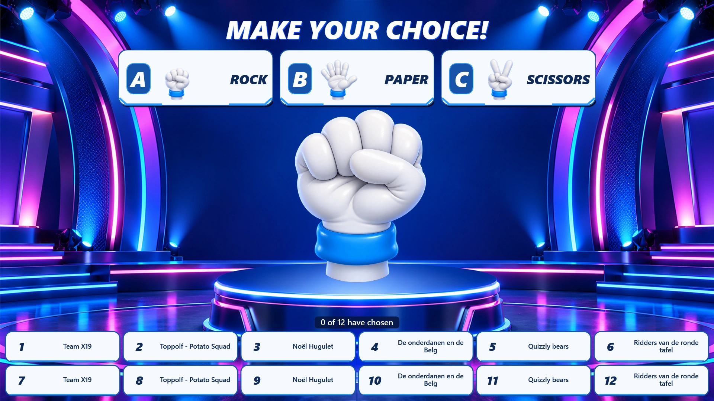
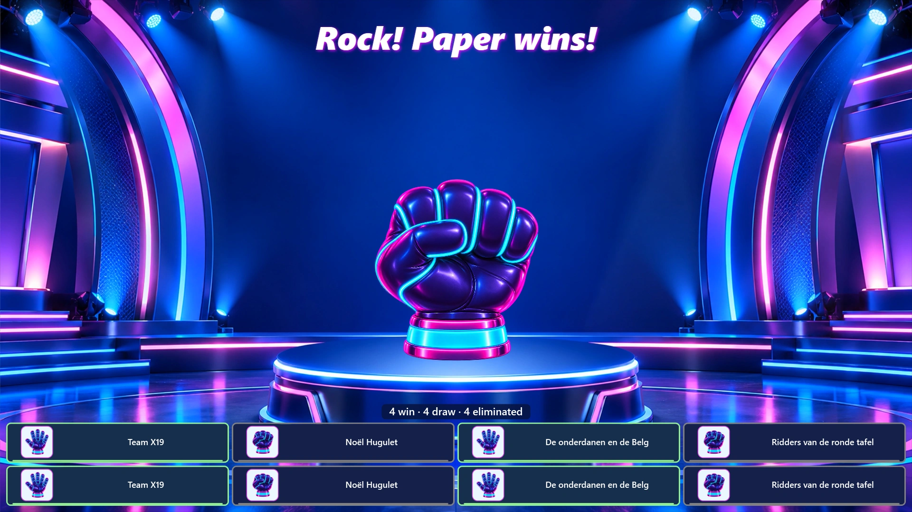
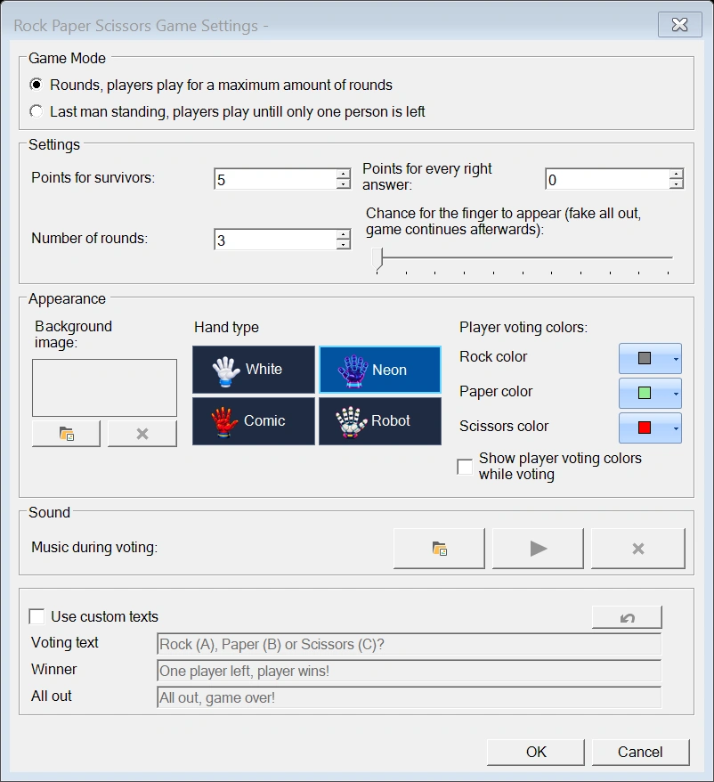

# Rock Paper Scissors

En el minijuego Rock Paper Scissors, el público juega contra un oponente virtual.
Los jugadores eligen piedra, papel o tijera en su pulsador, mando o teléfono. La mano
del ordenador sube y baja tres veces antes de revelar su elección.

{ loading=lazy }

## Cómo se juega una ronda

1. Inicie el juego. Aparece el estudio y comienza la música de fondo.
2. Utilice 'Next' para abrir la votación.
3. Los jugadores pulsan **A para piedra**, **B para papel** o **C para tijera**. En cada ronda
   solo cuenta su primera elección válida; los votos posteriores se ignoran.
4. Utilice 'Next' para cerrar la votación y reproducir la animación de la mano. La música se
   detiene y los efectos de sonido acompañan los tres movimientos y la revelación.
5. Tras la revelación, utilice 'Next' para mostrar los resultados de la ronda y eliminar a los
   jugadores perdedores. Sus casillas desaparecen con una animación y un efecto de sonido. Las
   casillas restantes se reorganizan en una nueva disposición.
6. Utilice 'Next' para abrir la ronda siguiente, o para terminar el juego cuando el modo de
   juego seleccionado haya llegado a su fin.

Se aplican las reglas habituales: la piedra vence a la tijera, la tijera vence al papel y el papel vence a la piedra.
Los jugadores que eligen el mismo gesto que el ordenador siguen en el juego, pero no obtienen
los puntos por una respuesta correcta. Los jugadores que pierden, o que no envían una elección válida
antes de que se cierre la votación, quedan eliminados.

!!! tip
    Por ejemplo, si el ordenador revela piedra, los jugadores que eligieron papel ganan la ronda,
    los que eligieron piedra empatan y los que eligieron tijera quedan eliminados.

{ loading=lazy }

## Modo de juego y puntuación

{ width="600" loading=lazy }

Abra los ajustes del juego para elegir un modo de juego:

- **'Rounds'**: se juega un número determinado de rondas. 'Number of rounds' debe ser al menos **1**.
- **'Last man standing'**: se continúa hasta que queda exactamente un jugador o hasta que todos
  han sido eliminados. 'Number of rounds' está desactivado en este modo.

'Points for survivors' establece la bonificación que se concede a los jugadores que sobreviven al juego.
'Points for every right answer' establece los puntos que se conceden por vencer al ordenador en
una ronda. Una respuesta empatada mantiene al jugador en el juego sin conceder estos puntos de ronda.

### La sorpresa del dedo

'Chance for the finger to appear' establece el porcentaje de probabilidad de que el ordenador revele
un dedo corazón en lugar de piedra, papel o tijera. Se trata de una falsa eliminación en tono de broma:
el público parece estar fuera, pero sus casillas vuelven y el juego continúa.

Establezca la probabilidad en **0** para desactivar esta sorpresa.

## Aspecto

### Estilo de mano

Elija un estilo de mano mediante las vistas previas de imagen de los ajustes:

- **White**: un clásico guante blanco de dibujos animados.
- **Neon**: una mano morada brillante con acentos cian y rosa.
- **Comic**: una mano roja de estilo cómic y trazo grueso.
- **Robot**: una mano robótica y angulosa.

El estilo seleccionado se utiliza para la animación principal, las imágenes de elección de
piedra/papel/tijera y los iconos de elección de los jugadores. Los paneles de elección y las casillas
de los jugadores también coinciden con el estilo de mano.

### Fondo

El fondo predeterminado es un estudio de concurso de estilo neón animado. Utilice el selector 'Background image'
para elegir su propia imagen fija. Borre la imagen personalizada para volver al estudio
predeterminado.

### Colores de votación de los jugadores

Elija los colores de piedra, papel y tijera en 'Player voting colors'. Los
valores predeterminados son gris, verde claro y rojo.

Active 'Show player voting colors while voting' para mostrar la elección de cada jugador mientras
la votación sigue abierta. Cuando está desactivado, las casillas indican que el jugador ha votado
y su elección se muestra después de que el ordenador revele su mano.

## Casillas de jugadores y grupos grandes

El área de jugadores se adapta automáticamente al número de jugadores restantes:

- Los grupos pequeños muestran los números y los nombres de los jugadores. Los nombres más largos ocupan hasta dos líneas.
- Los grupos más grandes utilizan casillas compactas con los números de los jugadores.
- En los grupos muy grandes, las casillas muestran el estado del jugador sin número si el número
  fuera demasiado pequeño para leerse.

La visualización del número depende del espacio disponible y del tamaño de la ventana del juego,
por lo que no hay un número fijo de jugadores a partir del cual aparezcan los números. A medida que se eliminan jugadores,
la disposición se recalcula y los números reaparecen cuando hay espacio suficiente. Los nombres y los
iconos de elección vuelven a aparecer a medida que el grupo se reduce.

Los jugadores eliminados se quitan automáticamente tras la animación de eliminación. No existe
un modo de visualización de jugadores independiente ni un ajuste 'Hide expelled players' que seleccionar.

## Sonido

El juego incluye música de fondo y efectos para los movimientos de la mano, la revelación
y la desaparición de los jugadores eliminados. La música de fondo comienza cuando se abre el
juego y suena durante la votación. Se detiene cuando comienza la animación de la mano.

En 'Sound', utilice 'Music during voting' para elegir su propia música. El botón de reproducción
permite escuchar una vista previa de su selección; el botón de borrar restaura la música predeterminada del juego.

!!! note
    La música y los efectos de sonido estándar se incluyen con el juego. No es necesario instalar
    archivos de sonido adicionales.

## Mensajes personalizados

Active 'Use custom texts' para sustituir los mensajes predeterminados:

- **'Voting text'**: el encabezado que se muestra mientras los jugadores eligen.
- **'Winner'**: el mensaje que se muestra cuando queda un solo jugador.
- **'All out'**: el mensaje que se muestra cuando todos han sido eliminados.

Utilice el botón de restablecer para restaurar los mensajes predeterminados.
