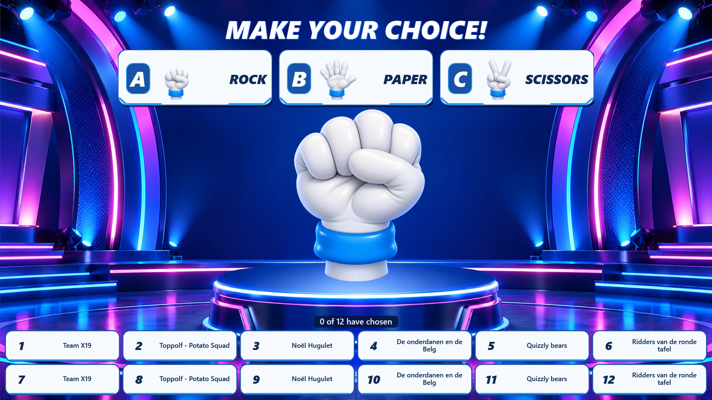
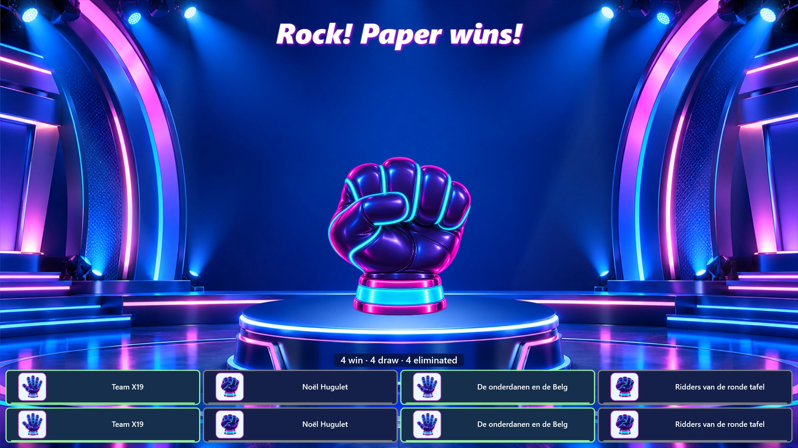
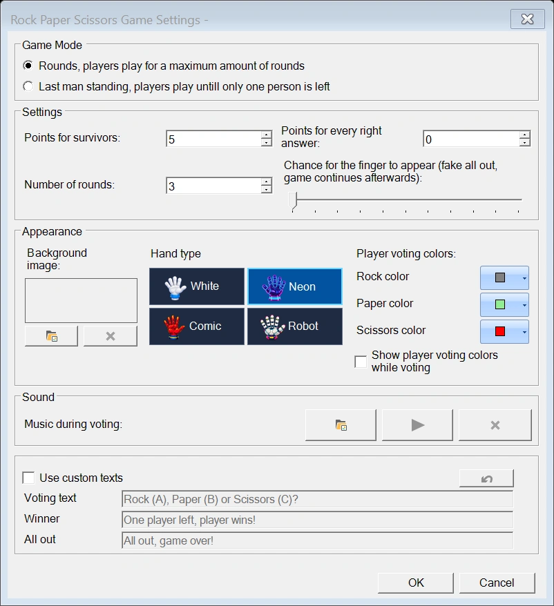

# Steen Papier Schaar

In de minigame Steen Papier Schaar speelt het publiek tegen een virtuele tegenstander.
Spelers kiezen steen, papier of schaar op hun buzzer, keypad of telefoon. De hand van de computer
gaat drie keer op en neer voordat de keuze wordt onthuld.

{ loading=lazy }

## Een ronde spelen

1. Start het spel. De studio verschijnt en de achtergrondmuziek begint.
2. Gebruik ‘Volgende’ om het stemmen te openen.
3. Spelers drukken op **A voor steen**, **B voor papier** of **C voor schaar**. Per ronde telt alleen
   hun eerste geldige keuze; verdere stemmen worden genegeerd.
4. Gebruik ‘Volgende’ om het stemmen te sluiten en de handanimatie af te spelen. De muziek stopt en
   geluidseffecten begeleiden de drie bewegingen en de onthulling.
5. Gebruik na de onthulling ‘Volgende’ om de rondeuitslag te tonen en de verliezende spelers uit te schakelen.
   Hun tegels verdwijnen met een animatie en een geluidseffect. De resterende tegels schuiven
   naar een nieuwe indeling.
6. Gebruik ‘Volgende’ om de volgende ronde te openen, of rond het spel af wanneer de gekozen
   spelmodus het einde heeft bereikt.

De gebruikelijke regels gelden: steen verslaat schaar, schaar verslaat papier en papier verslaat steen.
Spelers die hetzelfde gebaar kiezen als de computer blijven in het spel, maar verdienen niet
de punten voor een juist antwoord. Spelers die verliezen, of geen geldige keuze doorgeven
voordat het stemmen sluit, worden uitgeschakeld.

!!! tip
    Als de computer bijvoorbeeld steen onthult, winnen spelers die papier hebben gekozen de ronde,
    spelen spelers die steen hebben gekozen gelijk en worden spelers die schaar hebben gekozen uitgeschakeld.

{ loading=lazy }

## Spelmodus en score

{ width="600" loading=lazy }

Open de instellingen van het spel om een spelmodus te kiezen:

- **‘Rondes’**: speel een vast aantal rondes. ‘Aantal rondes’ moet minimaal **1** zijn.
- **‘Laatste man’**: ga door totdat precies één speler overblijft, of totdat iedereen
  is uitgeschakeld. ‘Aantal rondes’ is in deze modus uitgeschakeld.

‘Punten voor overlevenden’ stelt de bonus in die wordt toegekend aan spelers die het spel overleven.
‘Punten voor elk juist antwoord’ stelt de punten in die worden toegekend voor het verslaan van de computer in
een ronde. Bij een gelijkspel blijft de speler in het spel, zonder deze rondepunten te ontvangen.

### De vingerverrassing

‘Kans dat de vinger verschijnt’ stelt het percentage in waarmee de computer een middelvinger onthult
in plaats van steen, papier of schaar. Dit is een grappige nepeliminatie:
het publiek lijkt eruit te liggen, maar de tegels komen terug en het spel gaat door.

Stel de kans in op **0** om deze verrassing uit te schakelen.

## Weergave

### Handstijl

Kies een handstijl met behulp van de afbeeldingsvoorbeelden in de instellingen:

- **Wit**: een klassieke witte cartoonhandschoen.
- **Neon**: een gloeiende paarse hand met cyaan en roze accenten.
- **Comic**: een opvallende rode hand in stripstijl.
- **Robot**: een hoekige robothand.

De gekozen stijl wordt gebruikt voor de hoofdanimatie, de afbeeldingen voor de keuze steen/papier/schaar
en de keuzepictogrammen van de spelers. De keuzepanelen en spelertegels sluiten ook aan bij
de handstijl.

### Achtergrond

De standaardachtergrond is een geanimeerde neon spelshowstudio. Gebruik de keuzefunctie ‘Achtergrond afbeelding’
om uw eigen stilstaande afbeelding te kiezen. Wis de eigen afbeelding om terug te keren naar de standaardstudio.

### Stemkleuren van spelers

Kies de kleuren voor steen, papier en schaar onder ‘Stemkleuren van spelers’. De
standaardkleuren zijn grijs, lichtgroen en rood.

Schakel ‘Stemkleuren van spelers tonen tijdens het stemmen’ in om de keuze van elke speler te tonen terwijl
het stemmen nog open is. Als dit is uitgeschakeld, geven de tegels aan dat de speler heeft gestemd
en wordt zijn of haar keuze getoond nadat de computer zijn hand heeft onthuld.

## Spelertegels en grote groepen

Het spelersgebied past zich automatisch aan het aantal resterende spelers aan:

- Kleine groepen tonen spelernummers en namen. Langere namen gebruiken maximaal twee regels.
- Grotere groepen gebruiken compacte tegels met spelernummers.
- Bij zeer grote groepen tonen de tegels de status van de speler zonder nummer als het nummer
  te klein zou zijn om te lezen.

Het getoonde nummer hangt af van de beschikbare ruimte en de grootte van het spelvenster,
dus er is geen vast aantal spelers vanaf wanneer nummers verschijnen. Naarmate spelers worden uitgeschakeld,
wordt de indeling opnieuw berekend en verschijnen de nummers weer wanneer er genoeg ruimte is. Namen en
keuzepictogrammen komen terug naarmate de groep kleiner wordt.

Uitgeschakelde spelers worden na de eliminatie-animatie automatisch verwijderd. Er is
geen aparte weergavemodus voor spelers of instelling ‘Verwijderde spelers verbergen’ om te selecteren.

## Geluid

Het spel bevat achtergrondmuziek en effecten voor de handbewegingen, de onthulling
en het verdwijnen van uitgeschakelde spelers. De achtergrondmuziek begint wanneer het
spel opent en speelt tijdens het stemmen. Ze stopt wanneer de handanimatie begint.

Gebruik onder ‘Geluid’ de optie ‘Muziek tijdens het stemmen’ om uw eigen muziek te kiezen. Met de afspeelknop
beluistert u uw selectie; met de wisknop herstelt u de standaardmuziek van het spel.

!!! note
    De standaardmuziek en de geluidseffecten worden met het spel meegeleverd. Er hoeven geen aparte
    geluidsbestanden te worden geïnstalleerd.

## Eigen berichten

Schakel ‘Eigen teksten gebruiken’ in om de standaardberichten te vervangen:

- **‘Stemtekst’**: de kop die wordt getoond terwijl spelers kiezen.
- **‘Winnaar’**: het bericht dat wordt getoond wanneer één speler overblijft.
- **‘Allemaal uit’**: het bericht dat wordt getoond wanneer iedereen is uitgeschakeld.

Gebruik de herstelknop om de standaardberichten terug te zetten.
