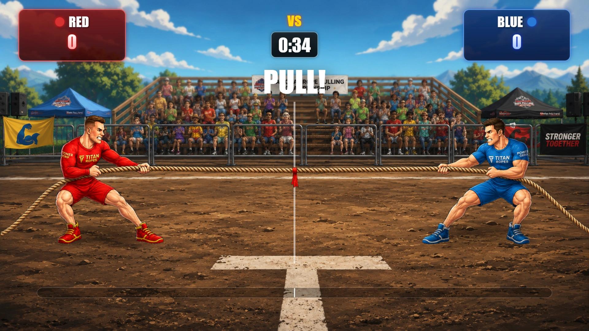
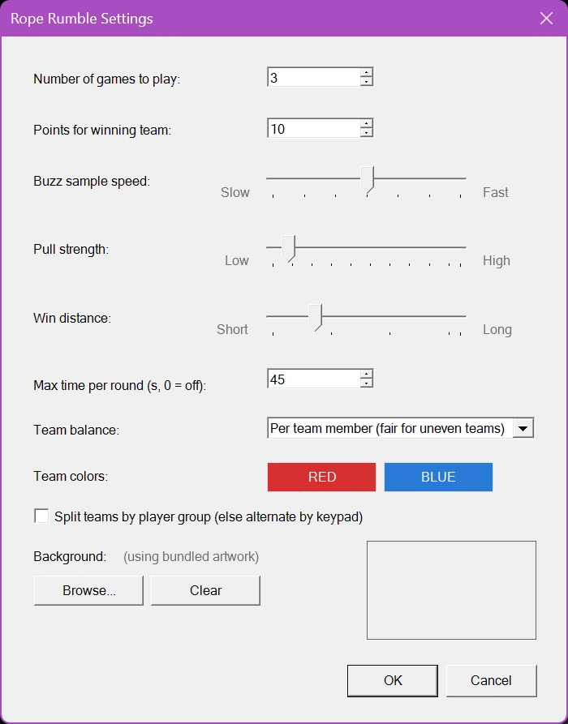

# Rope Rumble

Rope Rumble es un juego de tira y afloja por equipos de ritmo rápido. Los jugadores se dividen en dos equipos —Rojo y Azul— y compiten pulsando sus pulsadores para dar fuerza al tirador de cuerda de su equipo. Cada pulsación del pulsador añade fuerza al lado del equipo, creando una emocionante batalla mientras la cuerda y la bandera central se desplazan por la arena.

El juego evalúa la actividad de los equipos a intervalos rápidos, por lo que la ventaja puede cambiar en cualquier momento. El equipo que tira con más fuerza tira de la cuerda hacia su lado, y cuanto mayor es su ventaja, más se desplaza la cuerda. El primer equipo que tire de la bandera más allá de la línea de victoria gana la ronda.

{ loading=lazy }

Para añadir suspense, Rope Rumble puede jugarse con un límite de tiempo. Si el tiempo se agota antes de que ningún equipo alcance la línea de victoria, la victoria es para el equipo de cuyo lado se encuentra la bandera. Si la bandera está exactamente en el centro, gana el equipo que tiró con más fuerza durante toda la ronda; si también hay empate en eso, la ronda termina en empate y nadie recibe puntos. Se pueden jugar varias rondas, y los jugadores del equipo ganador reciben el número de puntos configurado.

Con controles intuitivos, imágenes animadas, seguimiento de la puntuación en directo y un dramático formato de tira y afloja, Rope Rumble transforma la actividad de los pulsadores en una competición enérgica y muy atractiva para públicos de cualquier tamaño.

## Juego limpio con equipos desiguales

Los equipos no siempre tienen el mismo tamaño: un número impar de jugadores, o dos grupos de distinto tamaño. Si cada pulsación contara sin más, el equipo más grande ganaría casi siempre, aunque sus jugadores no pulsen más rápido. Por eso Rope Rumble compara los equipos **por jugador** de forma predeterminada: las pulsaciones de cada equipo se dividen por su número de jugadores. Un equipo de 4 que pulsa con más fuerza que un equipo de 6 gana el tira y afloja. La forma de comparar los equipos se ajusta con 'Team balance' (véase más abajo).

Otras medidas mantienen el juego justo:

- Cada jugador cuenta como máximo 15 pulsaciones por segundo, de modo que un autoclicker o una tecla atascada no puede hacer ganar a un equipo.
- El marcador muestra el número de jugadores de cada equipo junto a sus pulsaciones, para que el público entienda por qué el equipo más pequeño puede ir por delante con menos pulsaciones.
- Los jugadores que se unen después de formar los equipos (por ejemplo, alguien que llega tarde con el mando móvil) se añaden al equipo más pequeño, o al equipo de su grupo cuando los equipos se dividen por grupo. Su teléfono les indica para qué equipo juegan.
- Una ronda solo empieza cuando ambos equipos tienen al menos un jugador. Si no, la pantalla muestra «Ambos equipos necesitan al menos un jugador».

## Ajustes de Rope Rumble

{ width="311" loading=lazy }

Los ajustes de Rope Rumble determinan cuánto dura el juego, con qué rapidez las pulsaciones de los pulsadores mueven la cuerda y cómo se forman los equipos. Para abrir los ajustes, seleccione Rope Rumble y elija Configure.

**Number of games to play**

Especifica cuántas rondas se juegan antes de que termine Rope Rumble. Una vez completada una ronda, el director puede iniciar la siguiente hasta alcanzar el número configurado.

**Points for winning team**

Establece el número de puntos que se conceden a cada jugador del equipo ganador al final de una ronda.

**Buzz sample speed**

Controla con qué frecuencia el juego evalúa las pulsaciones de los pulsadores y actualiza la posición de la cuerda.

- Fast: las pulsaciones de los pulsadores se evalúan con más frecuencia, lo que da lugar a un movimiento de la cuerda más rápido y receptivo.

- Slow: las pulsaciones de los pulsadores se evalúan con menos frecuencia, lo que da lugar a un movimiento más gradual.

El valor predeterminado es 250 milisegundos. El intervalo disponible va de 100 a 400 milisegundos.

**Pull strength**

Controla cuánto se mueve la cuerda cuando un equipo tira con más fuerza que el otro durante un intervalo de muestreo. Es la distancia para un equipo que hace todo el esfuerzo; una ventaja menor mueve menos la cuerda.

- Low: crea un tira y afloja más lento y gradual.

- High: hace que la ventaja de cada equipo desplace la cuerda más lejos, produciendo un juego más rápido y decisivo.

**Win distance**

Determina a qué distancia del centro debe moverse la bandera para que un equipo gane la ronda.

- Una distancia menor facilita la victoria y acorta la ronda.

- Una distancia mayor crea una batalla más larga y da a los equipos más oportunidades de recuperarse.

**Maximum time per round**

Establece la duración máxima de cada ronda en segundos. Si el temporizador llega a cero antes de que ningún equipo alcance la distancia de victoria, gana el equipo de cuyo lado se encuentra la bandera. Una bandera exactamente en el centro es para el equipo que tiró con más fuerza durante toda la ronda, y un empate total es un empate.

Establezca este valor en 0 para desactivar el límite de tiempo.

**Team balance**

Determina cómo se compara la fuerza de los dos equipos.

- Per team member (fair for uneven teams): el valor predeterminado. Las pulsaciones de cada equipo se dividen por el número de jugadores del equipo. Todos los jugadores deben participar: un jugador que no pulsa cuenta como un jugador que no tira. La mejor opción para la mayoría de los eventos.

- Per active player: las pulsaciones de cada equipo se dividen por el número de sus jugadores que han pulsado al menos una vez durante la ronda. Los jugadores que nunca aparecen no debilitan a su equipo. Use esta opción cuando espere jugadores registrados que no participarán, como asientos vacíos o teléfonos que nunca se conectaron.

- Off (the bigger team pulls harder): cada pulsación cuenta igual, y el equipo con más pulsaciones en un intervalo mueve la cuerda un paso completo. Así funcionaba Rope Rumble antes; un equipo más grande tiene una clara ventaja.

**Team colors**

Establece los colores de los equipos Rojo y Azul. Haga clic en el botón de un equipo para elegir otro color. Los colores se usan para los distintivos de los equipos, la barra de fuerza y el texto del ganador.

**Split teams by player group**

Determina cómo se asignan los jugadores a los equipos Rojo y Azul.

- Cuando está activado, los jugadores se dividen según su Group configurado. Esta opción está pensada para eventos en los que los jugadores ya se han organizado en dos grupos. Los grupos pueden ser de distinto tamaño; 'Team balance' mantiene el juego justo.

- Cuando está desactivado, los jugadores se reparten de forma alterna por orden de mando, de modo que los dos equipos nunca se diferencian en más de un jugador.

**Background**

Le permite sustituir el arte incluido de Rope Rumble por una imagen de fondo personalizada. Haga clic en Browse... para seleccionar un archivo de imagen (por ejemplo PNG, JPG o BMP). La imagen seleccionada se muestra en el área de vista previa y se guarda con la configuración del quiz. Haga clic en Clear para quitar la imagen personalizada y volver al arte incluido predeterminado.
