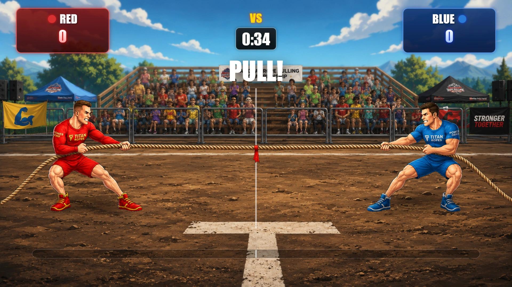
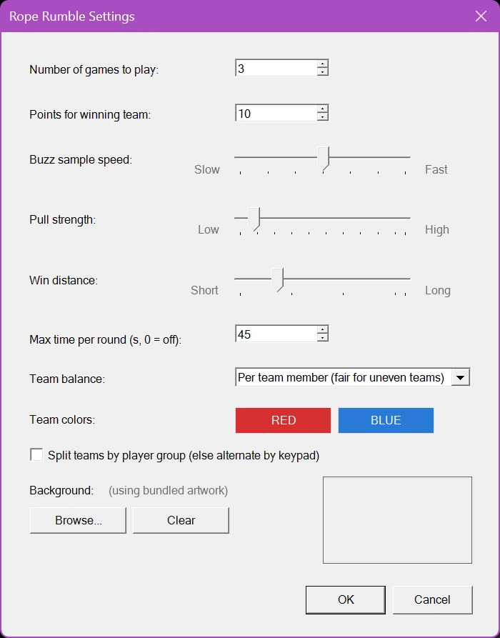

# Rope Rumble

Rope Rumble est un jeu de tir à la corde par équipes, rapide et intense. Les joueurs sont répartis en deux équipes, Red et Blue, et s'affrontent en appuyant sur leurs buzzers pour propulser le tireur de corde de leur équipe. Chaque pression sur un buzzer ajoute de la force du côté de l'équipe, créant un combat passionnant tandis que la corde et le drapeau central se déplacent dans l'arène.

Le jeu évalue l'activité des équipes à intervalles rapprochés, si bien que l'avantage peut changer à tout moment. L'équipe qui tire le plus fort tire la corde de son côté, et plus son avance est grande, plus la corde avance. La première équipe à tirer le drapeau au-delà de la ligne de victoire remporte la manche.

{ loading=lazy }

Pour plus de suspense, Rope Rumble peut se jouer avec une limite de temps. Si le temps expire avant qu'une équipe n'atteigne la ligne de victoire, la victoire revient à l'équipe du côté de laquelle se trouve le drapeau. Si le drapeau est exactement au centre, l'équipe qui a tiré le plus fort sur l'ensemble de la manche l'emporte ; en cas de nouvelle égalité, la manche se termine par un match nul et personne ne marque de points. Plusieurs manches peuvent être jouées, et les joueurs de l'équipe gagnante reçoivent le nombre de points configuré.

Avec ses commandes intuitives, ses visuels animés, son suivi des scores en direct et son format dramatique de tir à la corde, Rope Rumble transforme l'activité des buzzers en une compétition énergique et captivante pour un public de toute taille.

## Un jeu équitable avec des équipes inégales

Les équipes n'ont pas toujours la même taille : un nombre impair de joueurs, ou deux groupes de tailles différentes. Si chaque pression de buzzer comptait simplement, la plus grande équipe gagnerait presque à chaque fois, même si ses joueurs n'appuient pas plus vite. Rope Rumble compare donc par défaut les équipes **par joueur** : les pressions de buzzer de chaque équipe sont divisées par son nombre de joueurs. Une équipe de 4 qui appuie plus fort qu'une équipe de 6 gagne le tir à la corde. La manière de comparer les équipes se règle avec 'Team balance' (voir ci-dessous).

D'autres mesures gardent le jeu équitable :

- Chaque joueur compte pour 15 pressions par seconde au maximum, si bien qu'un auto-clicker ou une touche bloquée ne peut pas faire gagner une équipe.
- Le tableau des scores affiche le nombre de joueurs de chaque équipe à côté de ses pressions de buzzer, afin que le public comprenne pourquoi la plus petite équipe peut mener avec moins de pressions.
- Les joueurs qui arrivent après la formation des équipes (par exemple un retardataire sur le keypad mobile) rejoignent la plus petite équipe, ou l'équipe de leur groupe lorsque les équipes sont réparties par groupe. Leur téléphone leur indique pour quelle équipe ils jouent.
- Une manche ne démarre que si chaque équipe compte au moins un joueur. Sinon, l'écran affiche « Chaque équipe doit avoir au moins un joueur ».

## Paramètres de Rope Rumble

{ width="311" loading=lazy }

Les paramètres de Rope Rumble déterminent la durée du jeu, la rapidité avec laquelle les pressions de buzzer déplacent la corde et la manière dont les équipes sont formées. Pour ouvrir les paramètres, sélectionnez Rope Rumble et choisissez Configure.

**Number of games to play**

Indique combien de manches sont jouées avant la fin de Rope Rumble. Une fois une manche terminée, le Director peut lancer la manche suivante jusqu'à ce que le nombre configuré soit atteint.

**Points for winning team**

Définit le nombre de points attribués à chaque joueur de l'équipe gagnante à la fin d'une manche.

**Buzz sample speed**

Contrôle la fréquence à laquelle le jeu évalue les pressions de buzzer et met à jour la position de la corde.

- Fast : les pressions de buzzer sont évaluées plus fréquemment, ce qui donne un mouvement de corde plus rapide et plus réactif.

- Slow : les pressions de buzzer sont évaluées moins fréquemment, ce qui donne un mouvement plus progressif.

La valeur par défaut est de 250 millisecondes. La plage disponible va de 100 à 400 millisecondes.

**Pull strength**

Contrôle de combien la corde se déplace lorsqu'une équipe tire plus fort que l'autre pendant un intervalle d'échantillonnage. Il s'agit de la distance pour une équipe qui fait tout le travail ; une avance plus faible déplace moins la corde.

- Low : crée un tir à la corde plus lent et plus progressif.

- High : l'avantage de chaque équipe fait avancer la corde plus loin, ce qui produit un jeu plus rapide et plus décisif.

**Win distance**

Détermine la distance dont le drapeau doit s'éloigner du centre pour qu'une équipe remporte la manche.

- Une distance plus petite facilite la victoire et raccourcit la manche.

- Une distance plus grande crée un combat plus long et donne aux équipes plus d'occasions de se reprendre.

**Maximum time per round**

Définit la durée maximale de chaque manche en secondes. Si le chronomètre atteint zéro avant qu'une équipe n'atteigne la distance de victoire, l'équipe du côté de laquelle se trouve le drapeau l'emporte. Un drapeau exactement au centre revient à l'équipe qui a tiré le plus fort sur l'ensemble de la manche, et une égalité parfaite donne un match nul.

Réglez cette valeur sur 0 pour désactiver la limite de temps.

**Team balance**

Détermine la manière dont la force des deux équipes est comparée.

- Per team member (fair for uneven teams) : la valeur par défaut. Les pressions de buzzer de chaque équipe sont divisées par le nombre de joueurs de l'équipe. Chaque joueur doit participer : un joueur qui n'appuie pas compte comme un joueur qui ne tire pas. Le meilleur choix pour la plupart des événements.

- Per active player : les pressions de buzzer de chaque équipe sont divisées par le nombre de ses joueurs qui ont appuyé au moins une fois pendant la manche. Les joueurs qui ne se manifestent jamais n'affaiblissent pas leur équipe. Utilisez cette option si vous attendez des joueurs inscrits qui ne participeront pas, comme des places vides ou des téléphones jamais connectés.

- Off (the bigger team pulls harder) : chaque pression de buzzer compte autant, et l'équipe qui appuie le plus pendant un intervalle déplace la corde d'un pas complet. C'est ainsi que fonctionnait Rope Rumble auparavant ; une plus grande équipe a un net avantage.

**Team colors**

Définit les couleurs des équipes Red et Blue. Cliquez sur le bouton d'une équipe pour choisir une autre couleur. Les couleurs sont utilisées pour les pastilles des équipes, la barre de force et le texte du gagnant.

**Split teams by player group**

Détermine la manière dont les joueurs sont affectés aux équipes Red et Blue.

- Lorsque cette option est activée, les joueurs sont répartis selon leur Group configuré. Cette option est destinée aux événements où les joueurs ont déjà été organisés en deux groupes. Les groupes peuvent être de tailles différentes ; 'Team balance' garde le jeu équitable.

- Lorsqu'elle est désactivée, les joueurs sont répartis en alternance dans l'ordre de leur keypad, si bien que les deux équipes ne diffèrent jamais de plus d'un joueur.

**Background**

Permet de remplacer l'illustration fournie de Rope Rumble par une image d'arrière-plan personnalisée. Cliquez sur Browse... pour sélectionner un fichier image (par exemple PNG, JPG ou BMP). L'image sélectionnée s'affiche dans la zone d'aperçu et est enregistrée avec la configuration du quiz. Cliquez sur Clear pour supprimer l'image personnalisée et revenir à l'illustration fournie par défaut.
