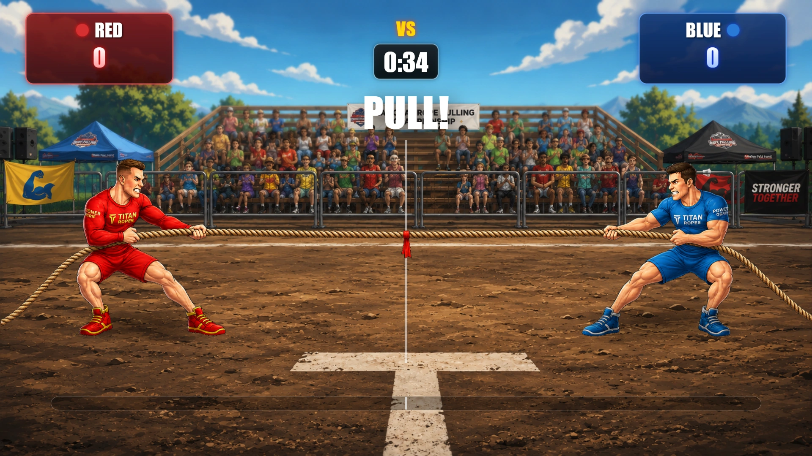
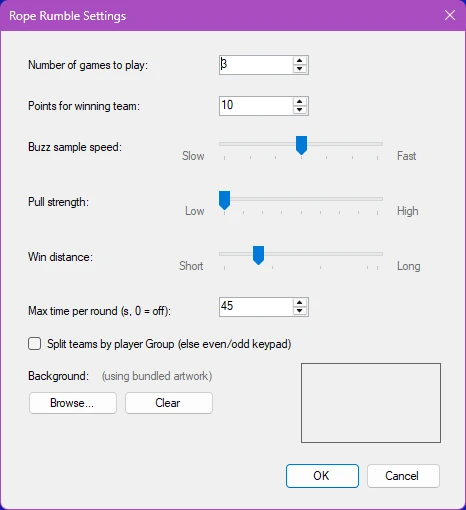

# Tiro alla Fune

Rope Rumble è un veloce gioco di tiro alla fune a squadre. I giocatori sono divisi in due squadre, Red e Blue, e competono premendo i propri buzzer per dare potenza al tiratore di fune della propria squadra. Ogni pressione del buzzer aggiunge forza al lato della squadra, creando una sfida emozionante mentre la fune e la bandiera centrale si spostano nell'arena.

Il gioco valuta l'attività delle squadre a intervalli rapidi, quindi il vantaggio può cambiare da un momento all'altro. La squadra che genera più pressioni di buzzer tira la fune dalla propria parte. La prima squadra a tirare la bandiera oltre la linea di vittoria vince il round.

{ loading=lazy }

Per aumentare la suspense, Rope Rumble può essere giocato con un limite di tempo. Se il tempo scade prima che una delle due squadre raggiunga la linea di vittoria, la vittoria va alla squadra dalla cui parte si trova la bandiera. È possibile giocare più round, e i giocatori della squadra vincente ricevono il numero di punti configurato.

Con comandi intuitivi, grafica animata, monitoraggio dei punteggi in tempo reale e un avvincente formato da tiro alla fune, Rope Rumble trasforma l'attività dei buzzer in una competizione energica e coinvolgente per un pubblico di qualsiasi dimensione.

**Impostazioni di Rope Rumble:**

{ width="311" loading=lazy }

Le impostazioni di Rope Rumble determinano la durata del gioco, la rapidità con cui le pressioni dei buzzer spostano la fune e il modo in cui vengono formate le squadre. Per aprire le impostazioni, selezionare Rope Rumble e scegliere Configure.

**Number of games to play**

Specifica quanti round vengono giocati prima della fine di Rope Rumble. Al termine di un round, il Director può avviare il round successivo fino al raggiungimento del numero configurato.

**Points for winning team**

Imposta il numero di punti assegnati a ciascun giocatore della squadra vincente al termine di un round.

**Buzz sample speed**

Controlla la frequenza con cui il gioco valuta le pressioni dei buzzer e aggiorna la posizione della fune.

- Fast: le pressioni dei buzzer vengono valutate più frequentemente, con un movimento della fune più rapido e reattivo.

- Slow: le pressioni dei buzzer vengono valutate meno frequentemente, con un movimento più graduale.

Il valore predefinito è 250 millisecondi. L'intervallo disponibile va da 100 a 400 millisecondi.

**Pull strength**

Controlla di quanto si sposta la fune quando una squadra ha più pressioni di buzzer dell'altra durante un intervallo di campionamento.

- Low: crea un tiro alla fune più lento e graduale.

- High: il vantaggio di ciascuna squadra sposta la fune più lontano, producendo un gioco più rapido e decisivo.

**Win distance**

Determina quanto la bandiera deve allontanarsi dal centro perché una squadra vinca il round.

- Una distanza minore rende più facile vincere e accorcia il round.

- Una distanza maggiore crea una sfida più lunga e offre alle squadre più opportunità di recuperare.

**Maximum time per round**

Imposta la durata massima di ogni round in secondi. Se il timer arriva a zero prima che una delle due squadre raggiunga la distanza di vittoria, vince la squadra che in quel momento sta tirando la bandiera dalla propria parte.

Impostare questo valore su 0 per disattivare il limite di tempo.

**Split teams by player Group**

Determina il modo in cui i giocatori vengono assegnati alle squadre Red e Blue.

- Se attivata, i giocatori vengono divisi in base al Group configurato. Questa opzione è pensata per gli eventi in cui i giocatori sono già stati organizzati in due gruppi.

- Se disattivata, i giocatori vengono divisi in base ai numeri del keypad, con gli ID keypad dispari e pari assegnati a squadre opposte. Questo offre una suddivisione predefinita equilibrata.

**Background**

Consente di sostituire la grafica di Rope Rumble inclusa con un'immagine di sfondo personalizzata. Fare clic su Browse... per selezionare un file PNG, JPG, JPEG o BMP. L'immagine selezionata viene mostrata nell'area di anteprima e salvata con la configurazione del quiz. Fare clic su Clear per rimuovere l'immagine personalizzata e tornare alla grafica predefinita inclusa.
