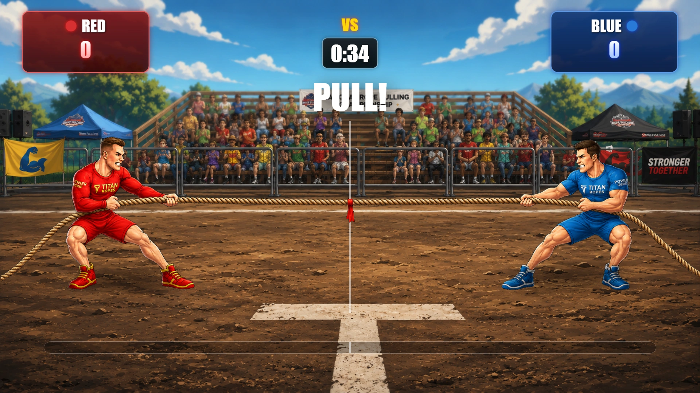
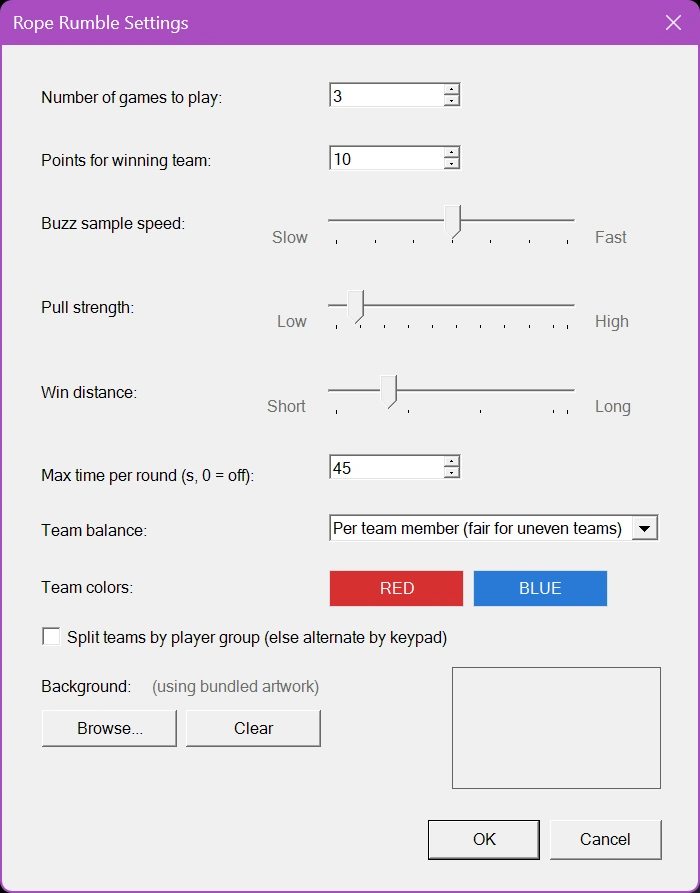

# Tiro alla Fune

Il Tiro alla Fune è un veloce gioco a squadre. I giocatori sono divisi in due squadre, Rossa e Blu, e competono premendo i propri buzzer per dare forza al giocatore che tira la fune per la loro squadra. Ogni pressione del buzzer aggiunge forza alla propria squadra, creando una sfida emozionante mentre la fune e la bandiera centrale si spostano nell'arena.

Il gioco valuta l'attività delle squadre a intervalli rapidi, quindi il vantaggio può cambiare da un momento all'altro. La squadra che tira più forte porta la fune dalla propria parte, e più grande è il suo vantaggio, più la fune si sposta. La prima squadra che porta la bandiera oltre la linea di vittoria vince il round.

{ loading=lazy }

Per aumentare la suspense, il Tiro alla Fune può essere giocato con un limite di tempo. Se il tempo scade prima che una delle due squadre raggiunga la linea di vittoria, vince la squadra dalla cui parte si trova la bandiera. Se la bandiera è esattamente al centro, vince la squadra che ha tirato più forte nell'intero round; se c'è parità anche in questo caso, il round finisce in pareggio e nessuno riceve punti. È possibile giocare più round, e i giocatori della squadra vincente ricevono il numero di punti impostato.

Con comandi intuitivi, grafica animata, punteggi in tempo reale e l'avvincente formato del tiro alla fune, il Tiro alla Fune trasforma l'attività dei buzzer in una competizione energica e coinvolgente per un pubblico di qualsiasi dimensione.

## Gioco equo con squadre diseguali

Le squadre non hanno sempre lo stesso numero di giocatori: il numero di giocatori può essere dispari, oppure i due gruppi possono essere di dimensioni diverse. Se ogni pressione del buzzer contasse semplicemente, la squadra più numerosa vincerebbe quasi sempre, anche se i suoi giocatori non premono più velocemente. Per questo il Tiro alla Fune, per impostazione predefinita, confronta le squadre **per giocatore**: le pressioni del buzzer di ogni squadra vengono divise per il suo numero di giocatori. Una squadra di 4 che tira più forte di una squadra di 6 vince il tiro alla fune. Il modo in cui le squadre vengono confrontate si imposta con 'Bilanciamento Squadre' (vedi sotto).

Altri accorgimenti mantengono il gioco equo:

- Ogni giocatore conta al massimo 15 pressioni al secondo, quindi un auto-clicker o un tasto bloccato non può far vincere una squadra.
- Il tabellone mostra il numero di giocatori di ogni squadra accanto alle sue pressioni del buzzer, così il pubblico capisce perché la squadra più piccola può essere in vantaggio con meno pressioni.
- I giocatori che arrivano dopo la formazione delle squadre (per esempio un ritardatario con la pulsantiera mobile) vengono aggiunti alla squadra più piccola, oppure alla squadra del proprio gruppo quando le squadre sono divise per gruppo. Il telefono indica loro per quale squadra giocano.
- Un round inizia solo se entrambe le squadre hanno almeno un giocatore. Altrimenti lo schermo mostra "Entrambe le squadre devono avere almeno un giocatore".

## Impostazioni del Tiro alla Fune

{ width="311" loading=lazy }

Le impostazioni del Tiro alla Fune determinano la durata del gioco, la rapidità con cui le pressioni dei buzzer spostano la fune e il modo in cui vengono formate le squadre. Per aprire le impostazioni, selezionare il Tiro alla Fune e scegliere 'Configura...'.

**Round da Giocare**

Specifica quanti round vengono giocati prima della fine del Tiro alla Fune. Al termine di un round, in QuizXpress Director si può avviare il round successivo, fino al numero impostato.

**Punti Squadra Vincente**

Imposta il numero di punti assegnati a ciascun giocatore della squadra vincente al termine di un round.

**Velocità Lettura Buzzer**

Controlla la frequenza con cui il gioco valuta le pressioni dei buzzer e aggiorna la posizione della fune.

- Veloce: le pressioni dei buzzer vengono valutate più spesso, con un movimento della fune più rapido e reattivo.

- Lenta: le pressioni dei buzzer vengono valutate meno spesso, con un movimento più graduale.

Il valore predefinito è 250 millisecondi. L'intervallo disponibile va da 100 a 400 millisecondi.

**Forza Trazione**

Controlla di quanto si sposta la fune quando una squadra tira più forte dell'altra durante un intervallo di lettura. È la distanza per una squadra che fa tutto il lavoro; un vantaggio minore sposta meno la fune.

- Bassa: crea un tiro alla fune più lento e graduale.

- Alta: il vantaggio di ciascuna squadra sposta la fune più lontano, producendo un gioco più rapido e decisivo.

**Distanza Vittoria**

Determina quanto la bandiera deve allontanarsi dal centro perché una squadra vinca il round.

- Breve: rende più facile vincere e accorcia il round.

- Lunga: crea una sfida più lunga e offre alle squadre più occasioni di recuperare.

**Tempo Max Round**

Imposta la durata massima di ogni round in secondi. Se il timer arriva a zero prima che una delle due squadre raggiunga la distanza di vittoria, vince la squadra dalla cui parte si trova la bandiera. Una bandiera esattamente al centro va alla squadra che ha tirato più forte nell'intero round, e una parità completa è un pareggio.

Impostare questo valore su 0 per togliere il limite di tempo.

**Bilanciamento Squadre**

Determina il modo in cui viene confrontata la forza delle due squadre.

- Per membro (equo): il valore predefinito. Le pressioni del buzzer di ogni squadra vengono divise per il numero di giocatori della squadra. Ogni giocatore deve partecipare: un giocatore che non preme conta come un giocatore che non tira. La scelta migliore per la maggior parte degli eventi.

- Per giocatore attivo: le pressioni del buzzer di ogni squadra vengono divise per il numero dei suoi giocatori che hanno premuto almeno una volta durante il round. I giocatori che non partecipano non indeboliscono la propria squadra. Usare questa opzione quando si prevedono giocatori registrati che non parteciperanno, come posti vuoti o telefoni mai collegati.

- No (la squadra più numerosa tira di più): ogni pressione del buzzer conta allo stesso modo, e la squadra con più pressioni in un intervallo sposta la fune di un passo intero. È il modo in cui il Tiro alla Fune funzionava in precedenza; la squadra più numerosa ha un netto vantaggio.

**Colori Squadre**

Imposta i colori delle squadre Rossa e Blu. Fare clic sul pulsante di una squadra per scegliere un altro colore. I colori vengono usati per i riquadri delle squadre, la barra della forza e la scritta del vincitore.

**Dividi squadre per gruppo giocatori**

Determina il modo in cui i giocatori vengono assegnati alle squadre Rossa e Blu.

- Se attivata, i giocatori vengono divisi in base al gruppo a cui sono assegnati. Questa opzione è pensata per gli eventi in cui i giocatori sono già stati organizzati in due gruppi. I gruppi possono avere dimensioni diverse: 'Bilanciamento Squadre' mantiene il gioco equo.

- Se disattivata, i giocatori vengono assegnati a turno alle due squadre in ordine di pulsantiera, quindi le due squadre non differiscono mai di più di un giocatore.

**Sfondo**

Consente di sostituire la grafica predefinita del Tiro alla Fune con un'immagine di sfondo personalizzata. Fare clic su 'Sfoglia...' per selezionare un file immagine (per esempio PNG, JPG o BMP). L'immagine selezionata viene mostrata nell'area di anteprima e salvata con la configurazione del quiz. Fare clic su 'Rimuovi' per togliere l'immagine personalizzata e tornare alla grafica predefinita.
