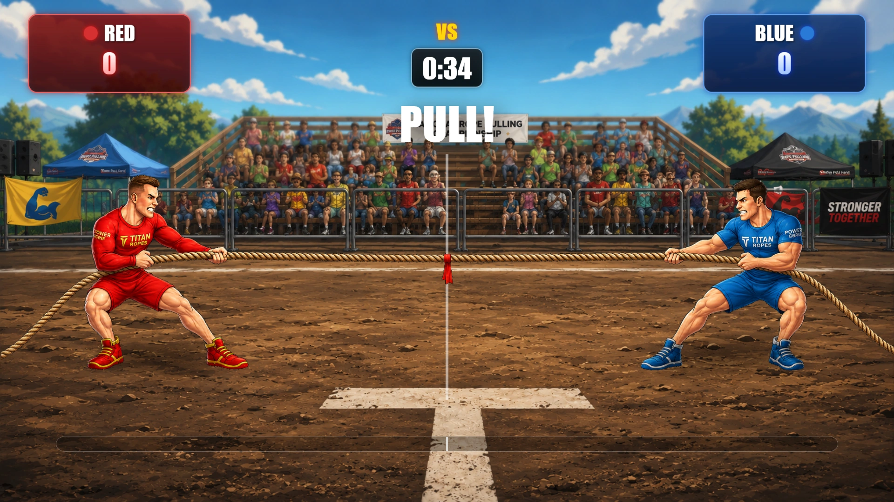
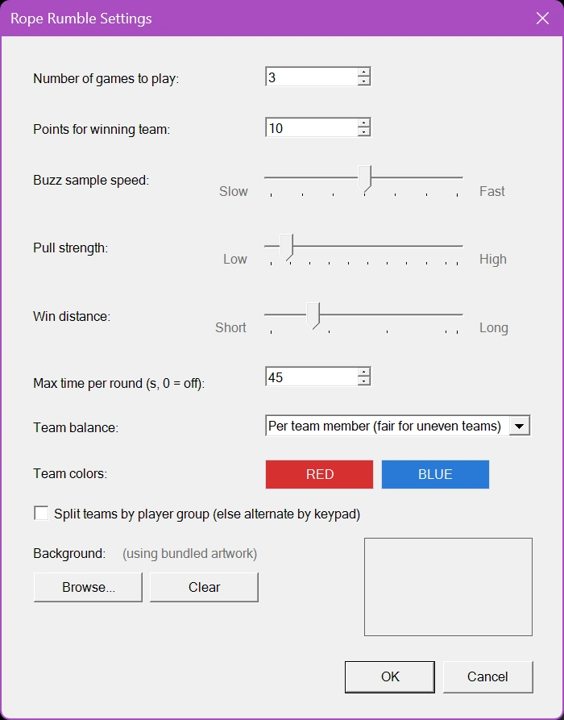

# Rope Rumble

Rope Rumble is a fast-paced team tug-of-war game. Players are divided into two teams—Red and Blue—and compete by pressing their buzzers to power their team’s rope puller. Every buzzer press adds force to the team’s side, creating an exciting battle as the rope and center flag move across the arena.

The game evaluates team activity in rapid intervals, so the lead can change from moment to moment. The team that pulls harder pulls the rope toward its side, and the bigger its lead, the further the rope moves. The first team to pull the flag past the winning line wins the round.

{ loading=lazy }

For added suspense, Rope Rumble can be played with a time limit. If time expires before either team reaches the winning line, victory goes to the team whose side the flag is on. If the flag is exactly in the center, the team that pulled harder over the whole round wins; if that is a tie too, the round ends in a draw and nobody gets points. Multiple rounds can be played, and players on the winning team receive the configured number of points.

With intuitive controls, animated visuals, live score tracking, and a dramatic tug-of-war format, Rope Rumble transforms buzzer activity into an energetic and highly engaging competition for audiences of any size.

## Fair play with uneven teams

Teams are not always the same size: an odd number of players, or two groups of different sizes. If every buzzer press simply counted, the bigger team would win almost every time, even when its players press no faster. Rope Rumble therefore compares the teams **per player** by default: each team's buzzer presses are divided by its number of players. A team of 4 that presses harder than a team of 6 wins the tug-of-war. How the teams are compared is set with 'Team balance' (see below).

A few more things keep the game fair:

- Each player counts for at most 15 presses per second, so an auto-clicker or a stuck key can't win the game for a team.
- The scoreboard shows the number of players on each team next to the team's buzzer presses, so the audience can see why the smaller team may be ahead with fewer presses.
- Players who join after the teams were made (for example a late arrival on the mobile keypad) are added to the smaller team, or to their own group's team when teams are split by group. They are told on their phone which team they play for.
- A round only starts when both teams have at least one player. Otherwise the screen shows "Both teams need at least one player".

## Rope Rumble settings

{ width="311" loading=lazy }

The Rope Rumble settings determine how long the game runs, how quickly buzzer presses move the rope, and how teams are formed. To open the settings, select Rope Rumble and choose Configure.

**Number of games to play**

Specifies how many rounds are played before Rope Rumble ends. After a round is completed, the director can start the next round until the configured number has been reached.

**Points for winning team**

Sets the number of points awarded to each player on the winning team at the end of a round.

**Buzz sample speed**

Controls how frequently the game evaluates buzzer presses and updates the rope position.

- Fast: Buzzer presses are evaluated more frequently, resulting in quicker and more responsive rope movement.

- Slow: Buzzer presses are evaluated less frequently, resulting in more gradual movement.

The default value is 250 milliseconds. The available range is 100 to 400 milliseconds.

**Pull strength**

Controls how far the rope moves when one team pulls harder than the other during a sample interval. This is the distance for a team that does all the pulling; a smaller lead moves the rope less.

- Low: Creates a slower, more gradual tug-of-war.

- High: Makes each team’s advantage move the rope farther, producing a faster and more decisive game.

**Win distance**

Determines how far the flag must move from the center before a team wins the round.

- A smaller distance makes it easier to win and shortens the round.

- A larger distance creates a longer battle and gives teams more opportunity to recover.

**Maximum time per round**

Sets the maximum duration of each round in seconds. If the timer reaches zero before either team reaches the winning distance, the team on whose side the flag is wins. A flag exactly in the center goes to the team that pulled harder over the whole round, and a full tie is a draw.

Set this value to 0 to disable the time limit.

**Team balance**

Determines how the pulling power of the two teams is compared.

- Per team member (fair for uneven teams): the default. Each team's buzzer presses are divided by the number of players on the team. Every player has to join in: a player who doesn't press counts as a player who isn't pulling. Best for most events.

- Per active player: each team's buzzer presses are divided by the number of its players who pressed at least once during the round. Players who never show up don't weaken their team. Use this when you expect registered players who won't take part, such as empty seats or phones that were never connected.

- Off (the bigger team pulls harder): every buzzer press counts the same, and the team with the most presses in an interval moves the rope a full step. This is how Rope Rumble worked before; a bigger team has a clear advantage.

**Team colors**

Sets the colors of the Red and Blue teams. Click a team's button to choose another color. The colors are used for the team swatches, the force bar and the winner text.

**Split teams by player group**

Determines how players are assigned to the Red and Blue teams.

- When enabled, players are divided according to their configured Group. This option is intended for events where players have already been organized into two groups. The groups may differ in size; 'Team balance' keeps the game fair.

- When disabled, players are dealt out alternately in keypad order, so the two teams never differ by more than one player.

**Background**

Allows you to replace the bundled Rope Rumble artwork with a custom background image. Click Browse... to select an image file (for example PNG, JPG or BMP). The selected image is shown in the preview area and stored with the quiz configuration. Click Clear to remove the custom image and return to the default bundled artwork.
