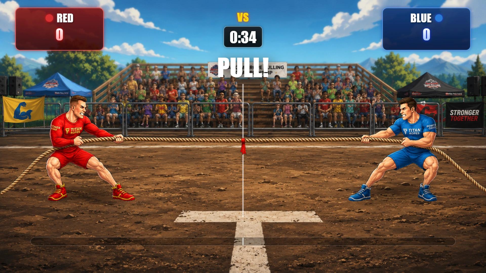
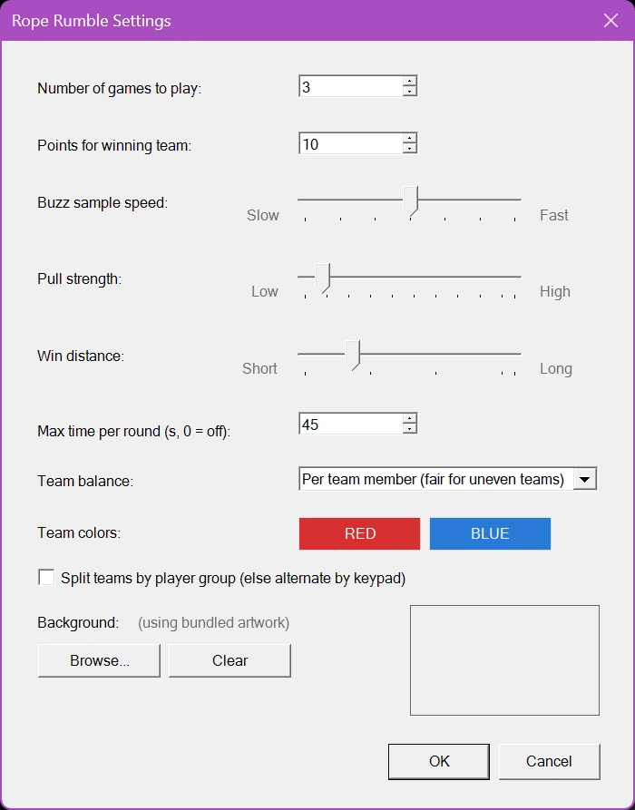

# Rope Rumble

Rope Rumble is een razendsnel touwtrekspel voor teams. Spelers worden verdeeld over twee teams – Rood en Blauw – en strijden door op hun buzzers te drukken om de touwtrekker van hun team aan te drijven. Elke druk op de buzzer voegt kracht toe aan de kant van het team, wat een spannende strijd oplevert terwijl het touw en de vlag in het midden over het speelveld bewegen.

Het spel beoordeelt de activiteit van de teams in snelle intervallen, zodat de leiding van moment tot moment kan wisselen. Het team dat harder trekt, trekt het touw naar zijn kant en hoe groter de voorsprong, hoe verder het touw beweegt. Het eerste team dat de vlag voorbij de winlijn trekt, wint de ronde.

{ loading=lazy }

Voor extra spanning kan Rope Rumble met een tijdslimiet worden gespeeld. Als de tijd verstrijkt voordat een van de teams de winlijn bereikt, gaat de overwinning naar het team aan wiens kant de vlag zich bevindt. Als de vlag precies in het midden staat, wint het team dat over de hele ronde harder heeft getrokken; als ook dat gelijk is, eindigt de ronde in een gelijkspel en krijgt niemand punten. Er kunnen meerdere rondes worden gespeeld en spelers van het winnende team ontvangen het ingestelde aantal punten.

Met intuïtieve bediening, geanimeerde beelden, live scorebijhouding en een dramatisch touwtrekformat verandert Rope Rumble buzzeractiviteit in een energieke en zeer boeiende wedstrijd voor publiek van elke omvang.

## Eerlijk spel met ongelijke teams

Teams zijn niet altijd even groot: een oneven aantal spelers, of twee groepen van verschillende grootte. Als elke druk op de buzzer simpelweg zou meetellen, zou het grotere team bijna altijd winnen, ook als zijn spelers niet sneller drukken. Rope Rumble vergelijkt de teams daarom standaard **per speler**: de buzzerdrukken van elk team worden gedeeld door het aantal spelers. Een team van 4 dat harder drukt dan een team van 6 wint het touwtrekken. Hoe de teams worden vergeleken, stelt u in met ‘Teambalans’ (zie hieronder).

Een paar andere zaken houden het spel eerlijk:

- Elke speler telt voor maximaal 15 drukken per seconde, zodat een autoclicker of een vastzittende toets het spel niet voor een team kan winnen.
- Het scorebord toont het aantal spelers van elk team naast de buzzerdrukken van het team, zodat het publiek kan zien waarom het kleinere team met minder drukken voor kan staan.
- Spelers die zich aansluiten nadat de teams zijn gemaakt (bijvoorbeeld iemand die te laat komt op het mobiele keypad) worden toegevoegd aan het kleinere team, of aan het team van hun eigen groep wanneer de teams per groep worden gesplitst. Op hun telefoon wordt hun verteld voor welk team ze spelen.
- Een ronde begint pas wanneer beide teams minimaal één speler hebben. Anders toont het scherm "Both teams need at least one player".

## Instellingen van Rope Rumble

{ width="311" loading=lazy }

De instellingen van Rope Rumble bepalen hoe lang het spel duurt, hoe snel buzzerdrukken het touw verplaatsen en hoe teams worden gevormd. Om de instellingen te openen, selecteert u Rope Rumble en kiest u Configureren.

**Aantal te spelen spellen**

Geeft op hoeveel rondes worden gespeeld voordat Rope Rumble eindigt. Nadat een ronde is voltooid, kan de Director de volgende ronde starten totdat het ingestelde aantal is bereikt.

**Punten voor winnend team**

Stelt het aantal punten in dat aan het einde van een ronde aan elke speler van het winnende team wordt toegekend.

**Buzz-samplesnelheid**

Bepaalt hoe vaak het spel buzzerdrukken beoordeelt en de positie van het touw bijwerkt.

- Snel: buzzerdrukken worden vaker beoordeeld, wat leidt tot snellere en responsievere touwbeweging.

- Langzaam: buzzerdrukken worden minder vaak beoordeeld, wat leidt tot geleidelijkere beweging.

De standaardwaarde is 250 milliseconden. Het beschikbare bereik is 100 tot 400 milliseconden.

**Trekkracht**

Bepaalt hoe ver het touw beweegt wanneer het ene team tijdens een sample-interval harder trekt dan het andere. Dit is de afstand voor een team dat al het trekwerk doet; bij een kleinere voorsprong beweegt het touw minder.

- Laag: zorgt voor een langzamer, geleidelijker touwtrekken.

- Hoog: laat het voordeel van elk team het touw verder bewegen, wat een sneller en beslissender spel oplevert.

**Winafstand**

Bepaalt hoe ver de vlag vanuit het midden moet bewegen voordat een team de ronde wint.

- Een kleinere afstand maakt winnen makkelijker en verkort de ronde.

- Een grotere afstand zorgt voor een langere strijd en geeft teams meer kans om terug te komen.

**Maximale tijd per ronde**

Stelt de maximale duur van elke ronde in seconden in. Als de timer nul bereikt voordat een team de winafstand heeft bereikt, wint het team aan wiens kant de vlag zich bevindt. Een vlag precies in het midden gaat naar het team dat over de hele ronde harder heeft getrokken, en een volledig gelijkspel is een remise.

Stel deze waarde in op 0 om de tijdslimiet uit te schakelen.

**Teambalans**

Bepaalt hoe de trekkracht van de twee teams wordt vergeleken.

- Per teamlid (eerlijk voor ongelijke teams): de standaardinstelling. De buzzerdrukken van elk team worden gedeeld door het aantal spelers in het team. Elke speler moet meedoen: een speler die niet drukt, telt als een speler die niet trekt. Het beste voor de meeste evenementen.

- Per actieve speler: de buzzerdrukken van elk team worden gedeeld door het aantal spelers dat tijdens de ronde minstens één keer heeft gedrukt. Spelers die niet komen opdagen, verzwakken hun team niet. Gebruik dit wanneer u verwacht dat er geregistreerde spelers zijn die niet meedoen, zoals lege stoelen of telefoons die nooit zijn verbonden.

- Uit (het grotere team trekt harder): elke druk op de buzzer telt hetzelfde en het team met de meeste drukken in een interval verplaatst het touw een volledige stap. Zo werkte Rope Rumble voorheen; een groter team heeft een duidelijk voordeel.

**Teamkleuren**

Stelt de kleuren van het rode en het blauwe team in. Klik op de knop van een team om een andere kleur te kiezen. De kleuren worden gebruikt voor de teamstalen, de krachtbalk en de winnaarstekst.

**Teams splitsen per spelersgroep**

Bepaalt hoe spelers aan het rode en het blauwe team worden toegewezen.

- Indien ingeschakeld worden spelers verdeeld volgens hun ingestelde Groep. Deze optie is bedoeld voor evenementen waarbij spelers al in twee groepen zijn ingedeeld. De groepen kunnen verschillen in grootte; ‘Teambalans’ houdt het spel eerlijk.

- Indien uitgeschakeld worden spelers om en om verdeeld in de volgorde van de keypads, zodat de twee teams nooit meer dan één speler verschillen.

**Achtergrond**

Hiermee kunt u de meegeleverde afbeeldingen van Rope Rumble vervangen door een eigen achtergrondafbeelding. Klik op Bladeren... om een afbeeldingsbestand te selecteren (bijvoorbeeld PNG, JPG of BMP). De geselecteerde afbeelding wordt getoond in het voorbeeldgebied en opgeslagen met de quizconfiguratie. Klik op Wissen om de eigen afbeelding te verwijderen en terug te keren naar de meegeleverde standaardafbeeldingen.
