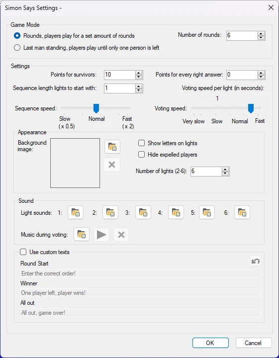
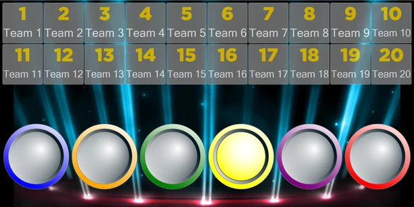
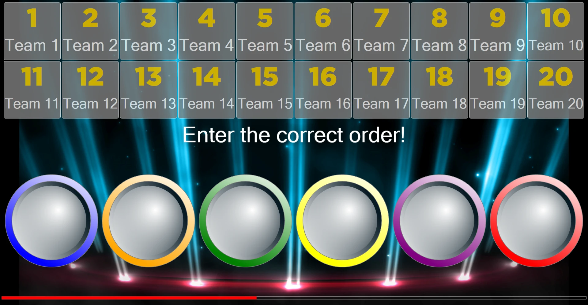
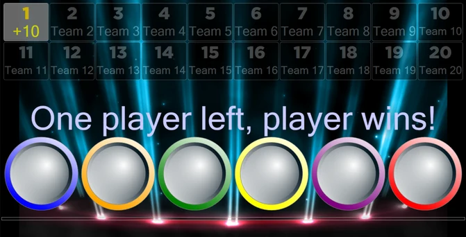

# Simon Says

En el minijuego Simon Says, el público participa en un juego que desafía a los jugadores a imitar una secuencia de luces cada vez más larga. Opciones de configuración disponibles:

{ width="323" loading=lazy }

- **Game Mode**. Hay 2 modos de juego: Rounds y Last Man Standing. En el modo Rounds, el juego termina después de un número determinado de rondas. En el modo Last Man Standing, el juego termina cuando no queda nadie o queda exactamente una persona.

- **Points**. Hay 2 maneras de ganar puntos como jugador. Los puntos para los supervivientes los ganan los jugadores que han sobrevivido a todas las rondas definidas en ‘number of rounds’ o que son el último jugador en pie. Los puntos definidos en ‘Points for every right answer’ se conceden a los jugadores que sobreviven a una ronda.

- **Sequence length lights to start with.** Indica cuántas luces se encienden al comienzo del juego.

- **Sequence Speed**. Indica la rapidez con la que se encienden las luces.

- **Voting Speed**. Indica de cuánto tiempo disponen los jugadores para introducir sus votos después de mostrarse una secuencia de luces.

- **Background Image**. Establece la imagen de fondo del juego.

- **Show letters on lights**. Indica si se muestran letras (A-F) en las luces.

- **Hide expelled players**. Oculta automáticamente a los jugadores que han perdido.

- **Number of lights**. Establece el número de luces del juego. Este número puede oscilar entre 2 y 6.

- **Light Sounds**. Se pueden configurar los sonidos que emite cada luz al encenderse. Cada sonido de luz (1-6) se puede establecer individualmente.

- **Voting music**. Establece la música que suena durante la votación.

- **Use custom texts**. Cambia los mensajes predeterminados que se muestran durante el juego.

  - Round start: el texto que se muestra cuando comienza una ronda.

  - Winner: el texto que se muestra cuando uno o varios jugadores han ganado.

  - All out: el texto que se muestra cuando todos han perdido.

El objetivo del juego es que, mientras se reproduce una secuencia de luces, los jugadores deben memorizarla.

{ loading=lazy }

Cuando termina de reproducirse la secuencia, los jugadores introducen la secuencia en su mando / pulsador / teléfono

{ loading=lazy }

Después, el sistema evalúa las respuestas y muestra los jugadores ganadores y perdedores. A continuación se añade una luz aleatoria a la secuencia y esta se reproduce de nuevo. Esto hace que el juego sea cada vez más difícil con el paso del tiempo.

En este juego (modo Last Man Standing), solo la respuesta del jugador 1 fue correcta. El jugador 1 gana el juego.

{ loading=lazy }
