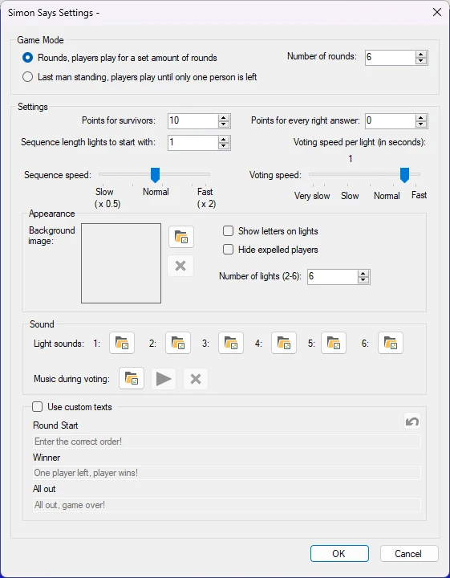
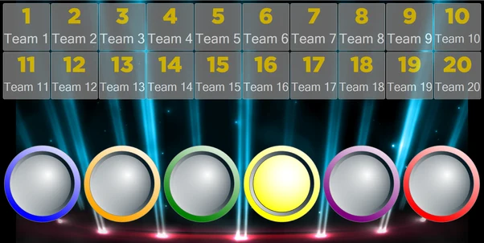
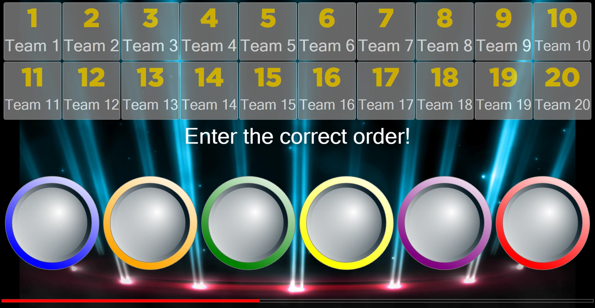
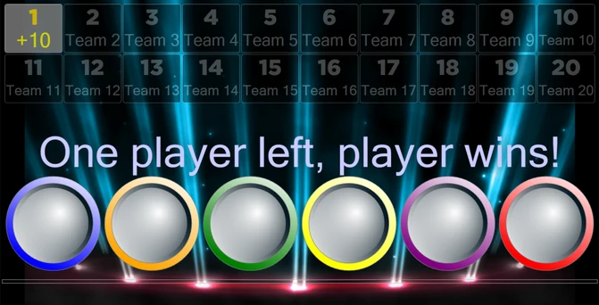

# Simon

Nel Modulo Gioco Simon Says, il pubblico partecipa a un gioco che sfida i giocatori a riprodurre una sequenza di luci sempre più lunga. Opzioni di configurazione disponibili:

{ width="323" loading=lazy }

- **Modalità di Gioco**. Esistono 2 modalità di gioco: Rounds e Ultimo Uomo. Nella modalità Rounds, il gioco termina dopo un numero stabilito di round. Nella modalità Last Man Standing, il gioco termina quando non rimane nessuno oppure esattamente una persona.

- **Points**. Esistono 2 modi per ottenere punti come giocatore. I punti per i sopravvissuti (Punti per i Sopravvissuti) vengono ottenuti dai giocatori che sono sopravvissuti a tutti i round definiti in ‘Numero Round’ oppure sono l'ultimo giocatore rimasto. I punti definiti in ‘Punti per ogni Risposta Esatta’ vengono assegnati ai giocatori che sopravvivono a un round.

- **Lunghezza sequenza luci Iniziale.** Indica quante luci si accendono all'inizio del gioco.

- **Velocità Sequenza**. Indica la velocità con cui le luci si accendono.

- **Velocità Voto**. Indica il tempo a disposizione dei giocatori per inserire i propri voti dopo che è stata mostrata una sequenza di luci.

- **Immagine Sfondo**. Imposta l'immagine di sfondo del gioco.

- **Mostra Lettere sulle Luci**. Indica se mostrare le lettere (A-F) sulle luci.

- **Nascondi Giocatori Eliminati**. Nasconde automaticamente i giocatori che hanno perso.

- **Numero Luci**. Imposta il numero di luci del gioco. Questo numero può variare da 2 a 6.

- **Audio Luci**. È possibile configurare i suoni emessi da ciascuna luce quando si accende. Ogni suono delle luci (1-6) può essere impostato singolarmente.

- **Audio durante la Votazione**. Imposta la musica riprodotta durante la votazione.

- **Usa Testi Personalizzati**. Modifica i messaggi predefiniti mostrati durante il gioco.

  - Inizio Round: il testo mostrato all'inizio di un round.

  - Winner: il testo mostrato quando uno o più giocatori hanno vinto.

  - Tutti Eliminati: il testo mostrato quando tutti hanno perso.

Lo scopo del gioco è che, mentre viene riprodotta una sequenza di luci, i giocatori devono memorizzarla.

{ loading=lazy }

Quando la sequenza è terminata, i giocatori inseriscono la sequenza sulla propria pulsantiera / buzzer / telefono

{ loading=lazy }

Successivamente, il sistema valuta le risposte e mostra i giocatori vincenti e perdenti. Poi una luce casuale viene aggiunta alla sequenza e la sequenza viene riprodotta di nuovo. In questo modo il gioco diventa sempre più difficile con il passare del tempo.

In questo gioco (modalità Ultimo Uomo), solo la risposta del giocatore 1 era corretta. Il giocatore 1 vince la partita.

{ loading=lazy }
