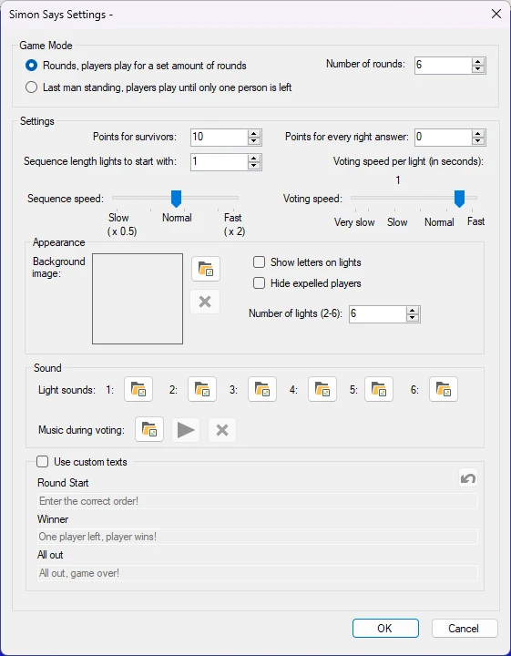
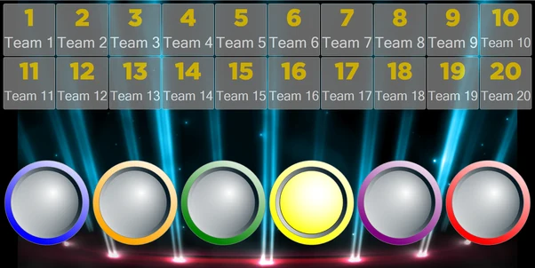
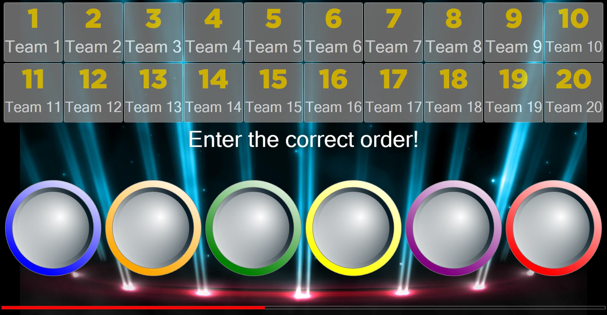
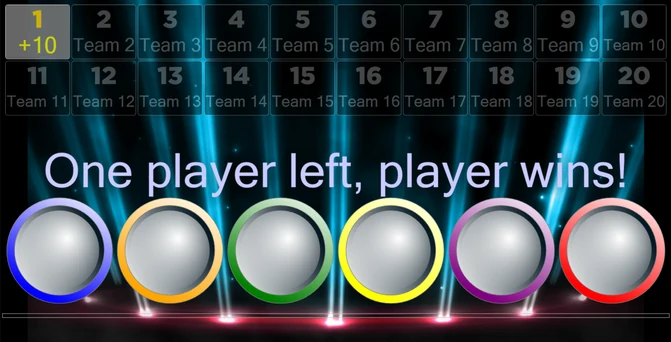

# Simon Says

In de minigame Simon Says speelt het publiek een spel dat spelers uitdaagt een steeds langere reeks lichtjes na te doen. Beschikbare configuratieopties:

{ width="323" loading=lazy }

- **Spelmodus**. Er zijn 2 spelmodi: Rondes en Laatste man. In de modus Rondes eindigt het spel na een vast aantal rondes. In de modus Laatste man eindigt het spel wanneer er niemand of precies één persoon over is.

- **Punten**. Er zijn 2 manieren om als speler punten te winnen. Punten voor overlevenden worden gewonnen door spelers die alle rondes hebben overleefd zoals ingesteld bij ‘aantal rondes’ of die als laatste overblijven. De punten die zijn ingesteld bij ‘Punten voor elk juist antwoord’ krijgen spelers die een ronde overleven.

- **Lengte van de lichtjesreeks waarmee wordt begonnen.** Geef aan hoeveel lichtjes er aan het begin van het spel oplichten.

- **Reekssnelheid**. Dit geeft aan hoe snel de lichtjes oplichten.

- **Stemsnelheid**. Dit geeft aan hoeveel tijd spelers hebben om hun stem in te voeren nadat een lichtreeks is getoond.

- **Achtergrond afbeelding**. Stel de achtergrondafbeelding van het spel in.

- **Letters op lichtjes tonen**. Geeft aan of letters (A-F) op de lichtjes worden getoond.

- **Verwijderde spelers verbergen**. Hiermee worden de spelers die hebben verloren automatisch verborgen.

- **Aantal lichtjes**. Hiermee stelt u het aantal lichtjes in het spel in. Dit aantal kan variëren van 2 tot 6.

- **Lichtgeluiden**. Het geluid dat elk lichtje maakt wanneer het oplicht, kan worden ingesteld. Elk lichtgeluid (1-6) kan afzonderlijk worden ingesteld.

- **Stemmuziek**. Stelt de muziek in die tijdens het stemmen wordt afgespeeld.

- **Eigen teksten gebruiken**. Wijzig de standaardberichten die tijdens het spel worden getoond.

  - Start ronde: de tekst die wordt getoond wanneer een ronde begint.

  - Winnaar: de tekst die wordt getoond wanneer een of meer spelers hebben gewonnen.

  - Allemaal uit: de tekst die wordt getoond wanneer iedereen heeft verloren.

Het doel van het spel is dat spelers een lichtreeks die wordt afgespeeld, moeten onthouden.

{ loading=lazy }

Wanneer de reeks is afgespeeld, voeren spelers de reeks in op hun keypad / buzzer / telefoon.

{ loading=lazy }

Daarna beoordeelt het systeem de antwoorden en toont het de winnende en verliezende spelers. Vervolgens wordt een willekeurig lichtje aan de reeks toegevoegd en wordt de reeks opnieuw afgespeeld. Hierdoor wordt het spel naarmate de tijd verstrijkt steeds moeilijker.

In dit spel (modus Laatste man) was alleen het antwoord van speler 1 juist. Speler 1 wint het spel.

{ loading=lazy }
