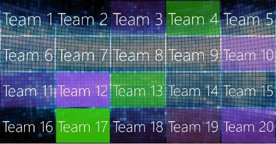

# Il modulo Randomizer

Il Randomizer di QuizXpress può essere utilizzato per estrarre a caso uno o più giocatori/squadre dal pubblico, ad esempio per sorteggiare un premio, organizzare una gara di karaoke, fare un gioco o qualsiasi altra cosa che completi la vostra serata di gameshow.

Invece di selezionare dei giocatori, è anche possibile far selezionare al Randomizer uno o più numeri da un intervallo, da un elenco separato da virgole o da un file di testo: in pratica è possibile estrarre qualsiasi cosa!

Quando si estraggono dei giocatori, è anche possibile far vincere loro un determinato numero di punti.

È possibile specificare quanti elementi estrarre per ogni esecuzione, nonché il numero di esecuzioni che il Randomizer effettuerà. Quando si esegue più di una volta, è possibile scegliere di escludere gli elementi già estratti. È anche possibile mostrare sullo schermo un elenco degli elementi estratti in precedenza.

Quando è in esecuzione, il Randomizer mostra prima un'animazione (sono disponibili due stili configurabili) di tutti i nomi delle squadre, poi estrae e presenta i risultati al comando del conduttore del quiz (barra spaziatrice, oppure tramite il telecomando del conduttore del quiz). Sono disponibili le seguenti opzioni di configurazione:

Per l'animazione, è possibile scegliere tra una griglia colorata statica o un'animazione di nomi di squadre fluttuanti:

{ width="275" loading=lazy }{ width="300" loading=lazy }

È possibile estrarre da un sottoinsieme dell'intero pubblico (tramite una finestra di selezione) oppure includere tutto il pubblico (nessuna selezione manuale necessaria)

Nella sezione ‘Appearance’ è possibile configurare l'immagine di sfondo da mostrare. La sezione ‘Music’ consente di specificare suoni diversi per l'animazione e per il momento in cui è stata effettuata la selezione.
