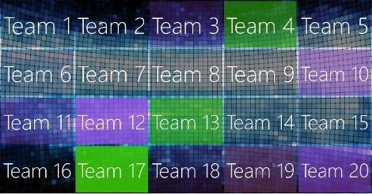

# De Randomizer-module

De QuizXpress Randomizer kan worden gebruikt om willekeurig een of meer spelers/teams uit het publiek te trekken — bijvoorbeeld om een prijs te verloten, een karaokewedstrijd te houden, een spel te spelen of iets anders te doen om uw spelshowavond compleet te maken.

In plaats van spelers te selecteren, kunt u de Randomizer ook een of meer getallen laten kiezen uit een bereik, uit een door komma’s gescheiden lijst of uit een tekstbestand — u kunt dus in feite alles trekken!

Bij het trekken van spelers kunt u de spelers ook een opgegeven aantal punten laten winnen.

U kunt opgeven hoeveel items per trekking worden getrokken en hoeveel trekkingen de Randomizer uitvoert. Bij meer dan één trekking kunt u ervoor kiezen eerder getrokken items uit te sluiten. U kunt ook een lijst met eerder getrokken items op het scherm tonen.

Tijdens het uitvoeren toont de Randomizer eerst een animatie (er zijn twee instelbare stijlen beschikbaar) van alle teamnamen, waarna op commando van de quizmaster (spatiebalk, of met de afstandsbediening van de quizmaster) de resultaten worden getrokken en gepresenteerd. De volgende configuratieopties zijn beschikbaar:

Voor de animatie kunt u kiezen tussen een statisch, kleurrijk raster of een animatie met zwevende teamnamen:

{ width="275" loading=lazy }{ width="300" loading=lazy }

U kunt trekken uit een deel van het gehele publiek (via een selectievenster) of het hele publiek meenemen (geen handmatige selectie nodig).

In het gedeelte ‘Weergave’ kunt u de achtergrondafbeelding instellen die wordt getoond. In het gedeelte ‘Muziek’ kunt u verschillende geluiden opgeven voor de animatie en voor het moment dat de selectie is gemaakt.
