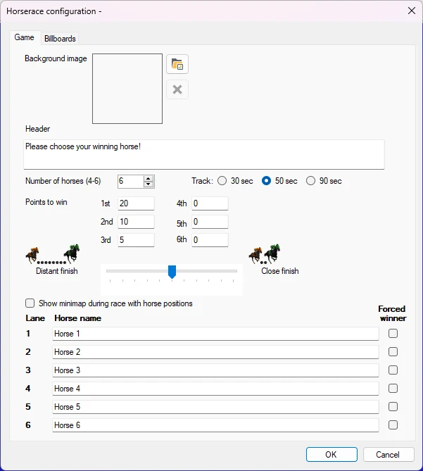
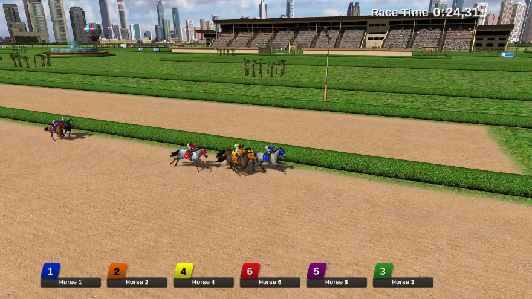

# Carrera de caballos virtual

En el juego de carreras de caballos, cada jugador apuesta por un caballo con su dispositivo de mano, tras lo cual se disputa una carrera con un resultado aleatorio. Los puntos se añaden en función del resultado de la carrera.

El módulo Virtual Horserace tiene las siguientes opciones de configuración:

- Background image: seleccione la imagen de fondo que se muestra en la pantalla donde los jugadores eligen el caballo ganador

- Header: texto que se muestra en la pantalla donde los jugadores eligen el caballo ganador. Number of horses: elija el número de caballos que participan en la carrera

- Track: elija entre distintas longitudes de pista, que duran aproximadamente 30, 50 o 90 segundos

- Points to win: puntos que se pueden ganar según las distintas clasificaciones

- Distant finish – close finish: elija aquí si los caballos deben llegar a la meta muy juntos o muy separados

- Show mini map during the race with horse positions: muestra una pequeña vista general en la esquina superior derecha durante una carrera de caballos con las posiciones de los caballos

> { width="436" loading=lazy }

- Horse names: aquí puede introducir los nombres de los caballos

- Pestaña Billboards: hay cuatro vallas publicitarias junto a la pista. Puede elegir sus propias imágenes para mostrarlas en estas vallas

- Forced winner: puede indicar qué caballo ganará

A continuación puede ver una imagen del juego de carreras de caballos en acción.

{ width="601" loading=lazy }

Para avanzar por los distintos pasos de la carrera de caballos (los jugadores eligen un caballo, ir a la salida, iniciar la carrera), basta con pulsar el botón ‘Next’ del panel del lado izquierdo.
