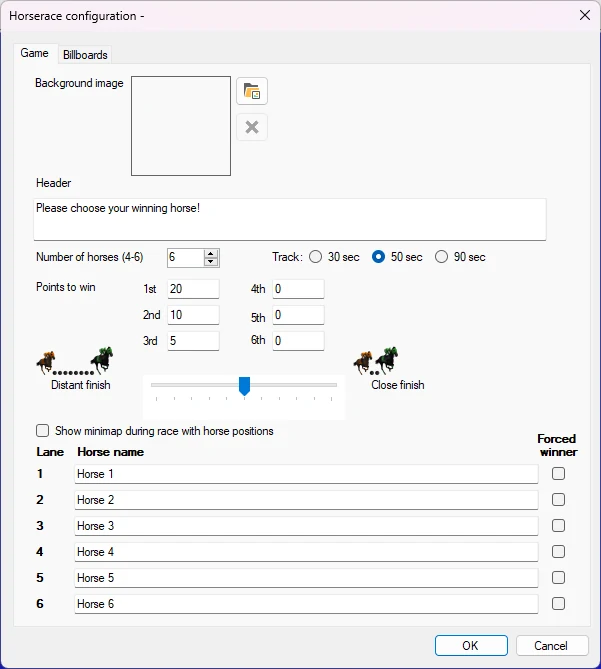
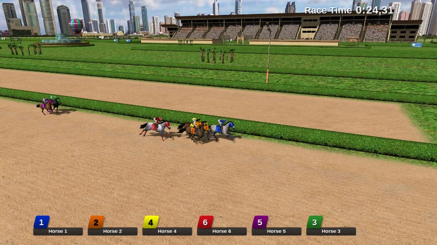

# Virtuele paardenrace

In het paardenracespel wedt elke speler op een paard met zijn of haar handheld, waarna een race wordt gelopen met een willekeurige uitkomst. Op basis van de uitkomst van de race worden punten toegekend.

De module Virtuele paardenrace heeft de volgende configuratieopties:

- Achtergrond afbeelding: selecteer de achtergrondafbeelding die wordt getoond op het scherm waar de spelers het winnende paard kiezen

- Koptekst: tekst die wordt getoond op het scherm waar de spelers het winnende paard kiezen. Aantal paarden: kies het aantal paarden dat aan de race deelneemt

- Baan: kies uit verschillende baanlengtes die ongeveer 30, 50 of 90 seconden duren

- Te winnen punten: punten die kunnen worden gewonnen voor de verschillende plaatsen

- Ver uit elkaar – dicht bij elkaar finishen: kies hier of de paarden dicht bij elkaar of ver uit elkaar moeten finishen

- Minikaart tijdens de race met de posities van de paarden tonen: toont tijdens een paardenrace rechtsboven een klein overzicht met de posities van de paarden

> { width="436" loading=lazy }

- Paardennamen: hier kunt u de namen van de paarden invoeren

- Tabblad Reclameborden: naast de renbaan staan vier reclameborden. U kunt uw eigen afbeeldingen kiezen die op deze reclameborden worden getoond

- Winnaar afdwingen: u kunt aangeven welk paard zal winnen

Hieronder ziet u een afbeelding van het paardenracespel in actie.

{ width="601" loading=lazy }

Om de verschillende stappen van de paardenrace te doorlopen (spelers kiezen een paard, ga naar de start, start de race) drukt u gewoon op de knop ‘Volgende’ in het linkerpaneel.
