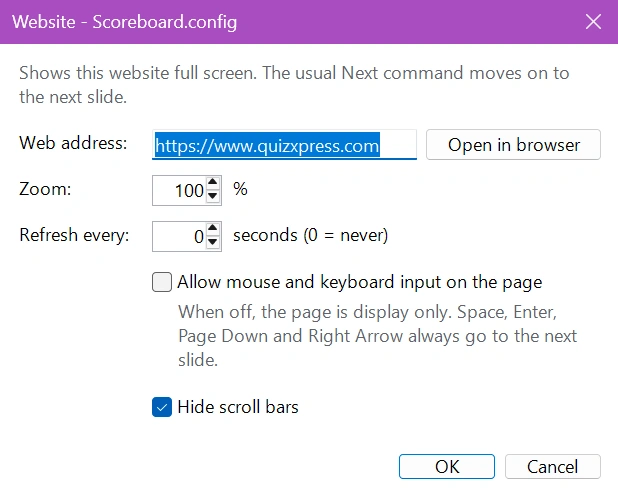

# Sito Web

Il modulo Sito Web mostra a schermo intero un sito web a scelta durante il quiz. Si può usare per la pagina di uno sponsor, una classifica o una pagina di risultati in tempo reale, un sondaggio, un social wall o qualsiasi altra pagina da far vedere al pubblico. Il quiz continua come sempre: il normale comando 'Prossimo' passa alla diapositiva successiva.

Aggiungere al quiz una diapositiva Modulo Gioco, selezionare 'Sito Web' e scegliere 'Configura...' per inserire l'indirizzo web. Ogni configurazione ha il proprio indirizzo web, quindi si può mostrare un sito diverso in ogni diapositiva. Il modulo Sito Web è un plugin gratuito.

!!! note
    Il modulo Sito Web usa Microsoft Edge WebView2 Runtime, che fa parte di Windows 10 e Windows 11. Se manca, la finestra delle impostazioni mostra un avviso e il pubblico vede uno schermo nero al posto del sito web.

**Impostazioni del modulo Sito Web:**

{ width="400" loading=lazy }

**Indirizzo Web**

L'indirizzo del sito web da mostrare, per esempio `https://www.quizxpress.it`. Si può omettere `https://`: anche `quizxpress.it` funziona. Si può mostrare anche una pagina web salvata sul computer (un file `.html`), inserendone il percorso completo. Fare clic su 'Apri nel Browser' per controllare la pagina nel normale browser.

**Zoom**

Ingrandisce o riduce la pagina, dal 25% al 500%. Aumentare lo zoom per rendere la pagina leggibile anche dal fondo della sala, ridurlo per far entrare sullo schermo una parte più grande della pagina.

**Aggiorna Ogni**

Ricarica la pagina in automatico ogni tot secondi, per esempio per una classifica o una pagina di risultati in tempo reale. Impostare 0 per non aggiornarla mai. Una pagina che non si è potuta caricare viene riprovata a ogni aggiornamento.

**Consenti l'uso di mouse e tastiera nella pagina**

Quando questa opzione è disattivata (impostazione predefinita), la pagina viene solo mostrata: clic, scorrimento e digitazione sulla pagina non hanno effetto, e ogni tasto va a QuizXpress Live. Attivarla quando durante lo show si vuole fare clic, scorrere o compilare la pagina, per esempio per accettare un avviso sui cookie o per accedere con le proprie credenziali. Mentre si scrive in un campo della pagina, i tasti restano nella pagina.

**Nascondi Barre di Scorrimento**

Nasconde le barre di scorrimento della pagina, così lo schermo resta pulito. Attiva per impostazione predefinita.

## Durante lo show

Quando il quiz arriva alla diapositiva Sito Web, il sito web viene mostrato a schermo intero. Per passare alla diapositiva successiva si usa uno dei soliti comandi:

- Spazio, Invio, Pag giù o il tasto freccia destra (anche dopo aver fatto clic nella pagina),
- il pulsante 'Prossimo' in QuizXpress Director,
- la pulsantiera Master.

Per caricare di nuovo la pagina, premere F5 o fare clic su 'Ricarica' in QuizXpress Director.

Se il sito web non si può caricare, per esempio perché manca la connessione a internet, il pubblico vede uno schermo nero al posto di un messaggio di errore. Basta passare alla diapositiva successiva.

!!! tip
    Il modulo Sito Web ricorda accessi e cookie da uno show all'altro. Se un sito web richiede l'accesso o mostra un avviso sui cookie, attivare una volta 'Consenti l'uso di mouse e tastiera nella pagina', accedere o accettare l'avviso, e poi disattivare di nuovo l'opzione.
