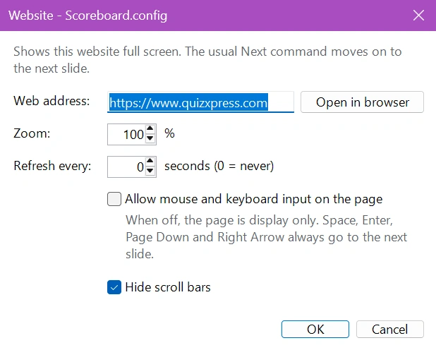

# Website

The Website module shows a website of your choice full screen during your quiz. Use it for a sponsor page, a live scoreboard or results page, a poll, a social media wall or any other page you want your audience to see. The quiz keeps running as usual: the normal 'Next' command moves on to the next slide.

Add a mini game slide to your quiz, select 'Website' and click 'Configure' to enter the web address. Every configuration has its own web address, so you can show a different website on every slide. The Website module is a free plugin.

!!! note
    The Website module uses the Microsoft Edge WebView2 Runtime, which is part of Windows 10 and Windows 11. If it is missing, the settings window shows a warning and the audience sees a black screen instead of the website.

**Website settings:**

{ width="400" loading=lazy }

**Web address**

The address of the website to show, for example `https://www.quizxpress.com`. You can leave out `https://`: `quizxpress.com` works as well. A web page stored on your computer (an `.html` file) can also be shown by entering its full path. Click 'Open in browser' to check the page in your normal web browser.

**Zoom**

Enlarges or reduces the page, from 25% to 500%. Increase the zoom to make a page readable from the back of the room, reduce it to fit more of the page on the screen.

**Refresh every**

Reloads the page automatically every set number of seconds, for example for a live scoreboard or results page. Set it to 0 to never refresh. A page that could not be loaded is tried again at every refresh.

**Allow mouse and keyboard input on the page**

When this option is off (the default), the page is display only: clicking, scrolling and typing on the page have no effect, and every key goes to Quiz Show. Turn it on when you want to click, scroll or fill in the page during the show, for example to accept a cookie notice or to log in. While you type in a field on the page, your keys stay in the page.

**Hide scroll bars**

Hides the scroll bars of the page so the screen looks clean. On by default.

## During the show

When the quiz reaches the Website slide, the website is shown full screen. To move on to the next slide, use any of the usual commands:

- Space, Enter, Page Down or the right arrow key (also when you have clicked in the page),
- the 'Next' button in QuizXpress Director,
- the quizmaster remote.

To load the page again, press F5 or click 'Reload' in QuizXpress Director.

If the website cannot be loaded, for example because there is no internet connection, the audience sees a black screen instead of an error message. Simply move on to the next slide.

!!! tip
    The Website module remembers logins and cookies between shows. If a website needs a login or shows a cookie notice, turn on 'Allow mouse and keyboard input on the page' once, log in or accept the notice, and turn the option off again.
