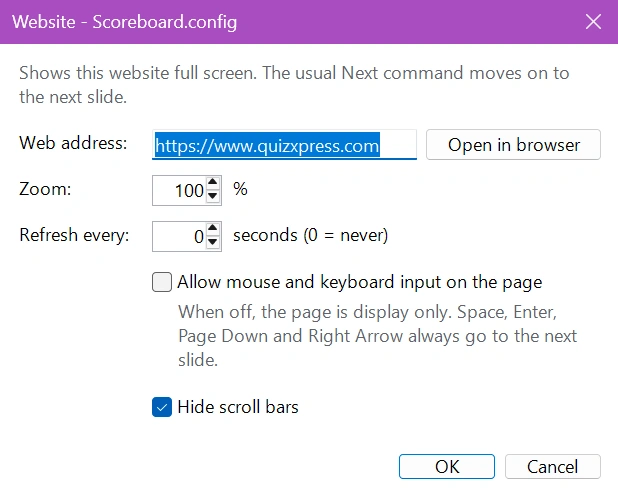

# Website

De module Website toont tijdens uw quiz een website naar keuze schermvullend. Gebruik de module voor een sponsorpagina, een live scorebord of resultatenpagina, een poll, een socialmediawall of een andere pagina die uw publiek moet zien. De quiz loopt gewoon door: met het normale commando ‘Volgende’ gaat u naar de volgende dia.

Voeg een minigamedia toe aan uw quiz, selecteer ‘Website’ en klik op ‘Configureren’ om het webadres in te voeren. Elke configuratie heeft een eigen webadres, zodat u op elke dia een andere website kunt tonen. De module Website is een gratis plug-in.

!!! note
    De module Website gebruikt de Microsoft Edge WebView2 Runtime, die deel uitmaakt van Windows 10 en Windows 11. Als deze ontbreekt, toont het instellingenvenster een waarschuwing en ziet het publiek een zwart scherm in plaats van de website.

**Website-instellingen:**

{ width="400" loading=lazy }

**Webadres**

Het adres van de website die moet worden getoond, bijvoorbeeld `https://www.quizxpress.com`. U kunt `https://` weglaten: `quizxpress.com` werkt ook. Een webpagina die op uw computer is opgeslagen (een `.html`-bestand) kunt u ook tonen door het volledige pad in te voeren. Klik op ‘Openen in browser’ om de pagina in uw gewone webbrowser te controleren.

**Zoom**

Vergroot of verkleint de pagina, van 25% tot 500%. Verhoog de zoom om een pagina leesbaar te maken vanaf de achterkant van de zaal, verlaag de zoom om meer van de pagina op het scherm te laten passen.

**Vernieuwen elke**

Laadt de pagina automatisch opnieuw na elk ingesteld aantal seconden, bijvoorbeeld voor een live scorebord of resultatenpagina. Stel in op 0 om nooit te vernieuwen. Een pagina die niet kon worden geladen, wordt bij elke vernieuwing opnieuw geprobeerd.

**Muis- en toetsenbordinvoer op de pagina toestaan**

Wanneer deze optie is uitgeschakeld (de standaardinstelling), is de pagina alleen om te bekijken: klikken, scrollen en typen op de pagina hebben geen effect en elke toets gaat naar Quiz Show. Schakel de optie in wanneer u tijdens de show wilt klikken, scrollen of de pagina wilt invullen, bijvoorbeeld om een cookiemelding te accepteren of om in te loggen. Terwijl u in een veld op de pagina typt, blijven uw toetsaanslagen in de pagina.

**Schuifbalken verbergen**

Verbergt de schuifbalken van de pagina zodat het scherm er netjes uitziet. Standaard ingeschakeld.

## Tijdens de show

Wanneer de quiz bij de dia Website komt, wordt de website schermvullend getoond. Om door te gaan naar de volgende dia gebruikt u een van de gebruikelijke commando’s:

- Space, Enter, Page Down of de pijl-rechts (ook wanneer u in de pagina hebt geklikt),
- de knop ‘Volgende’ in QuizXpress Director,
- de afstandsbediening van de quizmaster.

Om de pagina opnieuw te laden, drukt u op F5 of klikt u in QuizXpress Director op ‘Opnieuw laden’.

Als de website niet kan worden geladen, bijvoorbeeld omdat er geen internetverbinding is, ziet het publiek een zwart scherm in plaats van een foutmelding. Ga dan gewoon door naar de volgende dia.

!!! tip
    De module Website onthoudt aanmeldingen en cookies tussen shows. Als een website een aanmelding vereist of een cookiemelding toont, schakelt u eenmalig ‘Muis- en toetsenbordinvoer op de pagina toestaan’ in, meldt u zich aan of accepteert u de melding, en schakelt u de optie weer uit.
