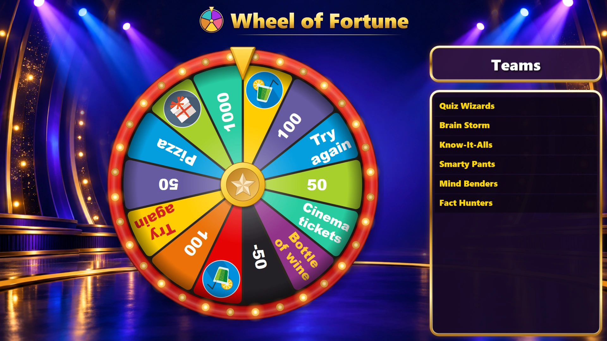
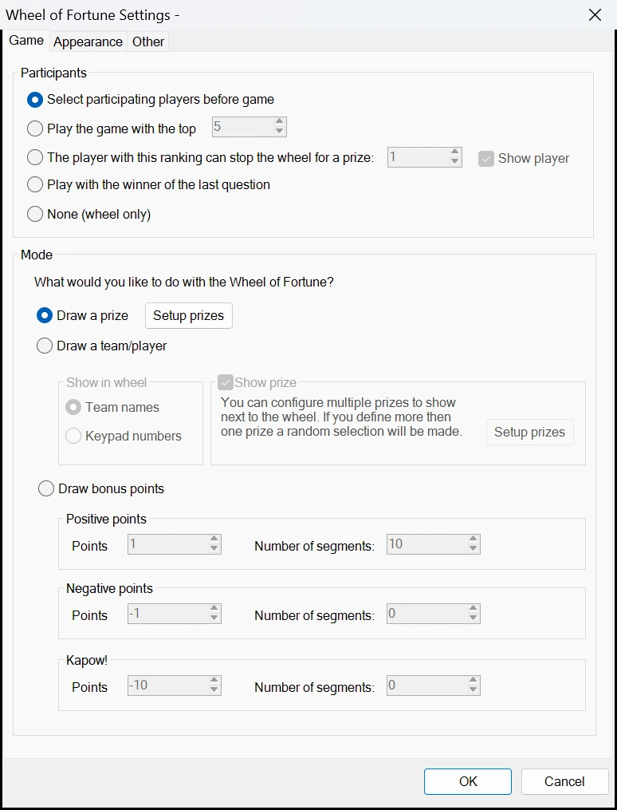
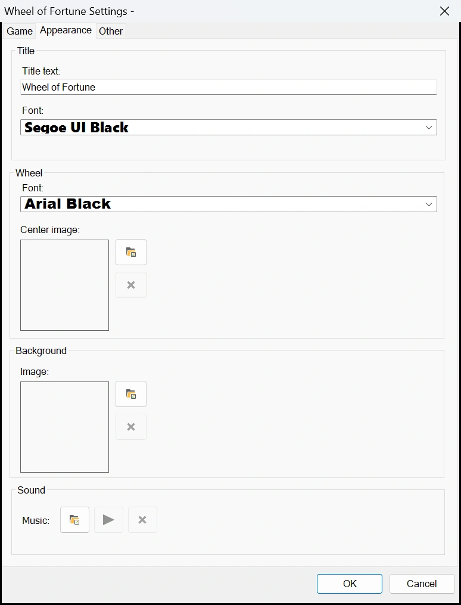
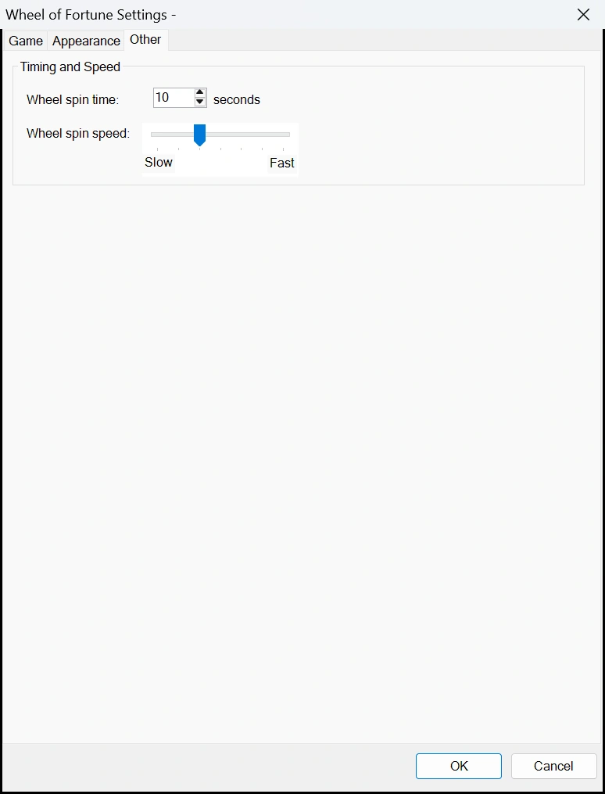
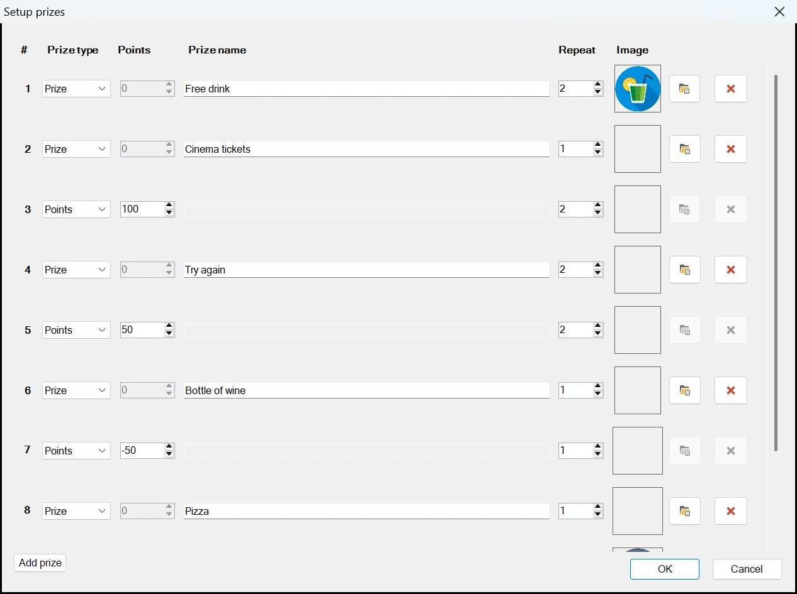
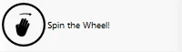
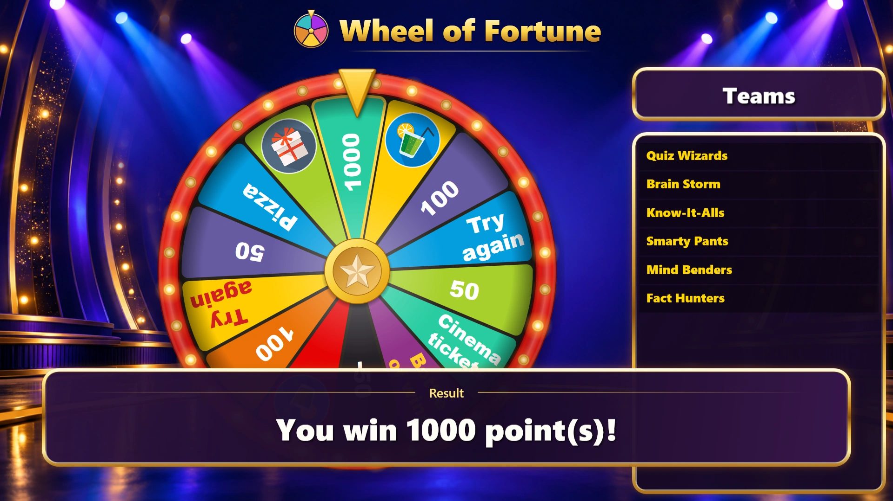
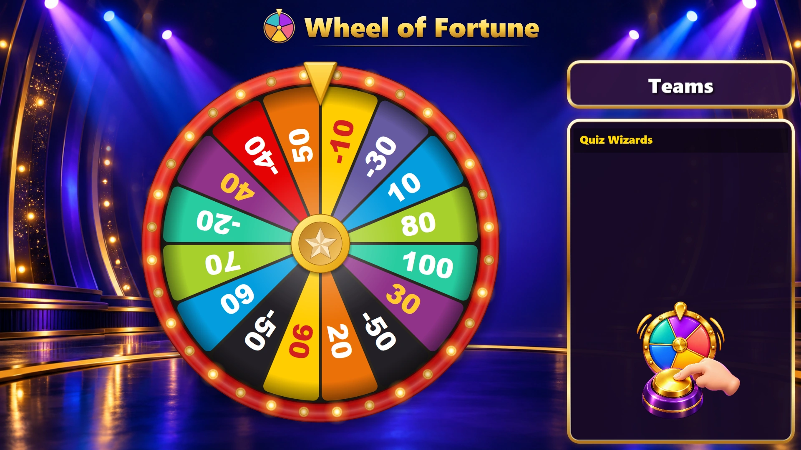
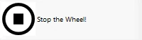

# Modulo Wheel of Fortune

Wheel of Fortune consente di far girare una ruota per estrarre un premio o dei punti per una squadra, oppure semplicemente per estrarre una squadra specifica.

{ loading=lazy }

Di seguito sono riportate le schermate di configurazione con le relative impostazioni predefinite:

| { width="240" loading=lazy } | { width="240" loading=lazy } | { width="240" loading=lazy } |
|---|---|---|

- Participants: scegliere chi gioca con la ruota.

    - ‘Select participating players before game’: i giocatori vengono selezionati sullo schermo del Director, subito prima dell'avvio della ruota.
    - ‘Play the game with the top’: giocano con la ruota il numero indicato di giocatori meglio classificati.
    - ‘The player with this ranking can stop the wheel for a prize’: un singolo giocatore di una certa posizione in classifica può fermare la ruota con il proprio keypad. Deselezionare ‘Show player’ per nascondere il pannello che mostra chi è questo giocatore.
    - ‘Play with the winner of the last question’: gioca con la ruota la squadra che ha dato per prima la risposta corretta alla domanda precedente. Se nessuno ha risposto correttamente a quella domanda, la ruota viene saltata.
    - ‘None (wheel only)’: viene mostrata solo la ruota, senza squadre. Utilizzare questa opzione per estrarre un premio per qualcuno presente in sala. I punti sulla ruota vengono mostrati, ma non assegnati a una squadra.

- Draw a prize: i premi (che possono anche essere punti positivi o negativi) vengono mostrati sulla ruota. Premendo il pulsante ‘Setup prizes’ è possibile configurare i premi, vedere [Impostare i premi](#impostare-i-premi).

- Draw a team/player: i partecipanti selezionati vengono distribuiti sulla ruota. In ‘Show in wheel’ si sceglie se la ruota mostra i nomi delle squadre o i numeri dei keypad. Il numero di segmenti della ruota può essere scelto selezionando un valore per ‘Number of segments’. Se la casella davanti a ‘Show prize’ è selezionata, i premi che si possono vincere (o perdere) vengono mostrati accanto alla ruota. Mentre la ruota gira, i premi si illuminano uno dopo l'altro. Quando la ruota si ferma su un giocatore/una squadra, il premio evidenziato viene vinto (o perso, nel caso di punti negativi). I premi (o i punti) possono essere definiti premendo il pulsante ‘Setup prizes’. Questa modalità non funziona in combinazione con l'opzione ‘stop the wheel’ nella sezione ‘participants’, poiché per il gioco ‘stop the wheel’ sono necessari dei premi sulla ruota, né con ‘None (wheel only)’.

- Draw bonus points: i punti positivi, negativi e Kapow! vengono distribuiti sulla ruota nel numero di segmenti indicato. Per i punti positivi e negativi, ogni segmento aumenta o diminuisce rispettivamente di valore (ad esempio: punti positivi di 1 con 5 segmenti danno i valori 1, 2, 3, 4 e 5; punti negativi di -2 con 4 segmenti danno i valori -2, -4, -6, -8). I punti Kapow! sono punti negativi fissi sul numero di segmenti specificato. I segmenti Kapow! sono quelli su cui i giocatori non vogliono fermarsi! Il numero totale di segmenti per la sezione ‘Draw bonus points’ non può superare 40.

- Scheda Appearance: impostare il testo del titolo del gioco, il carattere del titolo (usato anche per il pannello accanto alla ruota e per il risultato) e il carattere del testo sulla ruota. Scegliere un'immagine di sfondo e l'immagine mostrata al centro della ruota. Senza un'immagine centrale, la ruota mostra una stella dorata al centro. In ‘Sound’ è possibile scegliere una musica (un file MP3) che viene riprodotta mentre la ruota è sullo schermo.

- Scheda Other: impostare la velocità di rotazione della ruota e la durata della rotazione.

## Impostare i premi

{ loading=lazy }

Ogni riga è un premio:

- Prize type: ‘Prize’ per qualcosa da vincere, oppure ‘Points’ per vincere punti (o perderli, con un numero negativo).
- Points: il numero di punti per un premio ‘Points’. La ruota mostra questo numero.
- Prize name: il testo sulla ruota e nel messaggio per il vincitore.
- Repeat: il numero di segmenti che il premio occupa sulla ruota. Un premio che compare più di una volta viene distribuito sulla ruota.
- Image: un'immagine facoltativa, mostrata sulla ruota al posto del nome.

La finestra inizia con otto righe. Premere ‘Add prize’ per ottenere altre righe, fino a 40 premi. Le righe vuote oltre le prime otto vengono rimosse quando si preme ‘OK’. La ruota ha spazio per 40 segmenti in totale, oppure 24 quando i premi hanno un'immagine.

La stessa finestra consente di impostare i premi mostrati accanto alla ruota quando si estrae una squadra/un giocatore. La colonna ‘Repeat’ non viene utilizzata in quel caso.

!!! note
    Le versioni meno recenti di QuizXpress supportano solo otto premi. Giocare un quiz con più premi su un computer con la versione più recente.

## Giocare

Per far girare la ruota, premere il pulsante ‘Spin’ nel pannello a sinistra.

{ width="142" loading=lazy }

Mentre la ruota gira, le luci lungo il bordo si rincorrono. Quando la ruota si ferma, il segmento sotto l'indicatore lampeggia e mantiene un contorno dorato, e il risultato viene mostrato nella parte inferiore dello schermo.

{ loading=lazy }

Quando l'impostazione ‘Stop the wheel’ è attiva, il giocatore che può fermare la ruota con il proprio keypad è indicato nel pannello ‘Teams’ del gioco. Il buzzer sotto il nome vibra quando il giocatore preme il proprio keypad. La ruota può essere fermata anche premendo il pulsante ‘Stop the Wheel!’ (ma di solito non è necessario, poiché dovrebbe essere il giocatore a fermare la ruota).

{ loading=lazy }

{ width="143" loading=lazy }
