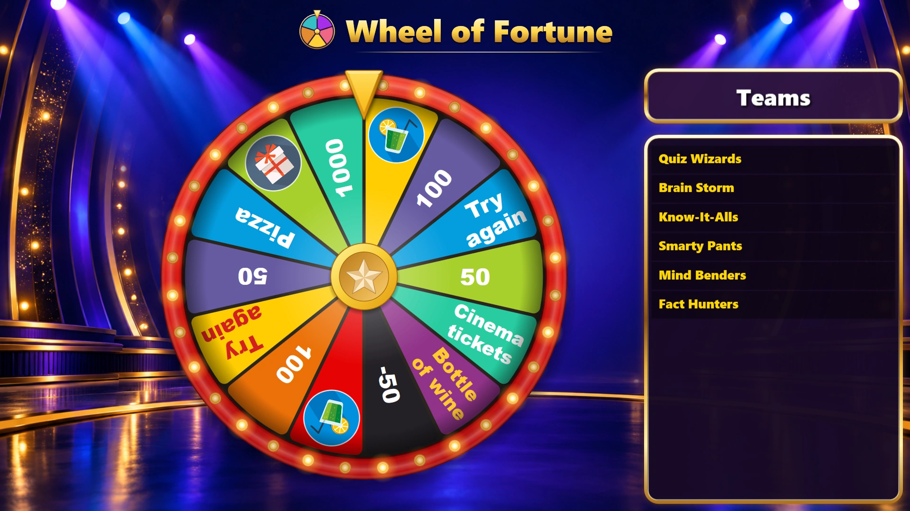
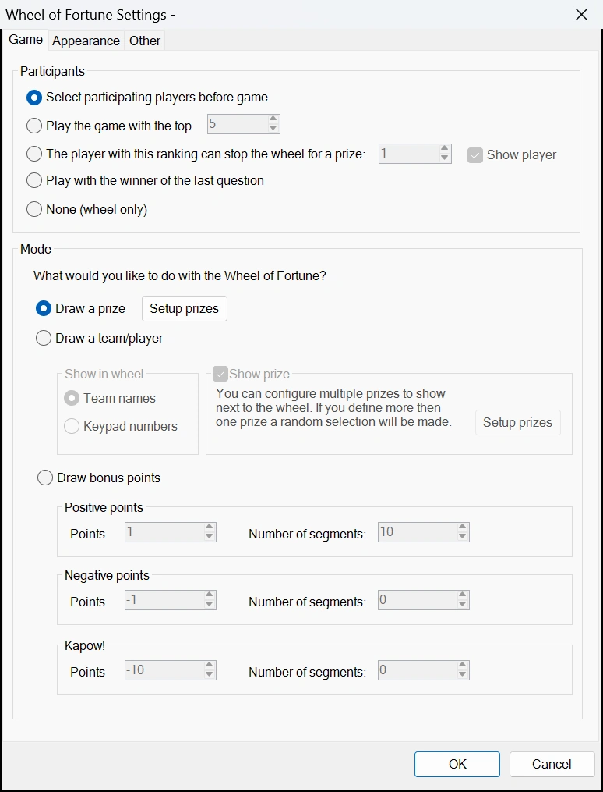
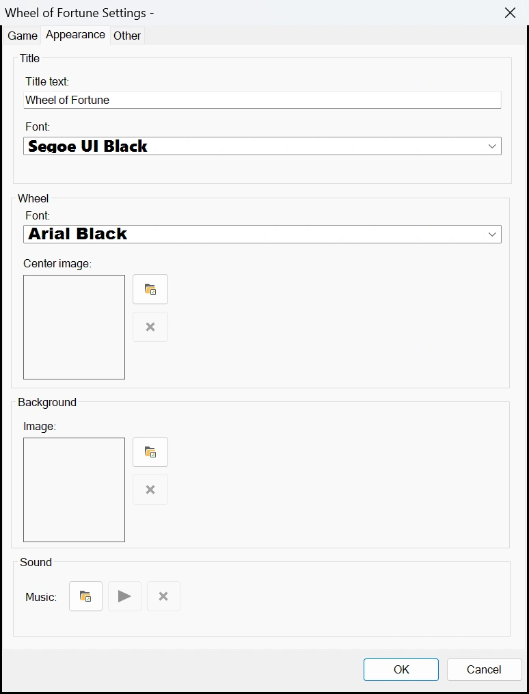
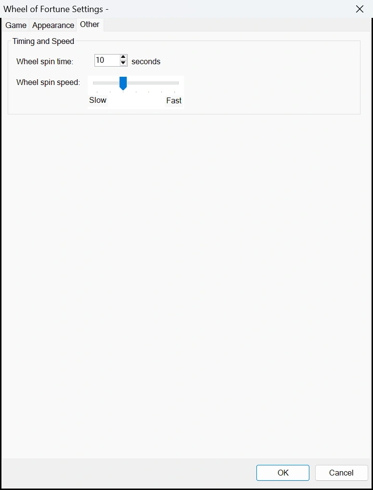
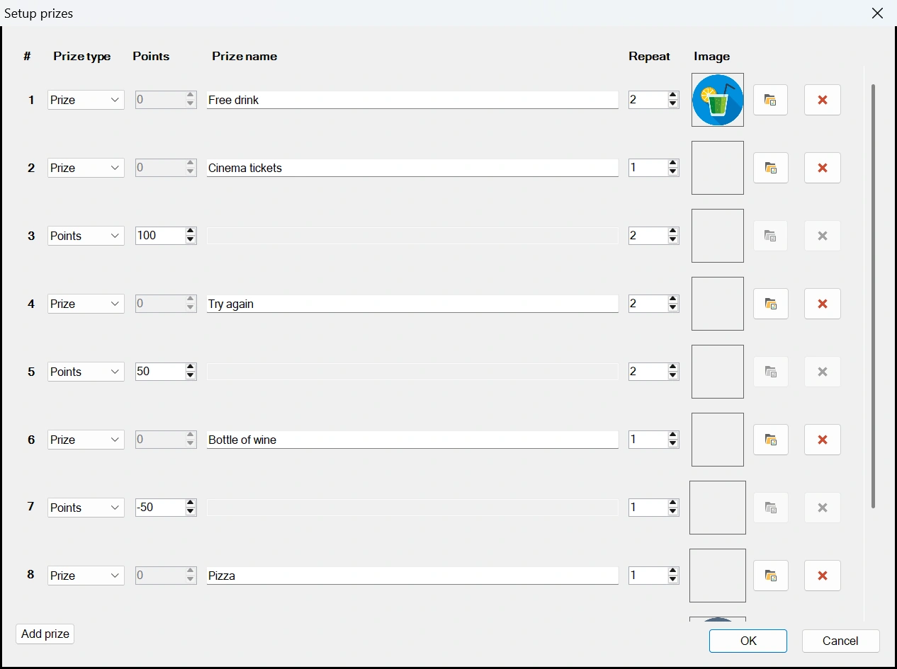
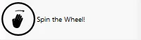
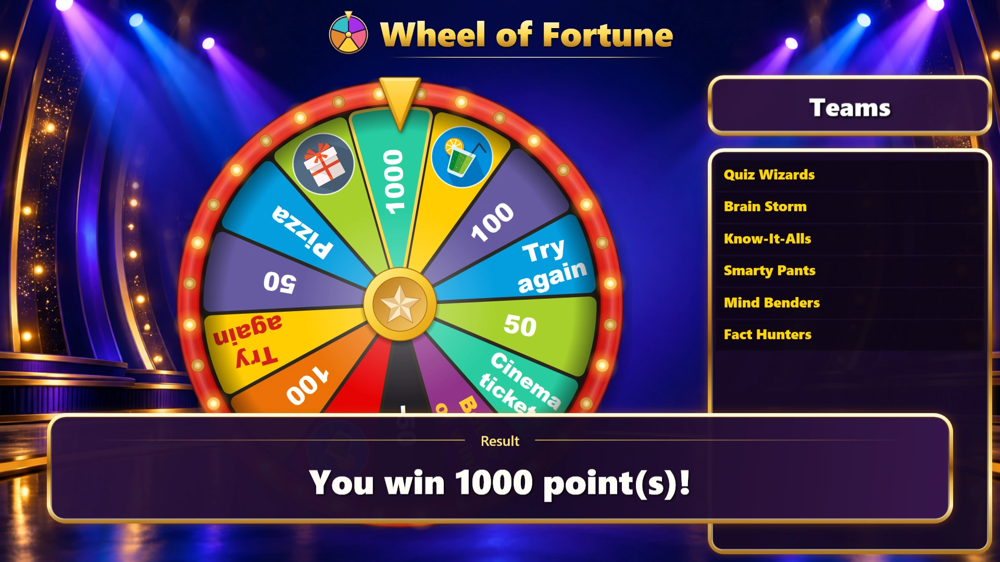
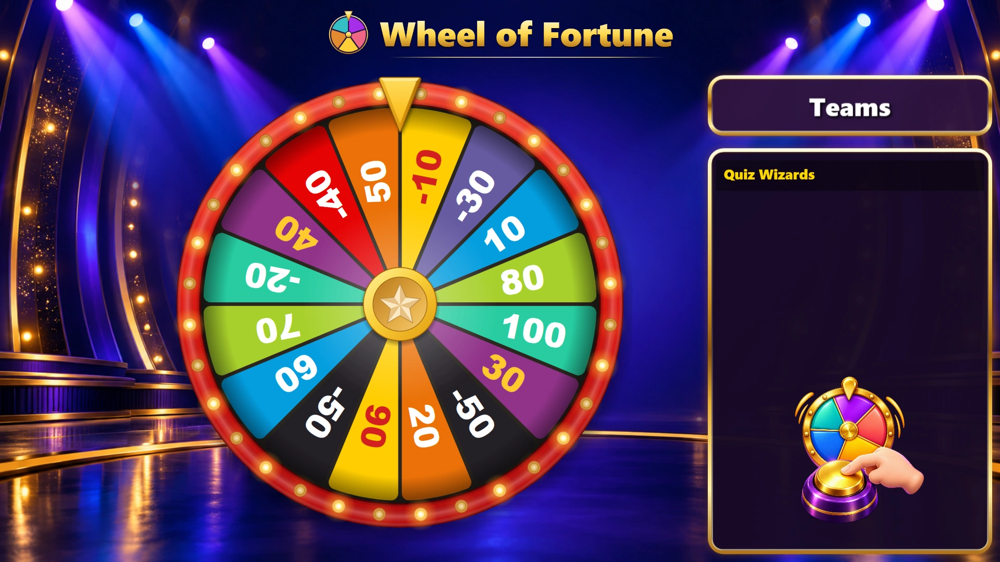
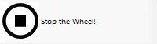

# Rad van Fortuin-module

Met het rad van fortuin kunt u aan een rad draaien om een prijs of punten voor een team te trekken, of gewoon een specifiek team te trekken.

{ loading=lazy }

Hieronder ziet u de configuratieschermen met hun standaardinstellingen:

| { width="240" loading=lazy } | { width="240" loading=lazy } | { width="240" loading=lazy } |
|---|---|---|

- Deelnemers: kies wie het rad speelt.

    - ‘Deelnemende spelers selecteren voor het spel’: u selecteert de spelers op het Director-scherm, vlak voordat het rad start.
    - ‘Speel het spel met de top’: het opgegeven aantal best geplaatste spelers speelt het rad.
    - ‘De speler met deze rangorde kan het rad stoppen voor een prijs’: een enkele speler met een bepaalde rangorde kan het rad met zijn of haar keypad stoppen. Schakel ‘Speler tonen’ uit om het paneel te verbergen waarin staat wie deze speler is.
    - ‘Spelen met de winnaar van de laatste vraag’: het team dat bij de vorige vraag als eerste het juiste antwoord gaf, speelt het rad. Als niemand die vraag juist heeft beantwoord, wordt het rad overgeslagen.
    - ‘Geen (alleen rad)’: alleen het rad wordt getoond, zonder teams. Gebruik dit om een prijs te trekken voor iemand in de zaal. Punten op het rad worden getoond, maar niet aan een team gegeven.

- Een prijs trekken: prijzen (die ook positieve of negatieve punten kunnen zijn) worden in het rad getoond. Met de knop ‘Prijzen instellen’ kunnen de prijzen worden geconfigureerd, zie [De prijzen instellen](#de-prijzen-instellen).

- Een team/speler trekken: de geselecteerde deelnemers worden over het rad verdeeld. Onder ‘Tonen in rad’ kiest u of het rad de teamnamen of de keypadnummers toont. Het aantal segmenten op het rad kunt u kiezen door een waarde voor ‘Aantal segmenten’ te selecteren. Als het vinkje bij ‘Prijs tonen’ is aangevinkt, worden prijzen die kunnen worden gewonnen (of verloren) naast het rad getoond. Terwijl het rad draait, lichten de prijzen na elkaar op. Wanneer het rad stopt bij een speler/team, is de gemarkeerde prijs gewonnen (of verloren, bij negatieve punten). Prijzen (of punten) kunnen worden ingesteld met de knop ‘Prijzen instellen’. Deze modus werkt niet in combinatie met de optie ‘het rad stoppen’ in het gedeelte ‘deelnemers’, omdat voor het spel ‘het rad stoppen’ prijzen op het rad nodig zijn, en ook niet met ‘Geen (alleen rad)’.

- Bonuspunten trekken: de positieve, negatieve en Kapow!-punten worden over het rad verdeeld in het aangegeven aantal segmenten. Bij positieve en negatieve punten neemt de waarde van elk segment respectievelijk toe of af (bijvoorbeeld: positieve punten van 1 met 5 segmenten geeft de waarden 1, 2, 3, 4 en 5; negatieve punten van -2 met 4 segmenten geven de waarden -2, -4, -6, -8). Kapow!-punten zijn negatieve punten die vast zijn over het opgegeven aantal segmenten. De Kapow!-segmenten zijn de segmenten waarop spelers liever niet terechtkomen! Het totale aantal segmenten voor het gedeelte ‘Bonuspunten trekken’ mag niet meer dan 40 bedragen.

- Tabblad Weergave: stel de titeltekst van het spel in, het lettertype van de titel (ook gebruikt voor het paneel naast het rad en voor het resultaat) en het lettertype van de tekst op het rad. Kies een achtergrondafbeelding en de afbeelding die in het midden van het rad wordt getoond. Zonder afbeelding in het midden toont het rad een gouden ster in het midden. Onder ‘Geluid’ kunt u muziek (een MP3-bestand) kiezen die wordt afgespeeld terwijl het rad op het scherm staat.

- Tabblad Overig: stel de draaisnelheid van het rad in, evenals de draaitijd.

## De prijzen instellen

{ loading=lazy }

Elke rij is een prijs:

- Prijs type: ‘Prijs’ voor iets om te winnen, of ‘Punten’ om punten te winnen (of te verliezen, met een negatief getal).
- Punten: het aantal punten voor een prijs van het type ‘Punten’. Het rad toont dit getal.
- Prijsnaam: de tekst op het rad en in het bericht voor de winnaar.
- Herhalen: het aantal segmenten dat de prijs op het rad krijgt. Een prijs die meer dan eens voorkomt, wordt over het rad verspreid.
- Afbeelding: een optionele afbeelding, die op het rad wordt getoond in plaats van de naam.

Het venster begint met acht rijen. Druk op ‘Prijs toevoegen’ voor meer rijen, tot maximaal 40 prijzen. Lege rijen na de eerste acht worden verwijderd wanneer u op ‘OK’ drukt. Het rad heeft in totaal ruimte voor 40 segmenten, of 24 wanneer prijzen een afbeelding hebben.

Hetzelfde venster stelt de prijzen in die naast het rad worden getoond wanneer u een team/speler trekt. De kolom ‘Herhalen’ wordt daar niet gebruikt.

!!! note
    Oudere versies van QuizXpress ondersteunen slechts acht prijzen. Speel een quiz met meer prijzen op een computer met de nieuwste versie.

## Het spel spelen

Om aan het rad te draaien, drukt u op de knop ‘Draaien’ in het linkerpaneel.

{ width="142" loading=lazy }

Terwijl het rad draait, lopen de lichtjes rond de rand mee. Wanneer het rad stopt, knippert het segment onder de wijzer en behoudt het een gouden omlijning, en wordt het resultaat onderaan het scherm getoond.

{ loading=lazy }

Wanneer de instelling ‘Het rad stoppen’ aan staat, wordt de speler die het rad met zijn of haar keypad kan stoppen aangegeven in het paneel ‘Teams’ in het spel. De buzzer onder de naam schudt wanneer de speler op zijn of haar keypad drukt. Het rad kan ook worden gestopt door op de knop ‘Stop het rad!’ te drukken (maar meestal is dit niet nodig, omdat de speler het rad zou moeten stoppen).

{ loading=lazy }

{ width="143" loading=lazy }
