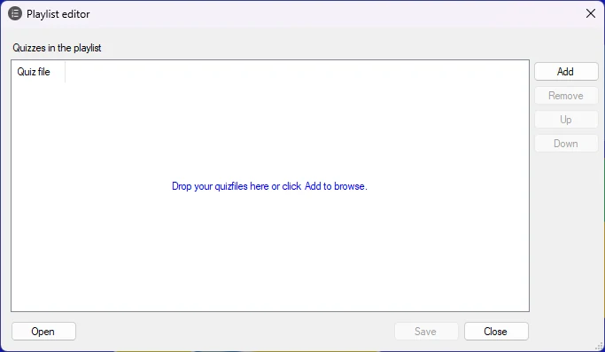

# Crear listas de reproducción

Puede crear y guardar listas de reproducción que contengan varios quizzes. Con las listas de reproducción, puede crear varios quizzes más pequeños y combinarlos en un quiz más grande.

Para crear una lista de reproducción, haga clic en el botón External de la cinta HOME y, a continuación, elija ‘Make playlist’.

{ width="474" loading=lazy }

Al hacer clic en el botón ‘Add’, puede añadir varios quizzes a la lista. Después de añadir los quizzes, puede cambiar su orden seleccionando un quiz de la lista y pulsando los botones ‘Up’ y ‘Down’.

Al pulsar el botón ‘Save’ se guarda la lista de reproducción en el disco. Las listas de reproducción tienen la extensión de archivo .qxp.

Al iniciar QuizXpress Live, el reproductor de quizzes, puede seleccionar un archivo de quiz (extensión .qx) o una lista de reproducción (extensión .qxp). Cuando selecciona una lista de reproducción, todos los quizzes que contiene se reproducen uno tras otro como si fueran un único quiz grande. Las puntuaciones se conservan entre los quizzes.

Como alternativa, puede seleccionar una lista de reproducción en el Explorador de Windows, hacer clic con el botón derecho sobre ella y elegir ‘Edit playlist’ para editarla con el editor de listas de reproducción, o elegir ‘Open with > QuizXpress Live’ para iniciar el reproductor de quizzes con la lista de reproducción.
