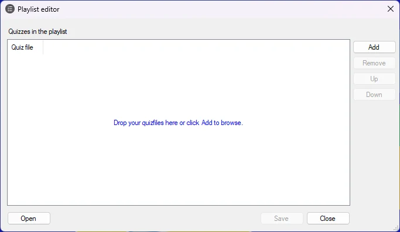

# Afspeellijsten maken

U kunt afspeellijsten maken en opslaan die meerdere quizzen bevatten. Met afspeellijsten kunt u meerdere kleinere quizzen maken en combineren tot één grotere quiz.

Om een afspeellijst te maken, klikt u op de knop Extern op het lint HOME en kiest u vervolgens ‘Afspeellijst maken’.

{ width="474" loading=lazy }

Met de knop ‘Toevoegen’ kunt u meerdere quizzen aan de lijst toevoegen. Na het toevoegen van de quizzen kunt u hun volgorde wijzigen door een quiz in de lijst te selecteren en op de knoppen ‘Omhoog’ en ‘Omlaag’ te drukken.

Met de knop ‘Opslaan’ slaat u de afspeellijst op schijf op. Afspeellijsten hebben de bestandsextensie .qxp.

Wanneer u QuizXpress Live, de quizspeler, start, kunt u een quizbestand (extensie .qx) of een afspeellijst (extensie .qxp) selecteren. Wanneer u een afspeellijst selecteert, worden alle quizzen erin na elkaar gespeeld alsof het één grote quiz is. Scores blijven behouden tussen quizzen.

U kunt ook een afspeellijst selecteren in Windows Verkenner, er met de rechtermuisknop op klikken en ‘Afspeellijst bewerken’ kiezen om deze te bewerken met de afspeellijsteditor, of ‘Openen met > QuizXpress Live’ kiezen om de quizspeler met de afspeellijst te starten.
