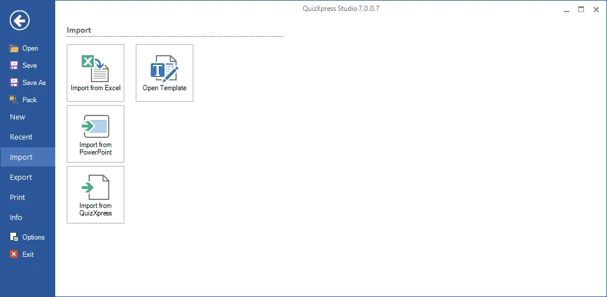
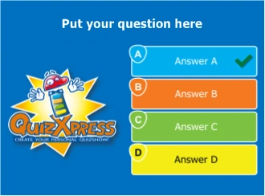
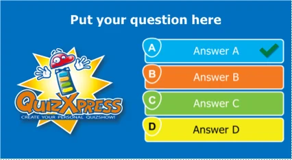
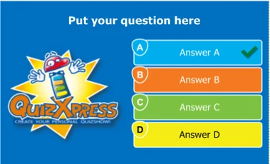

# Boîte de dialogue FILE → Options

L'accès à cette boîte de dialogue se trouve dans le menu backstage FILE :

{ width="605" loading=lazy }

L'onglet ‘Target device’ de cette boîte de dialogue vous permet de définir le format d'écran cible et la qualité d'image de votre quiz. L'option *ratio* configure le rapport largeur/hauteur de vos diapositives en fonction de l'appareil sur lequel vous présenterez votre quiz :

| { width="156" loading=lazy } | { width="213" loading=lazy } | { width="190" loading=lazy } |
|---------------------------------------------------------------------------------|---------------------------------------------------------------------------------|--------------------------------------------------------------------------------|
| 4:3                                                                             | 16:9                                                                            | 16:10                                                                          |

<table>
<colgroup>
<col style="width: 42%" />
<col style="width: 57%" />
</colgroup>
<thead>
<tr class="header">
<th></th>
<th>
Ainsi, par exemple, si vous comptez présenter votre quiz sur un téléviseur grand écran, utilisez le ratio 16:9 par défaut. Pour un ancien vidéoprojecteur, utilisez le ratio 4:3. Vous pouvez modifier le ratio après avoir créé votre quiz, et le système redimensionnera automatiquement toutes vos diapositives.

L'option Quality contrôle la résolution d'image que QuizXpress utilise en interne pour afficher une diapositive dans Quiz Show (le nombre physique de pixels utilisés pour l'image de la diapositive). Vous pouvez la régler sur ‘High quality’ ou ‘Ultra high quality’ si vous présentez votre quiz sur un appareil haute résolution (comme un écran LCD Full HD) et que vous disposez d'une carte vidéo/d'un PC puissant avec suffisamment de mémoire.
</th>
</tr>
</thead>
<tbody>
</tbody>
</table>

<table>
<colgroup>
<col style="width: 42%" />
<col style="width: 57%" />
</colgroup>
<thead>
<tr class="header">
<th></th>
<th>
Dans l'onglet ‘Protection’, une date d'expiration peut être définie pour le quiz. Après cette date, le quiz ne peut plus être joué par QuizXpress Live.

Vous pouvez également protéger votre quiz avec la clé DRM (Digital Rights Management) de votre client cible. Dans ce cas, le contenu du quiz ne peut pas être copié ni exécuté sur une autre machine. La clé DRM de votre client peut être obtenue dans l'onglet ‘Info’ du menu backstage sur son PC (dans la section License Info).
</th>
</tr>
</thead>
<tbody>
</tbody>
</table>

La section de détails ‘Quiz Author’ affiche l'historique du fichier de quiz : qui l'a créé à l'origine et qui l'a modifié en dernier. Ces informations sont utilisées, par exemple, lorsqu'un fichier de quiz a expiré et que votre utilisateur final se voit présenter des coordonnées pour obtenir une mise à jour récente. Vos propres informations d'auteur de quiz peuvent être saisies dans la boîte de dialogue ‘Options’ (disponible dans le ruban HOME).

Enfin, l'onglet ‘Advanced’ vous permet de définir des propriétés avancées pour le quiz. ‘QX3 compatible video rendering’ signifie que le système utilise le système vidéo présent dans QX3. Vous pouvez souhaiter l'utiliser car il peut offrir de meilleures performances sur des systèmes d'entrée de gamme comme les netbooks. L'inconvénient est qu'il ne prend en charge que le format AVI et que vous ne pouvez pas utiliser d'effets vidéo. Ce paramètre s'applique à l'ensemble du quiz ; veillez donc à ne pas utiliser d'autres formats vidéo dans votre quiz (si vous le faites, un avertissement est généré au démarrage de QuizXpress Live). *Vous aurez rarement besoin d'activer cette fonction.*
