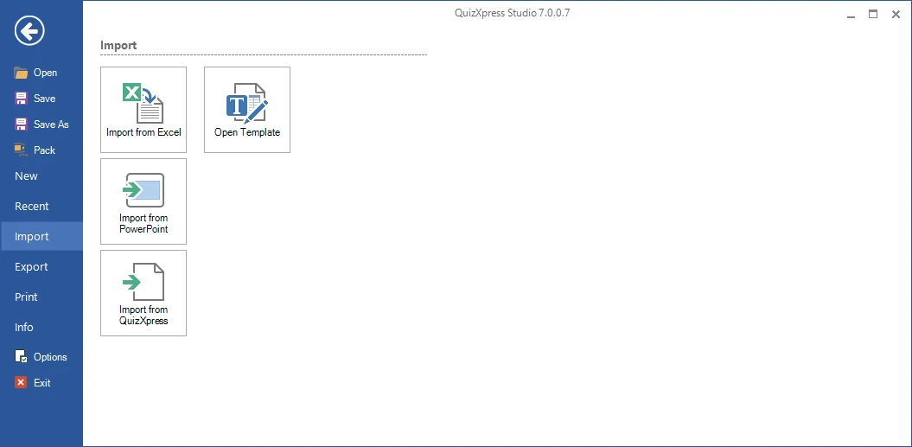
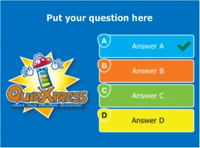
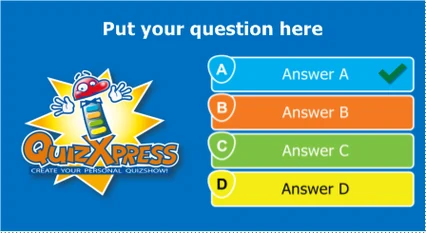
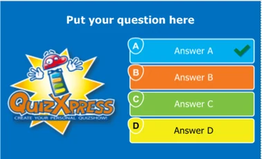

# BESTAND → Dialoogvenster Opties

De ingang naar dit dialoogvenster vindt u in het backstage-menu BESTAND:

{ width="605" loading=lazy }

Op het tabblad ‘Doel apparaat’ van dit dialoogvenster stelt u de beeldverhouding en de afbeeldingskwaliteit van uw quiz in. De optie *verhouding* configureert de breedte/hoogte-verhouding van uw dia’s zodat deze past bij het apparaat waarop u uw quiz presenteert:

| { width="156" loading=lazy } | { width="213" loading=lazy } | { width="190" loading=lazy } |
|---------------------------------------------------------------------------------|---------------------------------------------------------------------------------|--------------------------------------------------------------------------------|
| 4:3                                                                             | 16:9                                                                            | 16:10                                                                          |

<table>
<colgroup>
<col style="width: 42%" />
<col style="width: 57%" />
</colgroup>
<thead>
<tr class="header">
<th></th>
<th>
Als u uw quiz bijvoorbeeld op een widescreen-tv wilt afspelen, gebruikt u dus de standaardverhouding 16:9. Voor een oudere beamer gebruikt u de verhouding 4:3. U kunt de verhouding wijzigen nadat u uw quiz hebt gemaakt en het systeem past dan automatisch het formaat van al uw dia’s aan.

De optie Kwaliteit bepaalt de afbeeldingsresolutie die QuizXpress intern gebruikt bij het weergeven van een dia in Quiz Show (het fysieke aantal pixels dat voor de diaafbeelding wordt gebruikt). U kunt dit instellen op ‘Hoge kwaliteit’ of ‘Ultra hoge kwaliteit’ als u uw quiz presenteert op een apparaat met hoge resolutie (zoals een full HD-LCD-scherm) en een krachtige videokaart/pc met voldoende geheugen hebt.
</th>
</tr>
</thead>
<tbody>
</tbody>
</table>

<table>
<colgroup>
<col style="width: 42%" />
<col style="width: 57%" />
</colgroup>
<thead>
<tr class="header">
<th></th>
<th>
Op het tabblad ‘Beveiliging’ kan een verloopdatum voor de quiz worden ingesteld. Na deze datum kan de quiz niet meer worden afgespeeld met QuizXpress Live.

U kunt uw quiz ook beveiligen met de DRM-sleutel (Digital Rights Management) van uw doelklant. Wanneer u dat doet, kan de quizinhoud niet naar een andere machine worden gekopieerd of daarop worden uitgevoerd. De DRM-sleutel van uw klant is te vinden op het tabblad ‘Info’ in het backstage-menu op zijn of haar pc (in het gedeelte Licentie-informatie).
</th>
</tr>
</thead>
<tbody>
</tbody>
</table>

Het gedeelte ‘Quiz auteur details’ toont de geschiedenis van het quizbestand: wie het oorspronkelijk heeft gemaakt en wie het het laatst heeft gewijzigd. Deze gegevens worden bijvoorbeeld gebruikt wanneer een quizbestand is verlopen en uw eindgebruiker contactgegevens te zien krijgt om een recente update te verkrijgen. Uw eigen quizauteurgegevens kunt u invoeren in het dialoogvenster ‘Opties’ (beschikbaar op het lint HOME).

Ten slotte kunt u op het tabblad ‘Geavanceerd’ geavanceerde eigenschappen voor de quiz instellen. ‘QX3 compatibele video weergave’ betekent dat het systeem het videosysteem gebruikt dat in QX3 aanwezig was. U kunt dit willen gebruiken omdat het beter kan presteren op eenvoudige systemen zoals netbooks. Het nadeel is dat alleen het AVI-formaat wordt ondersteund en dat u geen video-effecten kunt gebruiken. Deze instelling geldt voor de hele quiz, dus let op dat u geen andere videoformaten in uw quiz gebruikt (als u dat toch doet, wordt bij het starten van QuizXpress Live een waarschuwing gegenereerd). *U hebt het zelden nodig om deze functie in te schakelen.*
