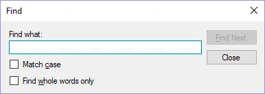

# Cercare testo nelle domande e nelle risposte

È possibile cercare testo nelle domande o nelle risposte premendo Ctrl+F (oppure il pulsante Find della scheda HOME).

{ width="301" loading=lazy }

Inserendo del testo e premendo ‘Find Next’ è possibile scorrere gli elementi trovati.
