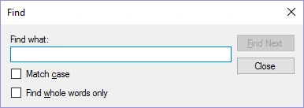

# Tekst zoeken in vragen en antwoorden

U kunt tekst in vragen of antwoorden zoeken door op Ctrl+F te drukken (of op de knop Zoeken op het tabblad HOME).

{ width="301" loading=lazy }

Door tekst in te voeren en op ‘Volgende’ te drukken, kunt u de gevonden items doorlopen.
