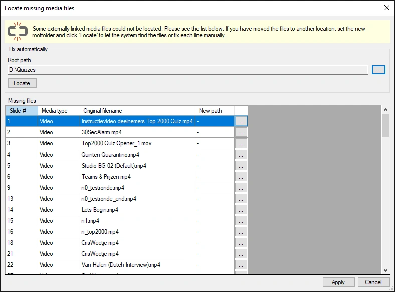

# Reparar vínculos rotos

Cuando vincula contenido de audio y vídeo, el quiz contiene únicamente una ruta al archivo externo. Si mueve el archivo externo, QuizXpress ya no podrá localizarlo, lo que da lugar a un vínculo roto. Después de cargar un quiz, Studio ejecuta una tarea en segundo plano para comprobar si todos los archivos multimedia referenciados siguen presentes. Cuando detecta al menos un vínculo roto, presenta un formulario con la lista de todos los vínculos que faltan:

{ width="568" loading=lazy }

En este formulario puede resolver el problema rápidamente (los archivos vinculados deben seguir estando, por supuesto, disponibles en algún lugar del ordenador). Si todos los archivos siguen estando bajo una carpeta raíz, puede dejar que el sistema los busque mediante el botón Locate. Si los archivos están repartidos por el disco, deberá localizarlos manualmente, entrada por entrada. Una vez corregidas todas las rutas, haga clic en Apply para aplicar los cambios a las diapositivas.
