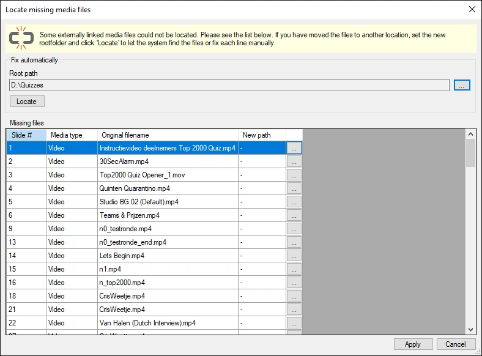

# Verbroken koppelingen herstellen

Wanneer u audio- en videocontent koppelt, bevat de quiz alleen een pad naar het externe bestand. Als u het externe bestand verplaatst, kan QuizXpress het niet meer vinden, met een verbroken koppeling als gevolg. Nadat een quiz is geladen, voert Studio een achtergrondtaak uit om te controleren of alle gebruikte mediabestanden nog aanwezig zijn. Wanneer ten minste één verbroken koppeling wordt gevonden, toont Studio een venster met alle ontbrekende koppelingen:

{ width="568" loading=lazy }

In dit venster kunt u het probleem snel oplossen (de gekoppelde bestanden moeten natuurlijk nog wel ergens op de computer beschikbaar zijn). Als alle bestanden nog beschikbaar zijn onder een hoofdmap, kunt u het systeem ernaar laten zoeken met de knop Zoeken. Als de bestanden verspreid over de schijf staan, moet u ze handmatig opsporen, item voor item. Zodra alle paden zijn gecorrigeerd, klikt u op Toepassen om de wijzigingen in de dia’s door te voeren.
