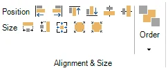

# HOME → Alignment & Size, Order

{ width="211" loading=lazy }

La sezione di allineamento e dimensione dispone di vari strumenti che consentono di allineare, posizionare e ridimensionare più elementi su una diapositiva. Per farlo, selezionare più elementi della diapositiva (ad esempio risposte, immagini o una combinazione di questi) facendo clic su di essi uno alla volta mentre si tiene premuto il tasto Ctrl. Il primo elemento selezionato ha maniglie di ridimensionamento bianche, mentre gli altri elementi selezionati hanno maniglie di ridimensionamento nere.

È ora possibile scegliere una delle seguenti opzioni:

- Position: allinea a sinistra, a destra, in alto, in basso, al centro in verticale, al centro in orizzontale

- Size: stessa larghezza, stessa altezza, stessa larghezza e altezza, riduci dimensione, aumenta dimensione

!!! tip
    Per allineare un singolo elemento, è sufficiente trascinarlo: le [guide intelligenti](../user-interface-overview/design-area.md#guide-intelligenti) vengono mostrate quando è allineato con altri elementi o con la diapositiva, e si aggancia in posizione.

{ width="108" loading=lazy }Il pulsante Order consente di ordinare più elementi sovrapposti secondo l'ordine z (profondità). È possibile portare un elemento in primo piano, inviarlo in secondo piano, portarlo avanti di un livello o inviarlo indietro di un livello.
