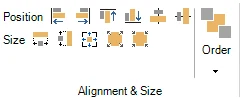
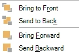

# HOME → Positie en grootte, Volgorde

{ width="211" loading=lazy }

Het gedeelte positie en grootte heeft diverse hulpmiddelen om meerdere elementen op een dia uit te lijnen, te positioneren en van grootte te veranderen. Selecteer daarvoor meerdere diaelementen (bijvoorbeeld antwoorden, afbeeldingen of een combinatie hiervan) door er een voor een op te klikken terwijl u de Ctrl-toets ingedrukt houdt. Het eerst geselecteerde item heeft witte formaatgrepen eromheen, terwijl de andere geselecteerde items zwarte formaatgrepen hebben.

U kunt nu een van de volgende opties kiezen:

- Positie: links, rechts, boven, onder, verticaal midden, horizontaal midden uitlijnen

- Grootte: even breed maken, even hoog maken, even breed en hoog maken, verkleinen, vergroten

!!! tip
    Om één enkel item uit te lijnen, sleept u het gewoon: [slimme hulplijnen](../user-interface-overview/design-area.md#slimme-hulplijnen) laten zien wanneer het op één lijn staat met andere items of de dia, en het klikt op zijn plaats.

{ width="108" align=left loading=lazy }Met de knop Volgorde kunt u meerdere elkaar overlappende items in z-volgorde (diepte) plaatsen. U kunt een item naar voren halen, naar achteren sturen, een niveau naar voren halen of een niveau naar achteren sturen.
