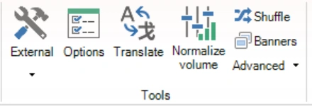

# HOME → Normalizza volume

Il comando ‘Normalize volume’, disponibile nel gruppo ‘Tools’ della scheda HOME, fa sì che tutti i suoni del quiz vengano riprodotti con lo stesso volume. QuizXpress misura il volume di ciascun suono e ne imposta il guadagno verso un volume di destinazione a scelta. I file audio in sé non vengono modificati.

{ width="220" loading=lazy }

Vedere [Normalizzare il volume](../adding-multimedia-content/sound.md#normalizzare-il-volume) per una descrizione completa, inclusa la procedura per normalizzare un singolo suono.
