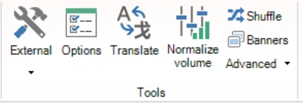

# START → Volume normaliseren

Met de opdracht ‘Volume normaliseren’ in de groep ‘Tools’ op het tabblad START laat u alle geluiden in de quiz even luid klinken. QuizXpress meet hoe luid elk geluid is en stelt de versterking van het geluid in op een streefvolume dat u kiest. De geluidsbestanden zelf worden niet gewijzigd.

{ width="220" loading=lazy }

Zie [Het volume normaliseren](../adding-multimedia-content/sound.md#het-volume-normaliseren) voor een volledige beschrijving, waaronder het normaliseren van één enkel geluid.
