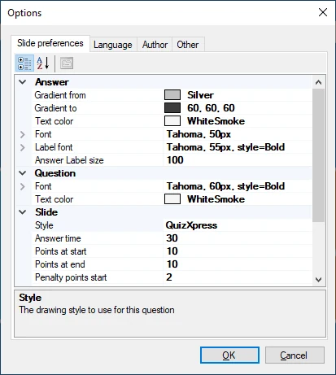
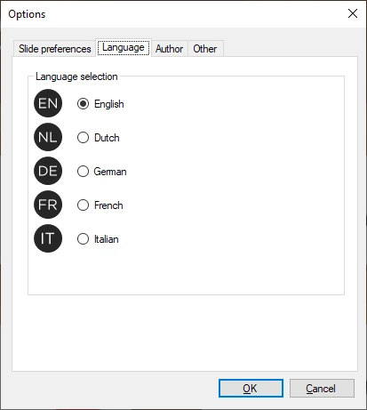
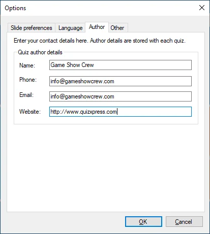
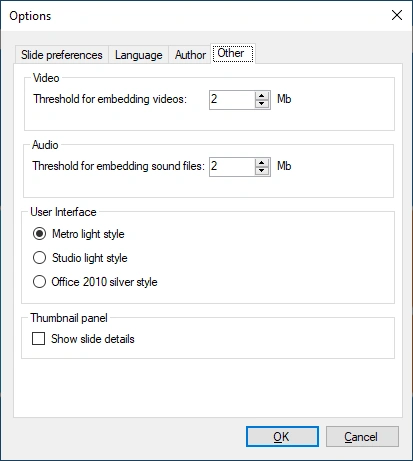

# HOME → Options

La finestra di dialogo delle opzioni di QuizXpress Studio si trova in Tools->Options. La finestra ha tre pagine:

| { width="262" loading=lazy }  | { width="263" loading=lazy }  |
|---------------------------------------------------------------------------------|---------------------------------------------------------------------------------|
| Preferenze delle diapositive                                                    | Selezione della lingua                                                          |
| { width="265" loading=lazy } | { width="261" loading=lazy } |
| Dati dell'autore del quiz                                                       | Altre impostazioni                                                              |

***Scheda Slide preferences:***

Questa pagina consente di impostare varie proprietà utilizzate come valori predefiniti per ogni nuova diapositiva creata. Ad esempio, impostare qui ‘Answer time’ su 40 secondi garantisce che il tempo di risposta di ogni nuova diapositiva sia impostato su 40 secondi. Nota: le modifiche apportate qui si applicano solo alle nuove diapositive, non a quelle esistenti!

***Scheda Language:***

Questa scheda consente di impostare la lingua dell'interfaccia utente di QuizXpress Studio e di tutti gli altri strumenti QuizXpress (memorizzata nel file delle impostazioni di QuizXpress).

***Scheda Author*:**

Qui è possibile impostare i propri dati che verranno incorporati nel quiz come autore originale del quiz.

***Scheda Other:***

Qui è possibile impostare le soglie per l'incorporamento/il collegamento dei contenuti audio e video, passare da uno all'altro di tre diversi stili di interfaccia utente e impostare un'opzione per far sì che il pannello delle miniature mostri informazioni aggiuntive, come il numero della domanda così come appare in QuizXpress Live.
