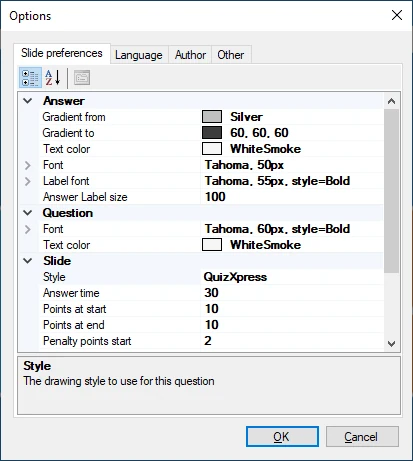
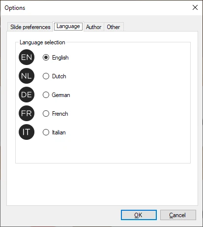
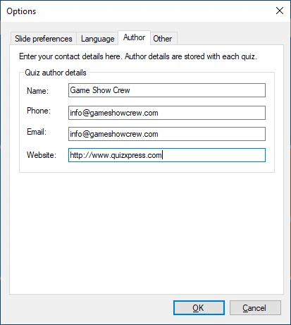
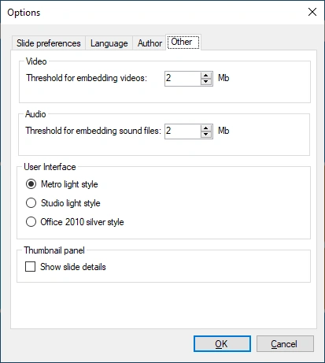

# START → Opties

Het dialoogvenster met opties van QuizXpress Studio vindt u onder Tools->Opties. Het dialoogvenster bevat drie pagina’s:

| { width="262" loading=lazy }  | { width="263" loading=lazy }  |
|---------------------------------------------------------------------------------|---------------------------------------------------------------------------------|
| Slide voorkeuren                                                                | Taalselectie                                                                    |
| { width="265" loading=lazy } | { width="261" loading=lazy } |
| Quiz auteur details                                                             | Overige instellingen                                                            |

***Tabblad Slide voorkeuren*:**

Op deze pagina stelt u diverse eigenschappen in die als standaard gelden voor elke nieuwe dia die u maakt. Als u hier bijvoorbeeld ‘Antwoordtijd’ op 40 seconden instelt, is de antwoordtijd van elke nieuwe dia 40 seconden. Let op: wijzigingen die u hier aanbrengt, gelden alleen voor nieuwe dia’s, niet voor bestaande!

***Tabblad Taal*:**

Op dit tabblad stelt u de taal van de gebruikersinterface in voor QuizXpress Studio en alle andere QuizXpress-tools (opgeslagen in het QuizXpress-instellingenbestand).

***Tabblad Auteur*:**

Hier stelt u de gegevens over uzelf in die in de quiz worden opgenomen als de oorspronkelijke auteur van de quiz.

***Tabblad Overig*:**

Hier stelt u de drempelwaarden in voor het insluiten of koppelen van audio- en videocontent, schakelt u tussen drie verschillende stijlen voor de gebruikersinterface en stelt u een optie in waarmee het miniatuurvenster extra informatie toont, zoals het vraagnummer zoals dat in QuizXpress Live wordt weergegeven.
