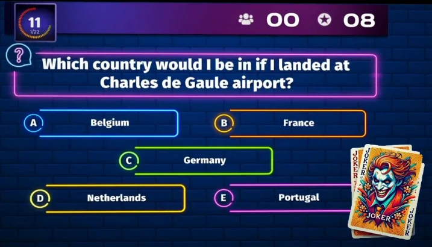
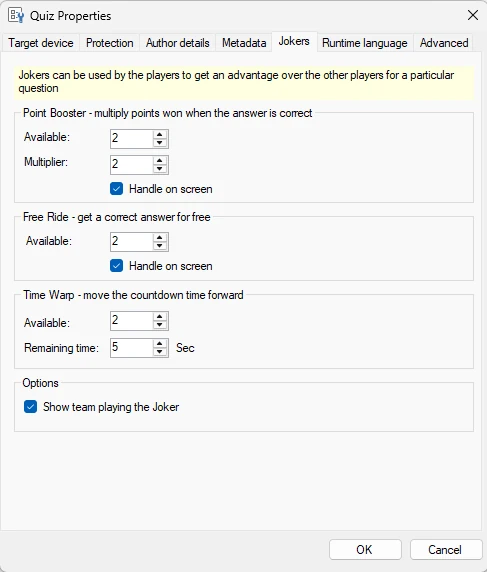
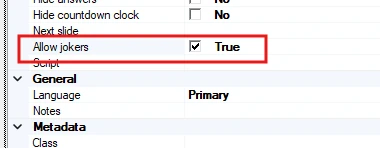
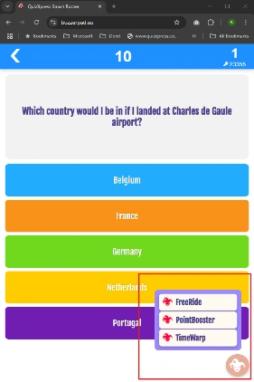

# Jokers

I giocatori possono usare i Jokers, gettoni che permettono di influenzare l'esito di un quiz! I giocatori possono scegliere di giocare un Joker ogni volta che pensano che darà loro un vantaggio. I Jokers sono disponibili solo quando si gioca con i telefoni cellulari.

{ loading=lazy }

Attualmente sono disponibili tre tipi di Jokers:

- **Time Warp**, fa avanzare il tempo in modo che gli altri giocatori abbiano meno tempo per rispondere

- **Free Ride**, ottiene automaticamente la risposta corretta alla domanda senza rispondere

- **Point Boost**, i giocatori ottengono i punti vinti per una domanda moltiplicati quando rispondono correttamente

I Jokers vengono definiti in Studio per l'intero quiz facendo clic su File > Options:

{ width="234" loading=lazy }

Per ogni tipo è possibile configurare quanto segue:

**Point booster**

- Available: quante volte il joker può essere usato da un giocatore

- Multiplier: quante volte vengono moltiplicati i punti vinti

- Handle on screen: il lettore di quiz mostra che è stato giocato un joker

Free Ride

- Available: quante volte il joker può essere usato da un giocatore

- Handle on screen: il lettore di quiz mostra che è stato giocato un joker

**Time Warp**

- Available: quante volte il joker può essere usato da un giocatore

- What is the remaining time when the joker has been used: qual è il tempo rimanente quando il joker è stato usato

!!! note

    Time Warp viene sempre mostrato sullo schermo, poiché riguarda tutti i giocatori

Show team playing the joker: mostra il nome della squadra nell'indicatore del joker visualizzato sullo schermo nel lettore di quiz quando un giocatore gioca un joker.

I joker sono abilitati automaticamente su tutte le diapositive di tipo Question. Se ci sono domande per le quali non si desidera che vengano usati i Jokers, è possibile disabilitarli esplicitamente nelle proprietà della diapositiva:

{ width="333" loading=lazy }

{ width="180" loading=lazy }

Quando i joker sono disponibili, i giocatori vedono un menu sul proprio Smart Buzzer (app o web) tramite il quale possono giocare il joker di loro scelta:

!!! note

    solo un giocatore può giocare un Time Warp per domanda, e Free Ride e Point Booster si escludono a vicenda (è possibile usare l'uno o l'altro). In future versioni saranno disponibili altri tipi di Jokers.
