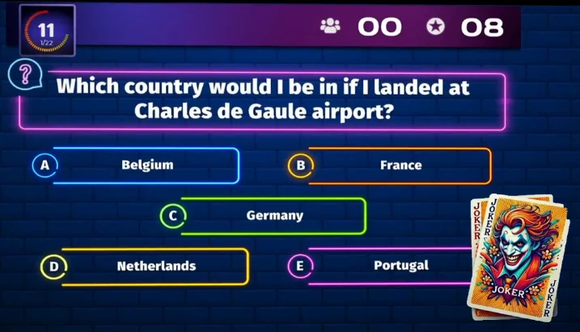
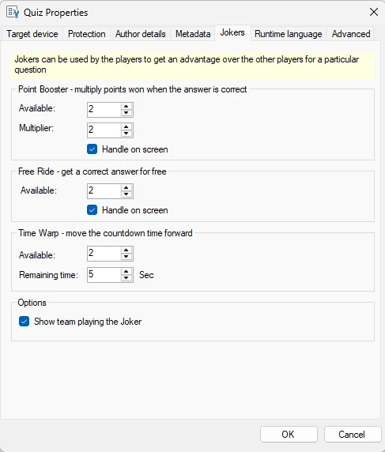
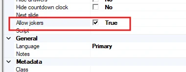
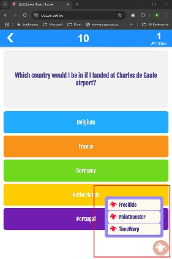

# Jokers

Spelers kunnen Jokers gebruiken: fiches waarmee ze de uitkomst van een quiz kunnen beïnvloeden! Spelers kunnen een Joker inzetten wanneer ze denken dat die hun een voordeel oplevert. Jokers zijn alleen beschikbaar als er met mobiele telefoons wordt gespeeld.

{ loading=lazy }

Momenteel zijn er drie soorten Jokers beschikbaar:

- **Time Warp**, zet de tijd vooruit zodat andere spelers minder tijd hebben om te antwoorden

- **Free Ride**, krijg automatisch de vraag juist zonder te antwoorden

- **Point Boost**, spelers krijgen de punten die ze voor een vraag winnen vermenigvuldigd als ze juist antwoorden

Jokers worden in Studio voor de hele quiz gedefinieerd door te klikken op Bestand > Opties:

{ width="234" loading=lazy }

Per type kunt u het volgende instellen:

**Point booster**

- Beschikbaar: hoe vaak de joker door een speler kan worden gebruikt

- Vermenigvuldiger: hoeveel keer de gewonnen punten worden vermenigvuldigd

- Joker op scherm afhandelen: de quizspeler toont dat er een joker is ingezet

Free Ride

- Beschikbaar: hoe vaak de joker door een speler kan worden gebruikt

- Joker op scherm afhandelen: de quizspeler toont dat er een joker is ingezet

**Time Warp**

- Beschikbaar: hoe vaak de joker door een speler kan worden gebruikt

- Wat de resterende tijd is nadat de joker is gebruikt

!!! note

    Time Warp wordt altijd op het scherm getoond, omdat de joker alle spelers beïnvloedt

Team tonen dat de joker uitspeelt: toon de teamnaam in de jokeraanduiding die op het scherm in de quizspeler verschijnt wanneer een speler een joker inzet.

Jokers zijn automatisch ingeschakeld op alle dia’s van het type Vraag. Als er vragen zijn waarbij u geen Jokers wilt toestaan, kunt u ze in de eigenschappen van de dia expliciet uitschakelen:

{ width="333" loading=lazy }

{ width="180" loading=lazy }

Wanneer jokers beschikbaar zijn, zien spelers op hun Smart Buzzer (app of web) een menu waarmee ze de joker van hun keuze kunnen inzetten:

!!! note

    per vraag kan slechts één speler een Time Warp inzetten, en Free Ride en Point Booster sluiten elkaar uit (u kunt de een of de ander gebruiken). In toekomstige versies komen er meer soorten Jokers beschikbaar.
