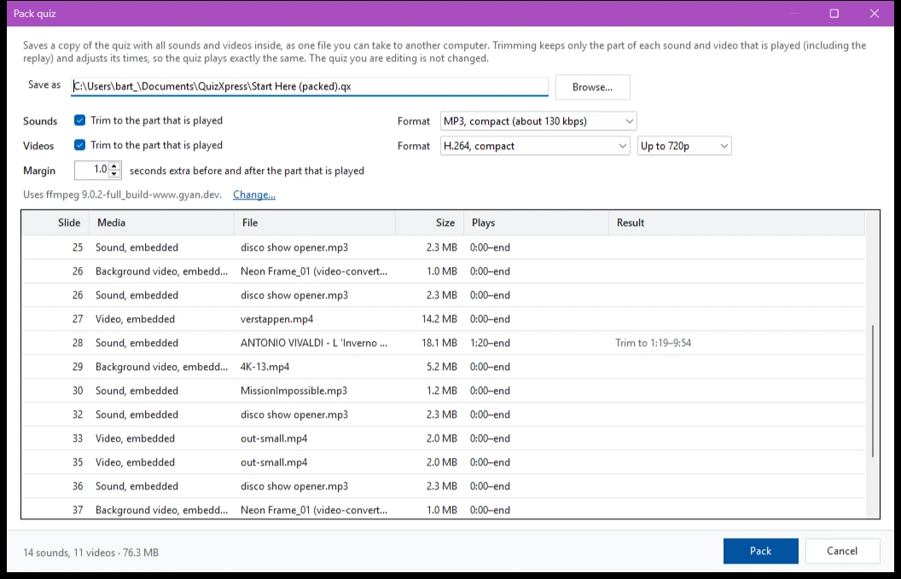
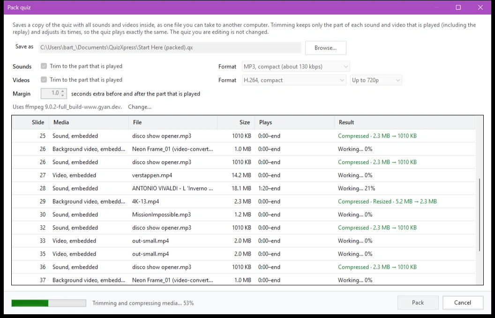
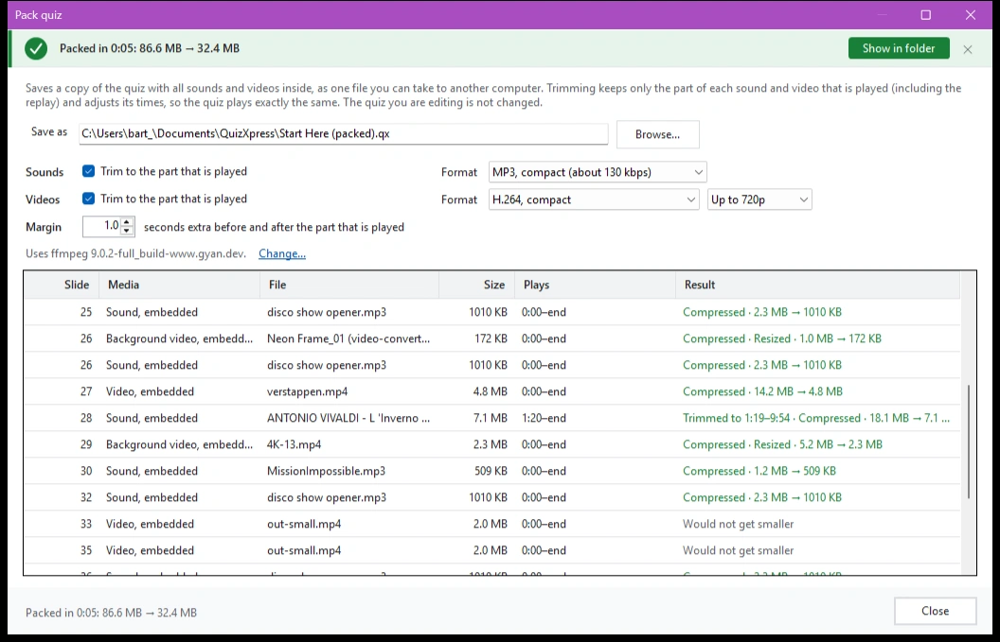
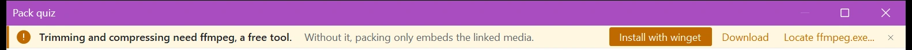

# Empaqueter et désempaqueter un quiz

Lorsque vous créez de grands quiz contenant beaucoup de contenu multimédia, comme des fragments vidéo et audio, le fichier du quiz peut facilement devenir volumineux et fastidieux à manipuler pendant la phase d'édition, et peut épuiser la mémoire interne du PC. Pour y remédier, QuizXpress vous permet de garder les fichiers multimédias externes (liés). C'est très bien pendant la création du quiz, mais lorsque le quiz doit être déplacé vers un autre PC ou remis à quelqu'un d'autre, tous les fichiers liés doivent l'accompagner, et en oublier un pose problème pendant le spectacle.

La fonction ‘Pack’ résout ce problème : elle enregistre une copie du quiz avec tous les sons et vidéos à l'intérieur, sous la forme d'un seul fichier que vous pouvez emporter sur un autre ordinateur. Elle peut aussi rendre ce fichier beaucoup plus petit, en réduisant chaque son et chaque vidéo à la partie réellement jouée et en les compressant. Le quiz que vous éditez n'est jamais modifié : l'empaquetage écrit toujours un nouveau fichier.

## Empaqueter un quiz

1. Enregistrez d'abord votre quiz. Un quiz qui n'a jamais été enregistré ne peut pas être empaqueté.
2. Appuyez sur F1 pour accéder au menu backstage et cliquez sur ‘Pack’.
3. Vérifiez le nom du fichier sous ‘Save as’. Par défaut, le quiz empaqueté est enregistré à côté de votre quiz, avec ‘(packed)’ ajouté au nom. Cliquez sur ‘Browse...’ pour choisir un autre emplacement ou un autre nom.
4. Choisissez les options (voir ci-dessous) et cliquez sur ‘Pack’.

{ loading=lazy }

La liste affiche chaque son et chaque vidéo du quiz : la diapositive sur laquelle il se trouve, s'il est intégré ou lié, sa taille, la partie jouée (‘Plays’) et, sous ‘Result’, ce que l'empaquetage va en faire, par exemple ‘Trim to 1:19–9:54’.

Pendant l'empaquetage, la progression est affichée en bas et chaque ligne indique où elle en est. Vous pouvez suivre le résultat pour chaque son ou vidéo au fur et à mesure. Cliquez sur ‘Cancel’ pour arrêter : rien n'est alors enregistré.

{ loading=lazy }

Lorsque c'est terminé, une barre verte indique le temps écoulé ainsi que la taille du quiz avant et après l'empaquetage. Cliquez sur ‘Show in folder’ pour ouvrir le dossier contenant le quiz empaqueté.

{ loading=lazy }

## Découper les sons et les vidéos

Souvent, seule une petite partie d'une chanson ou d'un clip vidéo est jouée pendant le quiz, par exemple 20 secondes d'une chanson de 4 minutes. Avec ‘Trim to the part that is played’ (séparément pour ‘Sounds’ et ‘Videos’), le quiz empaqueté ne conserve que cette partie. Cela peut économiser beaucoup d'espace, surtout dans les manches musicales et les bingos musicaux.

- La partie conservée va du ‘Start’ à la ‘End’ du son ou de la vidéo, et comprend la partie ‘Replay’ lorsque le son ou la vidéo est rejoué après la réponse.
- ‘Margin’ ajoute quelques secondes avant et après cette partie (1 seconde par défaut), afin de conserver un peu de marge si vous souhaitez ajuster les temps par la suite.
- Les temps de début, de fin et de rejeu dans le quiz empaqueté sont ajustés automatiquement, de sorte que le quiz se déroule exactement comme avant.
- Un son ou une vidéo qui est joué jusqu'à la fin conserve sa fin. Une vidéo en boucle qui est jouée jusqu'à la fin conserve aussi son début, car elle repart du début du fichier.
- Les vidéos d'arrière-plan sont découpées de la même manière que les autres vidéos.
- Lorsque (presque) tout le fichier est joué, il n'y a rien à découper et le fichier reste tel quel.

!!! note
    Dans le quiz empaqueté, vous ne pouvez pas reculer le début d'un son ou d'une vidéo découpé au-delà de la partie conservée. Si vous souhaitez tout de même modifier beaucoup les temps, faites-le dans votre quiz d'origine et empaquetez-le à nouveau.

## Compresser les sons et les vidéos

Avec ‘Format’, vous choisissez la manière dont les sons et les vidéos sont stockés dans le quiz empaqueté :

| Sons | Ce que cela fait |
|---|---|
| ‘Keep the format’ | Les sons restent tels quels. Le découpage les coupe sans les convertir, il n'y a donc aucune perte de qualité. |
| ‘MP3, high quality (about 190 kbps)’ | Convertit les sons en MP3. Les fichiers WAV deviennent beaucoup plus petits de cette façon. |
| ‘MP3, compact (about 130 kbps)’ | Convertit les sons en un MP3 plus petit, toujours correct pour une diffusion en salle. |

| Vidéos | Ce que cela fait |
|---|---|
| ‘Keep the video (cut at keyframes)’ | Les vidéos restent telles quelles, sans perte de qualité. Une vidéo découpée démarre alors à l'image clé la plus proche avant la coupure, quelques secondes plus tôt au maximum ; les temps sont ajustés en conséquence. |
| ‘H.264, high quality’ | Convertit les vidéos en MP4 (H.264), qui se lit partout et est généralement beaucoup plus petit. |
| ‘H.264, compact’ | Convertit les vidéos en un MP4 plus petit, avec une certaine perte de détails. |

À côté du format vidéo, vous pouvez limiter la taille de l'image à ‘Up to 1080p’ ou ‘Up to 720p’. Les vidéos dont l'image est plus grande sont réduites, ce qui économise beaucoup d'espace pour les vidéos 4K.

QuizXpress ne convertit un fichier que lorsque cela en vaut la peine : un MP3 ou une vidéo déjà compact est laissé tel quel (‘Already compact’), et un résultat qui ne serait pas plus petit que l'original n'est pas utilisé (‘Would not get smaller’). Cela permet aussi de garder un empaquetage rapide.

Vos choix sont mémorisés pour la prochaine fois que vous empaquetez un quiz.

## Installer ffmpeg

Le découpage et la compression sont réalisés avec ffmpeg, un outil gratuit qui ne fait pas partie de QuizXpress. Sous les options, la boîte de dialogue indique la version de ffmpeg utilisée. Lorsque ffmpeg n'est pas installé, une barre en haut de la boîte de dialogue propose trois façons de l'obtenir :

{ loading=lazy }

- ‘Install with winget’ installe ffmpeg avec le gestionnaire de paquets Windows. Une fenêtre de console s'ouvre ; suivez-la et acceptez les conditions de winget lorsqu'il le demande. Lorsque la fenêtre se ferme, QuizXpress trouve ffmpeg tout seul et le découpage et la compression deviennent disponibles.
- ‘Download’ ouvre la page de téléchargement de ffmpeg dans votre navigateur. Décompressez le téléchargement dans un dossier de votre choix.
- ‘Locate ffmpeg.exe...’ vous permet d'indiquer un fichier ffmpeg.exe que vous possédez déjà, par exemple dans le dossier ‘bin’ du téléchargement. Le fichier ffprobe.exe qui l'accompagne doit se trouver dans le même dossier.

Sans ffmpeg, vous pouvez tout de même empaqueter un quiz : les médias liés sont alors intégrés tels quels.

## Fichiers manquants

Lorsqu'un fichier son ou vidéo lié est introuvable, sa ligne est affichée en rouge (‘File not found, stays linked’) et un avertissement en bas vous indique combien de fichiers sont manquants. Vous pouvez tout de même empaqueter le quiz, mais ces fichiers restent liés et seront manquants sur un autre ordinateur. Pour les inclure, localisez d'abord les fichiers manquants dans votre quiz, puis empaquetez à nouveau.

## Désempaqueter un quiz

Vous pouvez également désempaqueter un fichier de quiz précédemment empaqueté. Cela extrait tous les médias (audio/vidéo) dans un dossier local et lie les éléments multimédias du quiz aux fichiers locaux. Cela accélère les temps de chargement du quiz et réduit l'utilisation de la mémoire dans le lecteur de quiz. Son usage principal est d'éviter les problèmes avec des fichiers de quiz énormes (~1,5 Go ou plus). Pour désempaqueter un quiz, appuyez sur F1 pour accéder au menu backstage et cliquez sur ‘Unpack’.
