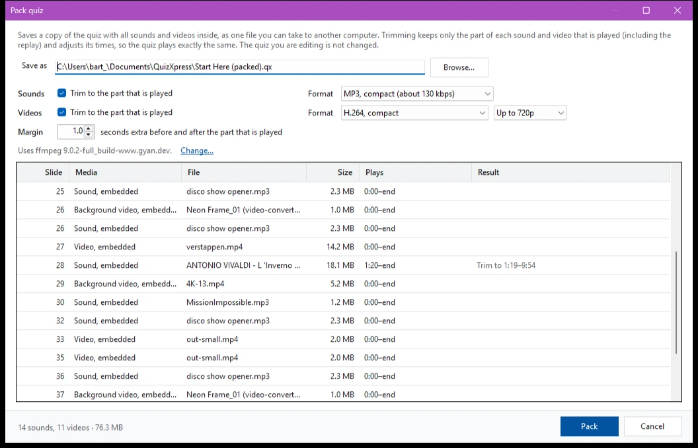
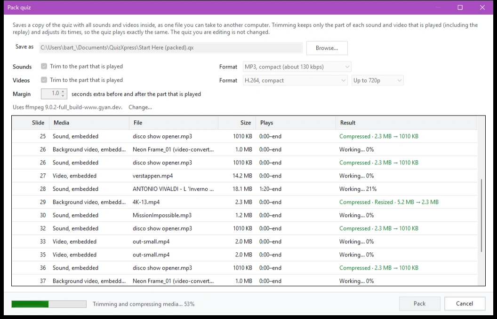
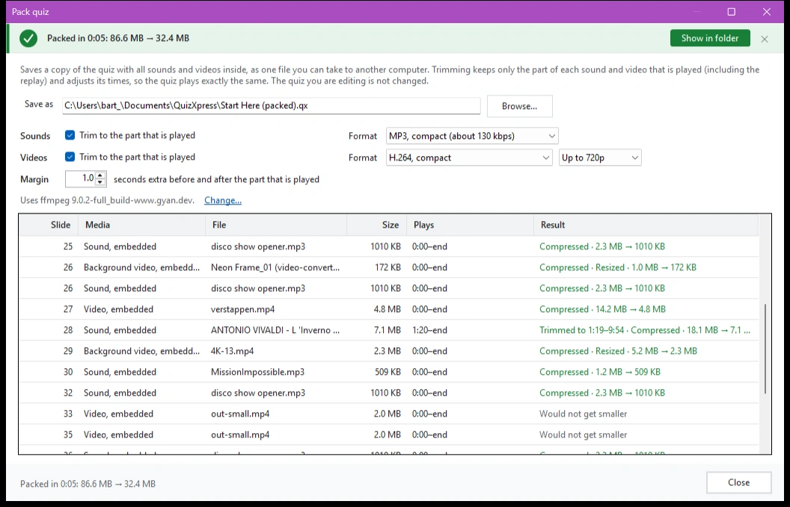
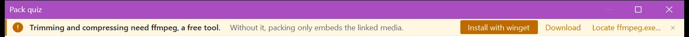

# Een quiz inpakken en uitpakken

Wanneer u grote quizzen maakt met veel multimediacontent, zoals video- en audiofragmenten, kan het quizbestand al snel groot en omslachtig worden om tijdens het bewerken mee te werken en kan het het interne geheugen van de pc uitputten. Om dit op te vangen, kunt u in QuizXpress mediabestanden extern (gekoppeld) houden. Dat is prima zolang u de quiz bouwt, maar wanneer de quiz naar een andere pc moet of aan iemand anders wordt gegeven, moeten alle gekoppelde bestanden mee, en als u er één vergeet, geeft dat problemen tijdens de show.

De functie ‘Inpakken’ lost dit op: ze slaat een kopie van de quiz op met alle geluiden en video’s erin, als één bestand dat u naar een andere computer kunt meenemen. Ze kan dat bestand ook een stuk kleiner maken door elk geluid en elke video bij te snijden tot het deel dat daadwerkelijk wordt afgespeeld en door ze te comprimeren. De quiz die u bewerkt, wordt nooit gewijzigd: bij het inpakken wordt altijd een nieuw bestand geschreven.

## Een quiz inpakken

1. Sla eerst uw quiz op. Een quiz die nog nooit is opgeslagen, kan niet worden ingepakt.
2. Druk op F1 om naar het backstage-menu te gaan en klik op ‘Inpakken’.
3. Controleer de bestandsnaam onder ‘Opslaan als’. Standaard wordt de ingepakte quiz naast uw quiz opgeslagen, met ‘(packed)’ achter de naam. Klik op ‘Bladeren...’ om een andere locatie of naam te kiezen.
4. Kies de opties (zie hieronder) en klik op ‘Inpakken’.

{ loading=lazy }

De lijst toont elk geluid en elke video in de quiz: de dia waarop het staat, of het is ingesloten of gekoppeld, de grootte, het deel dat wordt afgespeeld (‘Speelt af’) en, onder ‘Resultaat’, wat het inpakken ermee gaat doen, zoals ‘Bijsnijden tot 1:19–9:54’.

Tijdens het inpakken wordt de voortgang onderaan getoond en laat elke rij zien hoever het is. U kunt het resultaat per geluid of video volgen zodra het binnenkomt. Klik op ‘Annuleren’ om te stoppen: er wordt dan niets opgeslagen.

{ loading=lazy }

Wanneer het klaar is, toont een groene balk hoe lang het duurde en hoe groot de quiz was voor en na het inpakken. Klik op ‘Weergeven in map’ om de map met de ingepakte quiz te openen.

{ loading=lazy }

## Geluiden en video’s bijsnijden

Vaak wordt tijdens de quiz maar een klein deel van een nummer of videoclip afgespeeld, bijvoorbeeld 20 seconden van een nummer van 4 minuten. Met ‘Bijsnijden tot het deel dat wordt afgespeeld’ (apart voor ‘Geluiden’ en ‘Video’s’) bewaart de ingepakte quiz alleen dat deel. Dat kan veel ruimte besparen, vooral in muziekrondes en muziekbingo’s.

- Het deel dat wordt bewaard loopt van het ‘Begin’ tot het ‘Einde’ van het geluid of de video, en omvat het deel ‘Herhaling’ wanneer het geluid of de video na het antwoord opnieuw wordt afgespeeld.
- ‘Marge’ voegt een paar seconden toe voor en na dat deel (standaard 1 seconde), zodat u nog wat speelruimte hebt als u de tijden later wilt aanpassen.
- De begin-, eind- en herhalingstijden in de ingepakte quiz worden automatisch aangepast, zodat de quiz precies hetzelfde afspeelt als voorheen.
- Een geluid of video dat tot het einde wordt afgespeeld, behoudt zijn einde. Een herhalende video die tot het einde wordt afgespeeld, behoudt ook zijn begin, omdat hij opnieuw vanaf het begin van het bestand start.
- Achtergrondvideo’s worden op dezelfde manier bijgesneden als andere video’s.
- Wanneer (bijna) het hele bestand wordt afgespeeld, valt er niets bij te snijden en blijft het bestand zoals het is.

!!! note
    In de ingepakte quiz kunt u het begin van een bijgesneden geluid of video niet verder terugzetten dan het deel dat is bewaard. Als u de tijden toch sterk wilt wijzigen, doe dat dan in uw oorspronkelijke quiz en pak die opnieuw in.

## Geluiden en video’s comprimeren

Met ‘Formaat’ kiest u hoe geluiden en video’s in de ingepakte quiz worden opgeslagen:

| Geluiden | Wat het doet |
|---|---|
| ‘Formaat behouden’ | De geluiden blijven zoals ze zijn. Bijsnijden knipt ze zonder te converteren, dus er gaat geen kwaliteit verloren. |
| ‘MP3, hoge kwaliteit (ca. 190 kbps)’ | Converteert de geluiden naar MP3. WAV-bestanden worden zo een stuk kleiner. |
| ‘MP3, compact (ca. 130 kbps)’ | Converteert de geluiden naar een kleinere MP3, nog steeds prima om in een zaal af te spelen. |

| Video’s | Wat het doet |
|---|---|
| ‘Video behouden (knippen op keyframes)’ | De video’s blijven zoals ze zijn, zonder kwaliteitsverlies. Een bijgesneden video begint dan bij de dichtstbijzijnde keyframe vóór het knippunt, hooguit een paar seconden eerder; de tijden worden daarop aangepast. |
| ‘H.264, hoge kwaliteit’ | Converteert de video’s naar MP4 (H.264), dat overal wordt afgespeeld en meestal veel kleiner is. |
| ‘H.264, compact’ | Converteert de video’s naar een kleinere MP4, met enig verlies aan detail. |

Naast het videoformaat kunt u het beeldformaat beperken tot ‘Tot 1080p’ of ‘Tot 720p’. Video’s met een groter beeld worden verkleind, wat veel ruimte bespaart bij 4K-video’s.

QuizXpress converteert een bestand alleen wanneer dat de moeite waard is: een MP3 of een video die al compact is, blijft zoals hij is (‘Al compact’), en een resultaat dat niet kleiner zou zijn dan het origineel wordt niet gebruikt (‘Zou niet kleiner worden’). Zo blijft het inpakken ook snel.

Uw keuzes worden onthouden voor de volgende keer dat u een quiz inpakt.

## ffmpeg installeren

Bijsnijden en comprimeren gebeurt met ffmpeg, een gratis tool die geen onderdeel is van QuizXpress. Onder de opties toont het dialoogvenster welke versie van ffmpeg het gebruikt. Wanneer ffmpeg niet is geïnstalleerd, biedt een balk bovenaan het dialoogvenster drie manieren om het te krijgen:

{ loading=lazy }

- ‘Installeren met winget’ installeert ffmpeg met de pakketbeheerder van Windows. Er opent een consolevenster; volg dat en accepteer de voorwaarden van winget wanneer daarom wordt gevraagd. Wanneer het venster sluit, vindt QuizXpress ffmpeg zelf en zijn bijsnijden en comprimeren beschikbaar.
- ‘Downloaden’ opent de downloadpagina van ffmpeg in uw browser. Pak de download uit in een map naar keuze.
- Met ‘ffmpeg.exe zoeken...’ wijst u een ffmpeg.exe aan die u al hebt, bijvoorbeeld in de map ‘bin’ van de download. De ffprobe.exe die erbij hoort, moet in dezelfde map staan.

Zonder ffmpeg kunt u een quiz nog steeds inpakken: de gekoppelde media worden dan ingesloten zoals ze zijn.

## Ontbrekende bestanden

Wanneer een gekoppeld geluids- of videobestand niet kan worden gevonden, wordt de rij rood weergegeven (‘Bestand niet gevonden, blijft gekoppeld’) en geeft een waarschuwing onderaan aan hoeveel bestanden ontbreken. U kunt de quiz nog steeds inpakken, maar die bestanden blijven gekoppeld en ontbreken op een andere computer. Om ze toch op te nemen, zoekt u de ontbrekende bestanden eerst op in uw quiz en pakt u opnieuw in.

## Een quiz uitpakken

U kunt ook een eerder ingepakt quizbestand uitpakken. Daarmee worden alle media (audio/video) uitgepakt naar een lokale map en worden de media-elementen in de quiz gekoppeld aan de lokale bestanden. Dat versnelt het laden van de quiz en verlaagt het geheugengebruik in de quizspeler. Het is vooral bedoeld om problemen te voorkomen bij zeer grote quizbestanden (~1,5 GB of meer). Om een quiz uit te pakken, drukt u op F1 om naar het backstage-menu te gaan en klikt u op ‘Uitpakken’.
